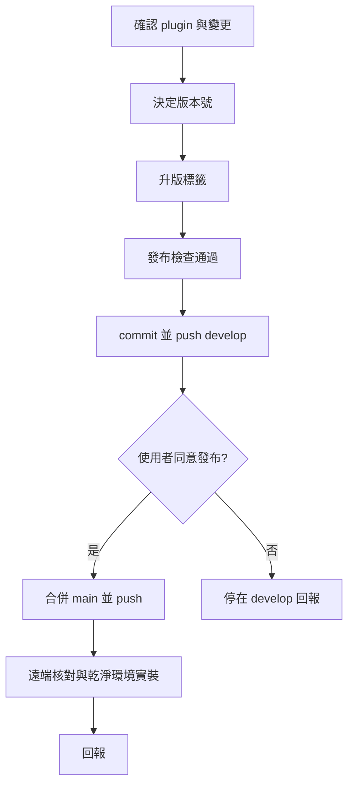

# my-plugin-release — 發布 plugin

使用者的安裝與自動更新**一律抓 `main`**；只推 `develop` 等於沒發布。流程以 plugin 自己的文件為準，這份只負責串起步驟，不重抄細節。



## 1. 準備

1. `git pull`，`git status` 確認工作區只有這次要發的變更；有別人的未提交變更就停下來問。
2. 確認目前在 `develop`。
3. 讀該 plugin 的 `AGENTS.md` 與 `docs/RELEASE.md`（沒有 `docs/RELEASE.md` 就照下面「其他 plugin」）。
4. 列出上次發布後的變更：`git log --oneline origin/main..develop -- my-plugins/<plugin>/`。

## 2. 決定版本號

SemVer：文件或小錯修正 → patch；新 skill 或新功能 → minor；破壞相容（改 skill 名、刪 skill、改安裝 id）→ major。把建議的版本號和理由告訴使用者。

## 3. 依 plugin 執行

### my-workflow

照 [`my-plugins/my-workflow/docs/RELEASE.md`](../../../my-plugins/my-workflow/docs/RELEASE.md)「發布流程」：

- 升版標籤：以 `pack.yaml` 為準，RELEASE.md 表格列的每一處同號（含 repo 根 `project.json` 與 `README.md`）。
- 新增 skill 時，同步根 `README.md`「自建 Workflow Skills」表格，「納入版本」填這次的版本。
- 跑 `node my-plugins/my-workflow/scripts/check-release.mjs`，**必須通過**。改到 `my-release-packaging` 另跑它的 `node --test`。
- `claude` 指令不存在時檢查會略過 `claude plugin validate`，回報時要說。

### 其他 plugin（如 example-plugin）

- 兩個 marketplace 都要登記：`.claude-plugin/marketplace.json` 與 `.agents/plugins/marketplace.json`。
- plugin 的 `.claude-plugin/plugin.json`、`plugin.json` **不寫 `version`**（寫了會凍結自動更新）。
- 有 `gemini-extension.json` 就同步它的 `version`。
- 跑 `claude plugin validate ./my-plugins/<plugin>` 與 `claude plugin validate .`。

## 4. 提交與合併

1. commit（Conventional Commits，繁體中文，scope 寫 plugin 名）並 push `develop`。發版 commit 用 `docs(<plugin>): 發行 <版本>` 或併在功能 commit 裡。
2. **合併 `main` 前先問使用者**：列出版本號與要發的變更，取得同意。合併後所有開自動更新的使用者都會收到。
3. `git checkout main && git pull && git merge --no-ff develop`，push `main`，切回 `develop`。有衝突就停下來回報，不要自己挑一邊。

## 5. 驗證

- my-workflow：`node my-plugins/my-workflow/scripts/check-release.mjs --remote`，確認 `origin/main` 是新版本。
- 乾淨環境實裝（不受本機快取影響）。Windows PowerShell：

  ```text
  $env:CLAUDE_CONFIG_DIR = (New-Item -ItemType Directory -Path "$env:TEMP\cc-release-check-$(Get-Random)").FullName
  claude plugin marketplace add https://github.com/VECTOR-COOL/my-agent-toolkit
  claude plugin install <plugin>@my-agent-toolkit
  claude plugin list
  ```

  用完刪掉暫存資料夾、清掉 `$env:CLAUDE_CONFIG_DIR`。沒有 `claude` 指令就跳過並回報。

## 回報

版本號（前→後）、發了哪些變更、commit SHA（develop 與 main）、檢查結果、哪一步沒做或略過。使用者端更新不到時，照該 plugin `docs/RELEASE.md`「無法更新怎麼排除」。

## 不要做

- 不要 force push，不要直接在 `main` 上改。
- 不要在 manifest 加 `version`。
- 檢查沒過不要 commit；不要為了過檢查改檢查腳本。
- 不要改 `skills/`（第三方）。
