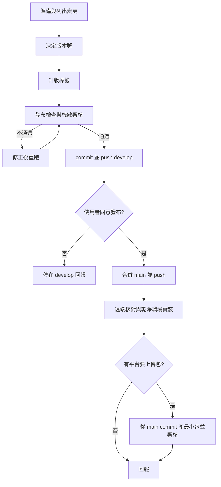

# my-plugin-release — 發布 plugin

**SSOT 是 `main` 上的 plugin 資料夾**（`my-plugins/<plugin>/`）。各平台的 marketplace 都直接讀這個資料夾，使用者安裝與自動更新**一律抓 `main`**；只推 `develop` 等於沒發布。上傳包只在平台不能讀 Git 時才產，而且一律從 `main` 的某個 commit 用 `git archive` 產出，不手動複製、不提交進 repo。



## 各平台發佈格式

同一個 plugin 資料夾放多份薄定義檔，每個平台只讀自己那份；內容（`skills/`、`rules/`）只有一份。

| 平台 | 讀哪個定義檔 | 怎麼拿到新版 | 平台專屬檔 |
|------|------|------|------|
| Claude Code／Cowork／claude.ai | repo 根 `.claude-plugin/marketplace.json` → plugin 的 `.claude-plugin/plugin.json` | Git marketplace，`main` 更新後自動或手動更新 | `.claude-plugin/`、`.mcp.json`、`hooks/hooks.json` |
| Codex／ChatGPT | repo 根 `.agents/plugins/marketplace.json` → plugin 根 `plugin.json`（agent-plugins 格式） | Codex：Git marketplace；ChatGPT 帳號端：上傳包 | `plugin.json`、`mcp.json`、`hooks/codex.json`、`agents/openai.yaml` |
| Gemini CLI | plugin 的 `gemini-extension.json`（`contextFileName` 指 `GEMINI.md`） | 本機 clone `git pull` 後 `link` 即生效，或重新 `install` | `gemini-extension.json`、`GEMINI.md` |
| Antigravity | plugin 根 `plugin.json`、`rules/` | `plugins.json` 指到本機 clone，`git pull` 後重啟 | 與 OpenAI 共用 `plugin.json` |

規則：

- `.claude-plugin/plugin.json` 與 `plugin.json` **不寫 `version`**。沒有時 Claude 以 commit SHA 當版本，`main` 每次更新都偵測得到；寫了就要每次 bump，否則使用者被凍結在舊版。
- `gemini-extension.json` **要寫 `version`**，與版本標籤同號。
- 新 plugin 要在**兩個** marketplace 都登記：`.claude-plugin/marketplace.json`（`"source": "./my-plugins/<plugin>"`）與 `.agents/plugins/marketplace.json`（`"source": {"source": "local", "path": "./my-plugins/<plugin>"}`）。
- 不能有頂層 `bin/`（claude.ai 與 Cowork 會拒裝）。
- 定義檔只引用 `skills/`、`rules/` 的內容，不複製；Windows 不用 symlink。

## 1. 準備

1. `git pull`，`git status` 確認工作區只有這次要發的變更；有別人的未提交變更就停下來問，不要一起提交。
2. 確認目前在 `develop`。
3. 列出上次發布後的變更：`git log --oneline origin/main..develop -- my-plugins/<plugin>/`。沒有變更就回報「沒有要發的內容」。

## 2. 決定版本號

SemVer：文件或小錯修正 → patch；新 skill 或新功能 → minor；破壞相容（改 skill 名、刪 skill、改安裝 id）→ major。把建議版本號和理由告訴使用者。

## 3. 升版標籤

### my-workflow

以 `pack.yaml` 為準，下列 7 處同號：

| 檔案 | 位置 |
|------|------|
| `my-plugins/my-workflow/pack.yaml` | `version:`（基準） |
| `my-plugins/my-workflow/gemini-extension.json` | `version` |
| `my-plugins/my-workflow/skills/my-workflow/references/index.yaml` | `version:` |
| `my-plugins/my-workflow/AGENTS.md` | 開頭「版本」 |
| `my-plugins/my-workflow/README.md` | 第一段「版本」 |
| `project.json`（repo 根） | `version` |
| `README.md`（repo 根） | 標題正下方「版本：`v…`」 |

新增 skill 時，同步根 `README.md`「自建 Workflow Skills」表格，「納入版本」填這次的版本。

### 其他 plugin（如 example-plugin）

有 `gemini-extension.json` 就同步它的 `version`；有自己的版本標籤檔就一起升。兩個 marketplace 都要登記（見上節）。

## 4. 發布檢查與機敏審核

全部通過才 commit；不要為了過檢查改檢查腳本，誤判就回報。

1. **my-workflow 檢查腳本**：`node my-plugins/my-workflow/scripts/check-release.mjs`，檢查版本一致、manifest 無 `version`、沒有被 `.gitignore` 擋掉或沒 `git add` 的檔、`claude plugin validate`。改到 `my-release-packaging` 另跑 `node --test my-plugins/my-workflow/skills/my-release-packaging/scripts/pack-release.test.mjs`。
2. **其他 plugin**：`claude plugin validate ./my-plugins/<plugin>` 與 `claude plugin validate .`。
3. **各平台格式**（有該 CLI 才跑，沒有就回報略過）：
   - `gemini extensions validate ./my-plugins/<plugin>`
   - 用 `node -e "JSON.parse(require('fs').readFileSync(process.argv[1],'utf8'))" <檔>` 確認兩個 marketplace、`plugin.json`、`.claude-plugin/plugin.json`、`mcp.json`、`.mcp.json`、`gemini-extension.json` 都是合法 JSON。
   - 確認 `.claude-plugin/plugin.json`、`plugin.json` 沒有 `"version"`，plugin 根沒有 `bin/`。
4. **機敏審核**（暫存區內容，等同即將發布的內容）：

   ```bash
   git add -A my-plugins/<plugin>
   git grep --cached -nIE \
     -e '-----BEGIN [A-Z ]*PRIVATE KEY-----' -e 'sk-(ant-|proj-)?[A-Za-z0-9_-]{20,}' \
     -e 'gh[pousr]_[A-Za-z0-9]{30,}' -e 'AKIA[0-9A-Z]{16}' -e 'xox[abpr]-[A-Za-z0-9-]{10,}' \
     -e '[A-Za-z]:.Users.[A-Za-z0-9_-]{2,}' \
     -- my-plugins/<plugin> ':(exclude,glob)**/*.test.mjs'
   git ls-files -- my-plugins/<plugin> | grep -iE '(^|/)\.env|\.pem$|\.key$|id_rsa|credentials'
   ```

   兩段都要**沒有輸出**。命中逐條看：真的金鑰或個人路徑就刪掉、改用環境變數或請使用者提供，已經 commit 過的金鑰要告訴使用者去輪替；文件裡的格式範例可保留，在回報說明。測試檔裡刻意放的假金鑰已排除。規則裡不要用反斜線，Windows 的 Git Bash 會吃掉它。

## 5. 提交與合併

1. commit（Conventional Commits，繁體中文，scope 寫 plugin 名），push `develop`。發版 commit 用 `docs(<plugin>): 發行 <版本>` 或併在功能 commit 裡。
2. **合併 `main` 前先問使用者**：列出版本號與要發的變更。合併後所有開自動更新的使用者都會收到。`develop` 上若有還不想發的其他變更，先告訴使用者，由使用者決定。
3. `git checkout main && git pull && git merge --no-ff develop`，push `main`，切回 `develop`。有衝突就停下來回報，不要自己挑一邊。

## 6. 驗證

- my-workflow：`node my-plugins/my-workflow/scripts/check-release.mjs --remote`，確認 `origin/main` 是新版本。
- **Claude 乾淨環境實裝**（不受本機快取影響）。先 `claude --version` 與 `claude plugin --help`，`plugin` 底下沒有 `install` 就先 `claude update`。Windows PowerShell：

  ```text
  $env:CLAUDE_CONFIG_DIR = (New-Item -ItemType Directory -Path "$env:TEMP\cc-release-check-$(Get-Random)").FullName
  claude plugin marketplace add https://github.com/VECTOR-COOL/my-agent-toolkit
  claude plugin install <plugin>@my-agent-toolkit
  claude plugin list
  ```

  macOS／Linux 用 `export CLAUDE_CONFIG_DIR="$(mktemp -d)"`。用完刪掉暫存資料夾、清掉 `CLAUDE_CONFIG_DIR`。
- **Codex**（有 CLI 才做）：`codex plugin marketplace add https://github.com/VECTOR-COOL/my-agent-toolkit.git --ref main` 後 `codex plugin marketplace list`；命令以該版 `codex plugin --help` 為準。
- **Gemini CLI**（有 CLI 才做）：在乾淨 clone 的 `main` 跑 `gemini extensions validate ./my-plugins/<plugin>`。
- 沒有該 CLI 就略過並在回報中標「未驗證」，不能用 Claude 的結果代表其他平台。

## 7. 最小上傳包（選用）

只有在平台不能讀 Git marketplace 時才產：claude.ai **Add > Upload plugin**、ChatGPT 帳號端上傳、離線交付 Gemini extension。內容只取自 `main` 上的某個 commit，所以和 marketplace 版本一致。

1. 確認來源：`git fetch origin && C=$(git rev-parse origin/main)`；`.gitignore` 要有 `dist/`。輸出放 `dist/`，**不提交**。
2. 共用排除（開發與治理檔，使用端用不到）：

   ```bash
   BASE=(':(exclude)docs' ':(exclude)AGENTS.md' ':(exclude)README.md' ':(exclude)NOTE.md' \
         ':(exclude)scripts/check-release.mjs' ':(exclude,glob)**/*.test.mjs' ':(exclude,glob)**/scripts/tmp/**')
   ```

   `scripts/` 裡被 hook 用到的腳本（如 `scripts/inject-rules.mjs`）要留。排除規則以 plugin 根為準，`skills/` 內的 `README.md`、範本不受影響。含 `**` 的規則一定要加 `glob`，否則漏掉第一層的檔。
3. 依平台再排除其他平台的專屬檔：

   | 平台 | 再排除 | 包的根必須有 |
   |------|------|------|
   | Claude | `plugin.json`、`mcp.json`、`hooks/codex.json`、`gemini-extension.json`、`GEMINI.md`、`(glob)**/agents/openai.yaml` | 恰好一個 `.claude-plugin/plugin.json` |
   | OpenAI（Codex 離線） | `.claude-plugin`、`.mcp.json`、`hooks/hooks.json`、`gemini-extension.json`、`GEMINI.md` | `plugin.json` |
   | ChatGPT 網頁 | `.claude-plugin`、`.mcp.json`、`mcp.json`、`hooks`、`scripts`、`gemini-extension.json`、`GEMINI.md` | `plugin.json`（含 `onboardingSkill`、`interface`） |
   | Gemini | `.claude-plugin`、`.mcp.json`、`mcp.json`、`hooks`、`(glob)**/agents/openai.yaml` | `gemini-extension.json`、`GEMINI.md`（`plugin.json` 留給 Antigravity） |

   必備檔不在 `$C` 上（例如 `main` 還沒有 `gemini-extension.json`）就不能產該平台的包，先發布再產。

   排除前先確認被排除的檔沒被保留的檔引用（例如 `plugin.json` 的 `extensions` 指向 `hooks/codex.json`，OpenAI 包就要留它）。

4. 產包（以 Claude 為例，其他平台換 `PLAT` 與排除清單）：

   ```bash
   P=my-workflow; PLAT=claude; V=$(sed -n 's/^version: *//p' my-plugins/$P/pack.yaml)
   EXTRA=(':(exclude)plugin.json' ':(exclude)mcp.json' ':(exclude)hooks/codex.json' \
          ':(exclude)gemini-extension.json' ':(exclude)GEMINI.md' ':(exclude,glob)**/agents/openai.yaml')
   OUT=dist/$P-$PLAT-v$V-${C:0:7}.zip
   git archive --format=tar "$C:my-plugins/$P" -- . "${BASE[@]}" "${EXTRA[@]}" | tar -t   # 先看清單
   git archive --format=zip -o "$OUT" "$C:my-plugins/$P" -- . "${BASE[@]}" "${EXTRA[@]}"
   ```

   Claude 包的根就是 plugin 根（`.claude-plugin/plugin.json` 在第一層），不要加 `--prefix`。

5. 審核（同一組 pathspec，內容等同包內）：
   - 清單裡不能有 `.env*`、`*.pem`、`*.key`、`.git/`、`docs/`、`AGENTS.md`、`*.test.mjs`、`dist/`、頂層 `bin/`。
   - `git -C my-plugins/$P grep -nIE <第 4 步的金鑰規則> "$C" -- . "${BASE[@]}" "${EXTRA[@]}"` 要沒有輸出（用 `-C` 進 plugin 目錄，排除規則才會以 plugin 根為準）。
   - 檔數 ≤ 5,000、大小 ≤ 200 MB（claude.ai 上限）。
   - 有問題就刪掉 zip，修規則或內容後重產。
   **ChatGPT 網頁包**另要改包內 `plugin.json`（repo 裡的不動），改完才壓 zip：
   - 加 `version` = `pack.yaml` 版本。ChatGPT 要求比帳號現有版本高，否則拒存；同一版不能重傳，要重傳就先發新版。
   - 刪 `extensions.com.openai.hooks`；保留 `onboardingSkill`、`interface`。帶 hook 會被標「僅限桌面版」；帶 `mcp.json` 或少了入口設定，裝得上但不生效（2026-11-01 實測）。
   - 用 `git archive --format=tar … | tar -x` 解到暫存資料夾，改完再壓 zip；不要直接壓工作目錄。細節見 `my-plugin-install` 的 `references/openai.md`「ChatGPT 現況」。

6. `sha256sum "$OUT" > "$OUT.sha256"`（PowerShell：`Get-FileHash $OUT -Algorithm SHA256`）。
7. 交付時附：平台、來源 commit `C`、版本標籤、檔數與大小、sha256。上傳後照該平台方式在新對話實測一個 skill；沒實測就標「未驗證」。

## 使用者端拿不到新版

先分「**來源沒有新版**」或「**使用者端沒抓到**」：乾淨環境裝得到，問題在使用者端；裝不到，問題在 repo。

| 症狀 | 原因 | 處理 |
|------|------|------|
| `--remote` 顯示 main 舊版 | 只推了 `develop` | 合併到 `main` 並 push |
| 內容改了，各平台都說「已是最新」 | manifest 被加回 `version` 沒 bump | 刪掉兩個 manifest 的 `version` |
| 本機正常，使用者缺檔 | 被 `.gitignore` 擋掉 | 加 `!路徑` 例外 |
| 乾淨環境安裝失敗 | manifest 格式錯 | `claude plugin validate`、`gemini extensions validate` 找錯 |
| claude.ai 更新反灰、停在舊版 | 帳號端 marketplace 快取 | marketplace 層 **Check for updates**；不行就移除 plugin 再加入 |
| claude.ai 一直沒自動更新 | 沒開 **Sync automatically** | 開啟 |
| Claude Code 一直沒自動更新 | 第三方 marketplace 預設不自動更新 | `/plugin` → Marketplaces → **Enable auto-update** |
| 加 marketplace 跳 **Connect GitHub**／**Install the Claude GitHub App** | 私有 repo 權限 | 授權 Claude GitHub App 讀 `VECTOR-COOL/my-agent-toolkit` |
| 終端機 `unknown command` | Claude Code 太舊 | `claude update`，開新終端機 `claude --version` |
| 雲端 session 舊版 | session 開始時固定 | 帳號端更新後開新 session |
| Gemini CLI 舊版 | `install` 是快照 | `git pull` 後重新 install，或改用 `link` |
| Antigravity 看不到新目錄 | 新目錄要重啟才發現 | 重啟 Antigravity |
| 上傳型安裝（claude.ai Upload、ChatGPT）舊版 | 上傳包不追蹤 Git | 重產最小包再上傳 |
| 更新了但規則沒生效 | 網頁、Desktop 聊天不執行 hook | 入口 skill 會讀全域規則；仍不行請使用者貼到個人偏好 |

## 回報

版本號（前→後）、發了哪些變更、commit SHA（develop 與 main）、各檢查結果、各平台驗證狀態（已驗證／略過／未驗證）、產出的上傳包（路徑、來源 commit、sha256）、哪一步沒做或略過。

## 不要做

- 不要 force push，不要直接在 `main` 上改。
- 不要在 `.claude-plugin/plugin.json`、`plugin.json` 加 `version`。
- 檢查沒過不要 commit；不要為了過檢查改檢查腳本。
- 不要用 `zip -r`、`Compress-Archive` 壓整個資料夾（會夾帶未版控檔）；一律 `git archive`。
- 不要提交 `dist/` 或任何上傳包；不要為了某個平台複製一份 plugin 內容。
- 不要改 `skills/`（第三方）。
