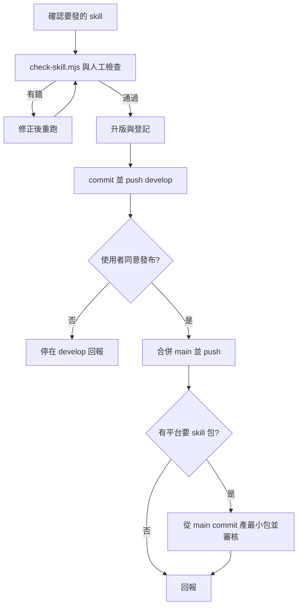

# my-skill-release — 發布獨立 skill

**SSOT 是 `main` 上的 skill 資料夾**（`my-skills/<分類>/<skill 名>/`）。獨立 skill 沒有 marketplace，使用者從 `main` 複製單一資料夾安裝，或上傳由 `main` 產出的 skill 包。所以「發布」＝確認能單獨使用、登記清楚、進 `main`；skill 包一律從 `main` 的某個 commit 用 `git archive` 產出，不手動複製、不提交進 repo。

`my-plugins/` 裡的 skill 跟著 plugin 發，改用 `my-plugin-release`。



## 獨立 skill 的規則

```text
my-skills/<分類>/<skill 名>/
  SKILL.md        必要，入口
  references/     選用，按需讀的參考
  templates/      選用，範本
  scripts/        選用，腳本
  agents/         選用，OpenAI 平台的介面描述（openai.yaml）
```

- 分類目錄只用來區隔類型、功能或平台，本身不是 skill，不放 `SKILL.md`。新分類只在現有分類都不合適時才建，名稱用小寫英文。
- 資料夾名與 `SKILL.md` 的 `name` 一致；`description` 寫做什麼與**何時用**（使用者會說的詞）。frontmatter 只用 `name`、`description` 等通用欄位。
- 自成一體：只引用自己資料夾內的檔。不連到其他 skill、`my-plugins/`、`skills/` 的路徑；提到別的 skill 只寫名稱。
- 不寫死個人路徑、帳號 ID、內部網址、金鑰；需要的設定用環境變數或請使用者提供。
- 繁體中文；流程圖用 mermaid `graph TD`／`LR`／`TB`。

## 各平台發佈格式

同一個資料夾就是各平台的 skill（Agent Skills 格式：資料夾＋`SKILL.md`）。平台專屬的只有 `agents/openai.yaml`。

| 平台 | 安裝位置／方式 | 平台專屬檔 |
|------|------|------|
| Claude Code | 專案 `.claude/skills/<skill 名>/`、個人 `~/.claude/skills/<skill 名>/` | 無 |
| claude.ai／Desktop 聊天／Cowork | Customize > Skills 上傳 skill 包（zip，最上層是 `<skill 名>/SKILL.md`） | 無 |
| Codex | 專案 `.agents/skills/<skill 名>/`；個人位置依該版 Codex 說明（**需確認**） | `agents/openai.yaml` |
| ChatGPT | 帳號端上傳 skill 包（**未驗證**） | `agents/openai.yaml` |
| Gemini CLI | 依 `gemini skills --help` 的安裝方式或 skill 目錄（**需確認**） | 無 |
| Antigravity | 工作區 `.agents/skills/<skill 名>/` | 無 |

只複製單一 skill 資料夾，不複製分類目錄。

## 1. 準備

1. `git pull`，`git status` 確認只有這次要發的變更；有別人的未提交變更就停下來問，不要一起提交。
2. 確認目前在 `develop`。
3. 確認目標：使用者沒指名就看 `git status` 與 `git log --oneline origin/main..develop -- my-skills/` 改到哪些 skill，列出來確認。

## 2. 檢查

```text
node .agents/skills/my-skill-release/scripts/check-skill.mjs <skill 名或路徑>
```

不給參數會檢查全部 skill。**錯誤必須修到通過**；警告逐條判斷，要保留就在回報說明原因。

| 檢查 | 失敗怎麼修 |
|------|------|
| 位置不是 `my-skills/<分類>/<skill 名>/` | 移到合適分類（`git mv`） |
| `name` 與資料夾名不一致、缺 `description` | 改 frontmatter |
| 連結不存在或跑出 skill 資料夾 | 改成 skill 內的檔；提到別的 skill 只寫名稱 |
| 疑似金鑰、私鑰 | 刪掉，改用環境變數或請使用者提供；已 commit 過的要告訴使用者輪替 |
| 個人絕對路徑 | 改成相對路徑或環境變數 |
| 被 `.gitignore` 擋掉或沒 `git add` | 確認該檔是否要發；要發就在 `.gitignore` 加 `!路徑` 例外並 `git add` |
| 沒登記在分類表或 README | 見下一步 |

腳本只抓常見格式；另外自己讀一次 `SKILL.md`，確認沒寫死帳號 ID、內部網址或個人資料，並確認：

- 有 `agents/openai.yaml` 時是合法 YAML，內容描述與 `description` 一致。
- 單獨複製到乾淨環境也能用：不依賴其他 skill、plugin 或 repo 其他檔。

## 3. 升版與登記

- **版本**：skill 有 `version`（frontmatter 或 badge）就依 SemVer 升（文件或小錯 patch、新功能 minor、破壞相容 major），兩處同號；沒有就不必加。
- **`my-skills/AGENTS.md` 分類表**：新 skill 加進對應分類列。
- **根 `README.md`「不在 my-workflow 包裡」表格**：新 skill 加一列（連結、一句說明）；「納入版本」填目前 `project.json` 的版本，原本是「未發布」的改成這個版本。

## 4. 提交與合併

1. commit（Conventional Commits，繁體中文，scope 寫 skill 名，例：`feat(my-grokbot): 新增 Grok Bot 獨立 skill`），push `develop`。
2. **合併 `main` 前先問使用者**：列出要發的 skill 與版本。`develop` 上若有還不想發的其他變更（例如 plugin 改到一半），先告訴使用者，由使用者決定要一起發還是等。
3. `git checkout main && git pull && git merge --no-ff develop`，push `main`，切回 `develop`。有衝突就停下來回報，不要自己挑一邊。

## 5. 最小 skill 包（選用）

只有在使用者要上傳（claude.ai、ChatGPT）或離線交付時才產。內容只取自 `main` 上的某個 commit。

1. 確認來源與路徑：

   ```bash
   git fetch origin && C=$(git rev-parse origin/main)
   S=my-skills/<分類>/<skill 名>; N=$(basename "$S")
   git cat-file -e "$C:$S/SKILL.md" || echo "main 上還沒有這個 skill，先發布"
   ```

   `.gitignore` 要有 `dist/`；輸出放 `dist/`，**不提交**。

2. 排除清單（開發用檔與其他平台專屬檔）：

   ```bash
   BASE=(':(exclude,glob)**/*.test.*' ':(exclude,glob)**/scripts/tmp/**' ':(exclude,glob)**/node_modules/**')
   ```

   | 平台 | 再排除 |
   |------|------|
   | Claude、Gemini | `':(exclude)agents/openai.yaml'`（`agents/` 變空時 `git archive` 不會留空目錄） |
   | OpenAI | 無 |

   `scripts/`、`references/`、`templates/` 是 skill 的一部分，要留。含 `**` 的規則一定要加 `glob`，否則漏掉第一層的檔。

3. 產包（以 Claude 為例）：

   ```bash
   PLAT=claude; EXTRA=(':(exclude)agents/openai.yaml')
   OUT=dist/$N-$PLAT-${C:0:7}.zip
   git archive --format=tar --prefix=$N/ "$C:$S" -- . "${BASE[@]}" "${EXTRA[@]}" | tar -t   # 先看清單
   git archive --format=zip --prefix=$N/ -o "$OUT" "$C:$S" -- . "${BASE[@]}" "${EXTRA[@]}"
   ```

   `--prefix=$N/` 讓 zip 最上層是 `<skill 名>/SKILL.md`，解壓或上傳後資料夾名就對。

4. 審核（同一組 pathspec，內容等同包內）：
   - 清單第一層只有 `<skill 名>/`，裡面有 `SKILL.md`；沒有 `.env*`、`*.pem`、`*.key`、`.git/`、測試檔。
   - 金鑰與個人路徑掃描要沒有輸出（規則裡不要用反斜線，Windows 的 Git Bash 會吃掉它）：

     ```bash
     git -C "$S" grep -nIE \
       -e '-----BEGIN [A-Z ]*PRIVATE KEY-----' -e 'sk-(ant-|proj-)?[A-Za-z0-9_-]{20,}' \
       -e 'gh[pousr]_[A-Za-z0-9]{30,}' -e 'AKIA[0-9A-Z]{16}' -e 'xox[abpr]-[A-Za-z0-9-]{10,}' \
       -e '[A-Za-z]:.Users.[A-Za-z0-9_-]{2,}' \
       "$C" -- . "${BASE[@]}" "${EXTRA[@]}"
     ```

   - 有問題就刪掉 zip，修內容（回到第 2 步重新發布）後重產。
5. `sha256sum "$OUT" > "$OUT.sha256"`（PowerShell：`Get-FileHash $OUT -Algorithm SHA256`）。
6. 交付時附：平台、來源 commit `C`、skill 版本、檔數與大小、sha256。上傳或複製後在該平台開新對話實際跑一次 skill；沒實測就標「未驗證」。

## 回報

發了哪些 skill、版本、檢查結果（含保留的警告與原因）、commit SHA（develop 與 main）、產出的 skill 包（路徑、來源 commit、sha256）、各平台驗證狀態、哪一步沒做。

## 不要做

- 不要 force push，不要直接在 `main` 上改。
- 不要讓 skill 引用 `my-plugins/`、`skills/` 或其他 skill 的路徑。
- 不要用 `zip -r`、`Compress-Archive` 壓資料夾（會夾帶未版控檔）；一律 `git archive`。
- 不要提交 `dist/` 或任何 skill 包；不要為某個平台另存一份 skill 內容。
- 不要改 `skills/`（第三方）。
- 不要為了過檢查改檢查腳本；腳本誤判就回報。
