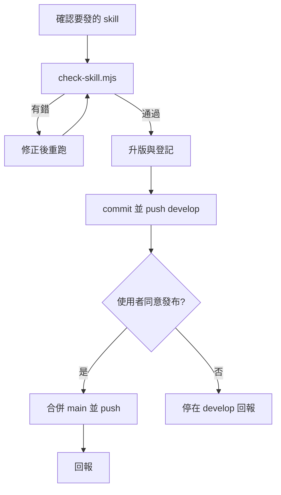

# my-skill-release — 發布獨立 skill

`my-skills/` 的 skill 各自獨立，沒有 marketplace；使用者從 `main` 複製單一 skill 資料夾安裝。所以「發布」＝檢查能單獨使用、登記清楚、進 `main`。準則以 [`my-skills/AGENTS.md`](../../../my-skills/AGENTS.md) 為準。

`my-plugins/` 裡的 skill 跟著 plugin 發，改用 `my-plugin-release`。



## 1. 準備

1. `git pull`，`git status` 確認只有這次要發的變更；有別人的未提交變更就停下來問。
2. 確認目前在 `develop`。
3. 確認目標：使用者沒指名就看 `git status` 與 `git log origin/main..develop -- my-skills/` 改到哪些 skill，列出來確認。

## 2. 檢查

```text
node .agents/skills/my-skill-release/scripts/check-skill.mjs <skill 名或路徑>
```

不給參數會檢查全部 skill。**錯誤必須修到通過**；警告逐條判斷，要保留就在回報說明原因。

| 檢查 | 失敗怎麼修 |
|------|------|
| 位置不是 `my-skills/<分類>/<skill 名>/` | 移到合適分類（`git mv`）；新分類只在現有都不合適時建 |
| `name` 與資料夾名不一致、缺 `description` | 改 frontmatter；`description` 要寫何時用 |
| 連結不存在或跑出 skill 資料夾 | 改成 skill 內的檔；提到別的 skill 只寫名稱 |
| 疑似金鑰、私鑰 | 刪掉，改用環境變數或請使用者提供；已 commit 過的要告訴使用者輪替 |
| 個人絕對路徑 | 改成相對路徑或環境變數 |
| 被 `.gitignore` 擋掉 | 確認該檔是否要發；要發就在 `.gitignore` 加 `!路徑` 例外 |
| 沒登記在分類表或 README | 見下一步 |

腳本只抓常見格式；另外自己讀過一次 `SKILL.md`，確認沒寫死帳號 ID、內部網址或個人資料。

## 3. 升版與登記

- **版本**：skill 有 `version`（frontmatter 或 badge）就依 SemVer 升，兩處同號；沒有就不必加。
- **`my-skills/AGENTS.md` 分類表**：新 skill 加進對應分類列。
- **根 `README.md`「不在 my-workflow 包裡」表格**：新 skill 加一列（連結、一句說明）；「納入版本」填目前 `project.json` 的版本，原本是「未發布」的改成這個版本。

## 4. 提交與合併

1. commit（Conventional Commits，繁體中文，scope 寫 skill 名，例：`feat(my-grokbot): 新增 Grok Bot 獨立 skill`），push `develop`。
2. **合併 `main` 前先問使用者**：列出要發的 skill 與版本，取得同意。
3. `git checkout main && git pull && git merge --no-ff develop`，push `main`，切回 `develop`。`develop` 上若有還不想發的其他變更（例如 plugin 改到一半），先告訴使用者，由使用者決定要一起發還是等。有衝突就停下來回報。

## 回報

發了哪些 skill、版本、檢查結果（含保留的警告與原因）、commit SHA（develop 與 main）、哪一步沒做。

## 不要做

- 不要 force push，不要直接在 `main` 上改。
- 不要讓 skill 引用 `my-plugins/`、`skills/` 或其他 skill 的路徑。
- 不要改 `skills/`（第三方）。
- 不要為了過檢查改檢查腳本；腳本誤判就回報。
