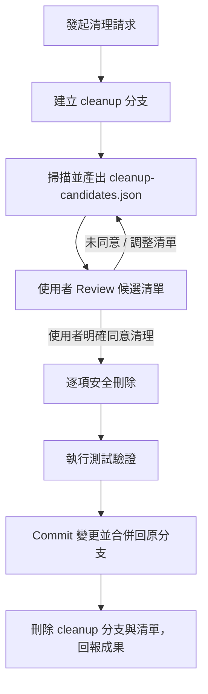

# my-codebase-clear — 程式碼庫安全清理

安全掃描並清理專案中的暫存檔、快取、過期日誌與無用檔案，保證清理過程可追溯、可回滾且不影響環境運作。



## 執行流程

### 1. 準備與分支隔離

1. 檢查 `git status`，若有未提交的業務代碼，先完成 commit 確保工作樹乾淨。
2. 建立並切換至專用清理分支（例如 `cleanup/YYYYMMDD`），避免在主力開發分支直接進行破壞性操作。

### 2. 掃描與產生候選清單

掃描專案目錄（排除 `.git`），尋找以下類型的可清理檔案：
- **編譯產物與快取**：無效的 build 快取、temp cache。
- **日誌與 Dump 檔**：`*.log`、`npm-debug.log*`、暫存 crash dump。
- **暫存與備份檔**：`*.tmp`、`*.bak`、編輯器暫存檔。
- **打包壓縮檔**：遺留的 `*.zip`、`*.tar.gz`。

在專案根目錄產生 `cleanup-candidates.json`，格式如下：

```json
{
  "scan_time": "2026-10-17T03:00:00Z",
  "total_size_bytes": 1048576,
  "candidates": [
    {
      "path": "logs/debug.log",
      "size_bytes": 524288,
      "reason": "本機除錯日誌，非生產需要",
      "impact": "不影響本地測試、CI 與雲端環境"
    }
  ]
}
```

### 3. Review 審查階段

- 將候選檔案數量、預估釋放空間呈報給使用者。
- **使用者未明確說「執行清理」或「確認刪除」前，絕對不刪除任何檔案**。
- 使用者提出保留某檔案時，從 `cleanup-candidates.json` 中移除該項目。

### 4. 執行清理與驗證

1. 取得使用者明確許可後，依 `cleanup-candidates.json` 所列清單逐一執行安全刪除。
2. 刪除過程中若遇到無法判定或鎖定中的檔案，略過並在對話中提示。
3. 執行基本測試或建置命令，確認刪除後專案依然可正常編譯與運作。

### 5. 收尾與合併

1. 提交變更：`git commit -m "chore(cleanup): 依清單清理暫存與無用檔案"`。
2. 刪除根目錄的 `cleanup-candidates.json`。
3. 切換回原開發分支（通常為 `develop`），合併清理分支：`git merge cleanup/YYYYMMDD --no-ff`。
4. 刪除本地清理分支，回報已清除檔案總數與釋放磁碟空間。
