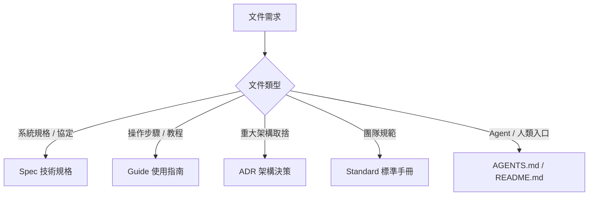

# my-docs — 技術文件與規格管理

建立結構清晰、言簡意賅且易於維護的技術文件。文件是「單一事實來源」(SSOT)，拒絕冗言贅字與過時資訊。

## 文件類型與結構

1. **技術規格 (Spec)**：
   - 結構：背景與目的 → 系統架構（Mermaid 圖）→ API / 資料模型 / Schema 契約 → 邊界情境與錯誤處理 → 驗收條件。
   - 適用：前後端契約、資料庫設計、模組重構。
2. **使用指南 (Guide) / 操作手冊 (Manual)**：
   - 結構：目的 → 前置需求 → 步驟（分步指令）→ 驗證方式 → 常見問題 (FAQ)。
   - 適用：工具安裝、部署 SOP、開發環境配置。
3. **架構決策記錄 (ADR)**：
   - 結構：標題 → 狀態（提議/已採納/已廢棄）→ 背景與問題 → 備選方案比較 → 最終決策與理由 → 產生的後果與影響。
   - 適用：更換框架、儲存引擎選型、重大通訊協定變更。
4. **根目錄核心入口 (SSOT)**：
   - **`README.md`**：人類工程師的導讀手冊。說明專案定位、快速啟動、架構簡圖與目錄指引。
   - **`AGENTS.md`**：AI Agent 的最高行為準則。說明專案結構、治理規則、執行約定與嚴禁事項。

## 撰寫準則

- **言簡意賅**：能用一句話說清楚就不要開長段；結論與重點先行。
- **說人話、少用偏門縮寫**：使用台灣繁體中文；首次出現之特殊縮寫須補一句白話說明；通用技術名詞保留標準英文（如 API, OAuth, JSON）。
- **結構化排版**：善用表格比對、列點清單與加粗標記，避免大段純文字堆疊。
- **圖表優先**：架構與流程多用 Mermaid；使用 `graph TD`／`graph LR`／`graph TB`，避免使用 `flowchart`。
- **安全第一**：禁止包含任何密碼、Token、API Key 或開發者本機絕對路徑（如 `C:\Users\...`）。
- **生命週期管理**：
  - 變更程式碼時，同步更新受影響之文件與最後修改日期。
  - 過時或已廢棄之文件移至 `docs/archived/` 標註歸檔日期，並更新相關連結，避免死連結 (Broken Links)。
