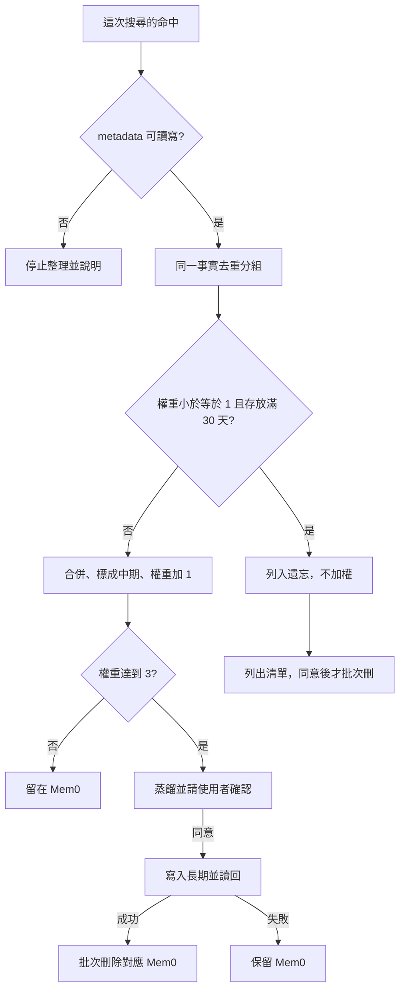

# 記憶整理

寫入交給 Mem0 擋完全相同的句子。滾動加權只處理**這次查詢已經命中的那幾筆**。不整庫掃描，不為整理再搜一次，不逐筆補讀。身份、確認與後端讀寫以 [`my-memory`](../my-memory/SKILL.md) 與 [backends.md](../my-memory/references/backends.md) 為準。欄位以 [schemas.md](../my-memory/references/schemas.md) 為準。

## 時機

| 時機 | 誰做 | 做什麼 |
|------|------|--------|
| 寫入 | Mem0 新增，`infer=true` | 抽出事實，並擋完全相同的句子。這裡不加權、不升中期、不遺忘 |
| 查詢 | 本 skill | 用這一次命中去重、升中期、權重加 1 |
| 升長期 | 本 skill，同意後 | 寫入 Notion，讀回成功才刪 Mem0 |
| 遺忘 | 本 skill，同意後 | 只刪清單上的 id |

搜尋分數、Memory Decay 的縮放、`categories` 都不是 `weight`。不要在寫入或查詢當下開關專案的 decay。

## 閥值

| 名稱 | 值 |
|------|----|
| 起始權重 | `1`。沒有 `weight`，或舊值 `normal`，都當 `1` |
| 舊值 `high` | 當 `3` |
| 每次查詢加權 | 同一則對話、同一組只加 `1` |
| 升長期 | 加權後 `weight` **大於等於 3** |
| 低權重 | `weight` **小於等於 1** |
| 遺忘 | 低權重，且最舊的 `created_at` **滿 30 天** |

沒有 `created_at` 就不遺忘，也不要猜日期。工具不能讀寫 metadata 時，這次不加權、不升層、不刪，並說明缺 metadata。

憑證、token、金鑰、付款資料不加權，也不寫進長期。

## 寫入

使用者說記住，且這筆是短期時：

1. `infer=true`。只有使用者要留下原句時才 `infer=false`。原句可能產生重複，留到下次查到再合併，不要為了它再搜一輪。
2. 這一則對話裡已經有同一事實的記憶 id，就更新那筆。沒有 id 就直接新增。不要先搜尋去重。
3. 新增工具沒有 `metadata` 時，寫入成功後用該筆 id 設 `weight=1`、`tier=short`。不要另開一筆。
4. 事實有明確結束日，且工具 schema 有 `expiration_date` 時，才設 `YYYY-MM-DD`。到期後搜尋會隱藏該筆，資料還在，用 id 仍讀得到。這不是遺忘。schema 沒有這個欄就不要硬設，也不要用它代替下面的 30 天規則。

## 查詢當下

沿用回答問題的那一次搜尋結果。還沒有結果、必須查 Mem0 時，只打一次：

- `filters` 帶這次身份。至少要有工具要求的 `user_id`、`agent_id`、`app_id`、`run_id` 其中之一。
- `fields` 只留 `id`、`memory`、`user_id`、`agent_id`、`created_at`、`metadata`。
- `top_k` 用這次問題需要的筆數。`threshold` 用工具預設。
- 不要開 `rerank`。不要再取單筆，不要列整庫，不要為了找過期記憶再查一次。

只處理這次命中的筆。

1. 按「同一 `scope`、同一 `user_id`、同一 `agent_id`、同一事實」分組。同一事實看語意。不同身份不要併在一起。
2. 一組先看遺忘。低權重且存放滿 30 天：列入遺忘清單，不加權、不升中期。
3. 其餘組：合併成一句，寫回保留的那筆，`tier` 設成 `mid`，`weight` 加 1。保留筆用這組最舊的 `created_at` 計算日後遺忘，不要用合併時間把年紀清零。
4. 每一組的保留筆只更新一次。批次更新若只能改文字，就不要拿它改 `weight` 或 `tier`，改用單筆更新 metadata。
5. 保留筆更新成功後，同組其餘 id 用批次刪除一次。更新沒成功就不要刪。回覆列出保留 id、新權重，以及刪掉的重複 id。
6. 加權後 `weight` 大於等於 3：進入升長期。還沒同意前，這筆留在 Mem0。

還在改的任務狀態可以升成中期，但不升長期。

## 升長期

沿用同一組的合併結果。

1. 蒸餾成一句去敏的穩定事實。還在改、或只是任務狀態，就拒絕升長期。
2. 抄來源的 `scope`、`user_id`、`agent_id`。隔離鍵是 `scope|user_id|agent_id|記憶鍵`。先查這把，沒有再查舊鍵 `user_id|agent_id|記憶鍵`。查到就更新那一頁。
3. 內容互補就合成一句。內容衝突就列出差異，等使用者選。永久庫已有多筆重複時，併進隔離鍵相符的那筆，其餘標 `已過時`，不要刪頁。
4. 顯示合併後的長期內容、隔離鍵、將刪除的 Mem0 id。等使用者同意。
5. 同意後寫入 Notion，讀回確認。成功後用批次刪除刪掉列出的這些 id。長期沒寫成，不要刪 Mem0。

只刪列出的 id。不要依 user、agent 或 metadata 一次刪掉整群。

## 遺忘

低權重且存放滿 30 天，兩項都要成立。搜尋因 `expiration_date` 隱藏的筆，不算已經遺忘。

1. 列出 Mem0 id、摘要、目前權重、存放天數。
2. 等使用者同意後，用批次刪除刪掉列出的 id。
3. 不同意就留著，這次不要加權。
4. 刪除失敗要明講。

遺忘只處理本次命中、或使用者點名的筆。不要為了找過期記憶去掃整庫。
