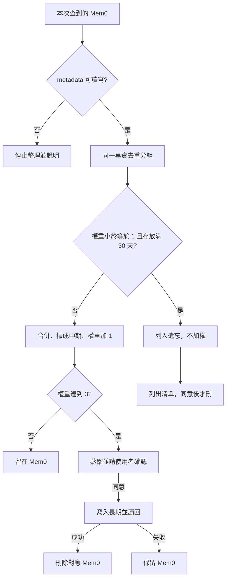

# 記憶整理

每次查到 Mem0 短期記憶，就對**這次命中的那幾筆**做一輪滾動整理。不整庫掃描。身份、確認與後端讀寫以 [`my-memory`](../my-memory/SKILL.md) 與 [backends.md](../my-memory/references/backends.md) 為準。欄位以 [schemas.md](../my-memory/references/schemas.md) 為準。

## 閥值

| 名稱 | 值 |
|------|----|
| 起始權重 | `1`。沒有 `weight`，或舊值 `normal`，都當 `1` |
| 舊值 `high` | 當 `3` |
| 每次查詢加權 | 同一則對話、同一組只加 `1` |
| 升長期 | 加權後 `weight` **大於等於 3** |
| 低權重 | `weight` **小於等於 1** |
| 遺忘 | 低權重，且最舊的 `created_at` **滿 30 天** |

搜尋相似度不是權重。沒有 `created_at` 就不遺忘，也不要猜日期。工具不能讀寫 metadata 時，這次不加權、不升層、不刪，並說明缺 metadata。

憑證、token、金鑰、付款資料不加權，也不寫進長期。

## 查詢當下

只處理這次查詢命中的筆。

1. 按「同一 `scope`、同一 `user_id`、同一 `agent_id`、同一事實」分組。同一事實看語意。不同身份不要併在一起。
2. 一組先看遺忘。低權重且存放滿 30 天：列入遺忘清單，不加權、不升中期。
3. 其餘組：合併成一句，寫回保留的那筆，`tier` 設成 `mid`，`weight` 加 1。保留筆用這組最舊的 `created_at` 計算日後遺忘，不要用合併時間把年紀清零。
4. 保留筆更新成功後，刪除同組其餘 Mem0。更新沒成功就不要刪。回覆列出保留 id、新權重，以及刪掉的重複 id。
5. 加權後 `weight` 大於等於 3：進入升長期。還沒同意前，這筆留在 Mem0。

還在改的任務狀態可以升成中期，但不升長期。

## 升長期

沿用同一組的合併結果。

1. 蒸餾成一句去敏的穩定事實。還在改、或只是任務狀態，就拒絕升長期。
2. 抄來源的 `scope`、`user_id`、`agent_id`。隔離鍵是 `scope|user_id|agent_id|記憶鍵`。先查這把，沒有再查舊鍵 `user_id|agent_id|記憶鍵`。查到就更新那一頁。
3. 內容互補就合成一句。內容衝突就列出差異，等使用者選。永久庫已有多筆重複時，併進隔離鍵相符的那筆，其餘標 `已過時`，不要刪頁。
4. 顯示合併後的長期內容、隔離鍵、將刪除的 Mem0 id。等使用者同意。
5. 同意後寫入 Notion，讀回確認。成功後刪除這一組 Mem0。長期沒寫成，不要刪 Mem0。

## 遺忘

低權重且存放滿 30 天，兩項都要成立。

1. 列出 Mem0 id、摘要、目前權重、存放天數。
2. 等使用者同意後才刪除。
3. 不同意就留著，這次不要加權。
4. 刪除失敗要明講。

遺忘只處理本次命中、或使用者點名的筆。不要為了找過期記憶去掃整庫。
