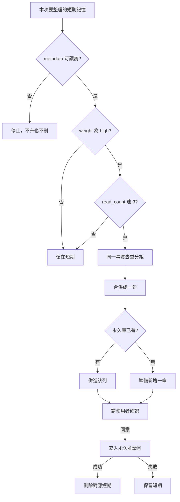

# 記憶整理

只做**要不要升永久**的判斷。身份、確認、去重與後端讀寫以 [`my-memory`](../my-memory/SKILL.md) 與 [backends.md](../my-memory/references/backends.md) 為準。欄位格式以 [schemas.md](../my-memory/references/schemas.md) 為準，不要自創欄位或選項。

## 計數放哪

放在該筆 Mem0 記憶的 metadata。欄位固定：

| 欄位 | 值 |
|------|----|
| `weight` | `high` 或 `normal`。沒有就當 `normal` |
| `read_count` | 整數。沒有就當 `0` |

搜尋相似度、排序不是權重，也不當讀取次數。工具不能讀寫 metadata 時，這次不計數、不整理，並說明缺 metadata。

## 權重

- `high`：使用者說重要或要長期留，或內容已是穩定偏好、身份事實、一直有效的決定。
- `normal`：任務脈絡、還會改的決定、沒說要長期留的。預設用這個。
- 不確定就 `normal`。閒聊、推測、憑證、token、金鑰、付款資料不標 `high`，也不寫進永久。

## 什麼算一次讀取

這筆記憶**實際被拿來回答或做決定**才加 1。同一則對話、同一筆只加一次。搜到但沒用，不加。

先讀目前的 `read_count` 再加。更新失敗就不要當成已加上，也不要整理。

## 何時整理

三項同時成立才整理：

1. 這筆是短期（Mem0）。中期索引、已經在永久庫的，不走這份。
2. `weight` 是 `high`。
3. 加上這一次之後，`read_count` **大於等於 3**。

使用者點名整理、但未達閥值：說出現在的權重與次數，問要不要這次例外升永久。例外仍要確認，不要默默做。

不整庫掃描。只處理本次讀到的，或使用者點名的那幾筆。

## 寫入永久之前

先去重，再合併。這兩步做完才可以新增或更新永久列。

### 去重

本次要整理的短期記憶，按「同一 `scope`、同一 `user_id`、同一 `agent_id`、同一事實」分組。同一事實看語意，不看字面是否逐字相同。不同身份的同一句話各留各的，不要併成一筆。

永久庫先查隔離鍵 `scope|user_id|agent_id|記憶鍵`。找不到再查舊鍵 `user_id|agent_id|記憶鍵`（既有全域列常見 `xiaoan||記憶鍵`）。查到就當同一筆。

`scope` 用 `private`、`global` 或 `general`。`user_id`、`agent_id` 與來源 Mem0 相同；私人與全域這兩欄留空。

### 合併

一組只留一句去敏的穩定事實。還在改、或只是任務狀態，整組拒絕升永久，短期留著。

| 情況 | 做法 |
|------|------|
| 內容互補 | 合成一句。不把多份原文並列進永久庫 |
| 內容衝突 | 列出差異，等使用者選。不要自己覆蓋 |
| 永久庫已有一筆 | 併進該列的「目前值」，更新同一頁。不要再開一頁 |
| 永久庫已有多筆重複 | 併進隔離鍵相符的那一筆。其餘標 `已過時`，不要刪頁 |

## 確認後才寫

1. 顯示：併進了哪些短期摘要、合併後的永久內容、將更新或新增的隔離鍵、將刪除的 Mem0 id、將標成已過時的永久列。等使用者同意。
2. 同意後寫永久，讀回確認。
3. 永久寫成後，刪除這一組對應的短期記憶。不要改成 `已過時` 留在 Mem0。
4. 永久沒寫成，不要刪短期，也不要改永久列的狀態。刪除失敗要明講；永久那筆已經在。

整理完，同一身份下的同一事實只留永久這一處。
