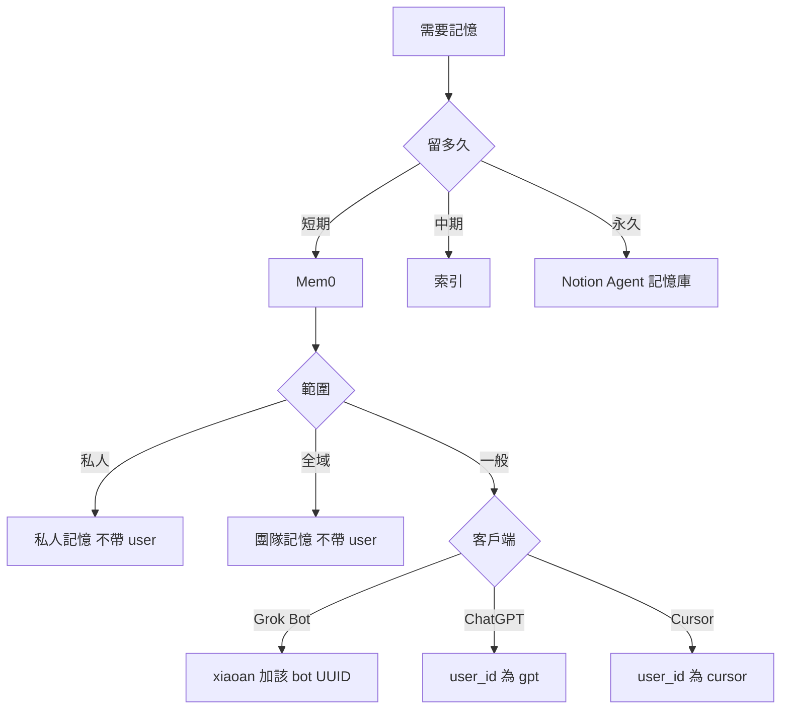

# 外部記憶管理

## 先判斷

讀寫前先做完。時效決定留多久；範圍只用於 Mem0。

1. 這筆是短期、中期，還是永久。
2. 短期才分私人、全域、一般。不要按 session 另開 id。

## 短／中／永久

| 層級 | 判斷 | 內容 | 去處 |
|------|------|------|------|
| **短期** | 數日～數週、綁任務、可改 | 偏好、近期決策、任務脈絡 | Mem0 |
| **中期** | 跨任務、要索引、不存全文、須去敏 | skills／templates 指向 | 知識庫索引或記憶鍵指向 repo |
| **永久** | 已蒸餾、要一直留、須去敏 | 穩定原則與事實 | Notion 的 Agent 記憶庫 |

會過期或還在改 → 短期。只留指向 → 中期。要一直留 → 永久。憑證與未去敏的內容不寫中期、永久。

同一件事只留一處。短期反覆命中、要一直留：寫進 Agent 記憶庫，Mem0 那筆改為 `已過時`。

## 身份

只用於 Mem0。永久記憶不套這張表。

| 範圍 | 庫 | 誰 | 怎麼帶 |
|------|----|----|--------|
| 私人 | `私人記憶` | 全部 | 不帶 user |
| 全域 | `團隊記憶` | 全部 | 不帶 user |
| 一般 | `團隊記憶` | 只有 Grok Bot | `user_id=xiaoan` 與該 bot 的 UUID。UUID 未填留佔位 |
| 一般 | `團隊記憶` | ChatGPT | `user_id=gpt`。所有 session 共用。不設 `agent_id` |
| 一般 | `團隊記憶` | Cursor | `user_id=cursor`。IDE 與 Cloud 所有 session 共用。不設 `agent_id` |

其他客戶端的一般 Mem0 沒有 `user_id` 就先問，不要仿造，也不要按 session 換。私人或全域若工具硬要身份欄，先停下來問，不要猜。

讀寫要分開帶：

- 全域：不帶 user、不帶 agent。搜尋若不能只留「沒有 user、也沒有 agent」的紀錄，先停下來問，不要把整庫當全域。
- 一般：一定帶上表的 user。Grok Bot 再加自己的 agent。不要省略身份去讀一般。

## 選後端

選**一個主後端**；跨後端須先說明。同一事實勿無計畫寫入多處。記憶是索引與脈絡，不取代 Git `docs/`、`ai/`。

| 後端 | 何時用 | 入口 |
|------|--------|------|
| **Agent 記憶庫** | 永久記憶 | [Agent 記憶庫](https://app.notion.com/p/74fc3fcecfc04102a62b75c314bcd132)；`collection://b32ed069-fadc-4cf3-9c64-4a2e5a8255e7` |
| **Mem0 `私人記憶`** | 短期的私人事務 | Composio 別名，勿硬編碼 ID。不帶 user |
| **Mem0 `團隊記憶`** | 短期的全域與一般 | 先 Composio；無則 Mem0 MCP。全域不帶 user；一般才帶身份 |
| **Cursor Notion Memory** | Notion 個人摘要，不是永久記憶，也不是私人記憶庫 | `notion-memory-search`；先讀 `notion://docs/memory` |

組織知識庫（SOP、研究全文）仍走 `$my-notion` + 專案 `notion.knowledge_db`，不與 Agent 記憶庫混用。

## 種類

時效三種。只有短期再分範圍。平台內建記憶（ChatGPT 帳號記憶、Codex 本機 `~/.codex/memories`）不在這張表。

| 種類 | 是什麼 |
|------|--------|
| 短期私人 | Mem0 別名 `私人記憶`，不帶 user |
| 短期全域 | Mem0 別名 `團隊記憶`，不帶 user、不帶 agent |
| 短期一般 | Mem0 別名 `團隊記憶`，帶該客戶端身份 |
| 中期 | 索引，指向 repo 或知識庫，不存全文 |
| 永久 | Notion 的 Agent 記憶庫 |

Cursor Notion Memory 只是 Notion 個人摘要，不是上表的儲存。

## 讀取時機

- 使用者要求回想，或這一步依賴對話外的舊偏好、決策。
- 問題自己答得了，不讀。不要每則訊息搜。
- 新對話要不要先讀，只照當前客戶端那一份。沒寫先讀的，就不要掃。

## 讀取方法

1. 先定種類。
2. 永久：Agent 記憶庫，`狀態=有效` 且 `AI 可用`，再用關鍵字。不整庫拉。
3. 中期：打開索引指到的檔。不要把索引當全文。
4. 短期：Composio 用別名選帳，語意搜尋優先。私人不帶 user。全域不帶 user、不帶 agent；排除不了帶身份的紀錄就停下來問。一般一定帶該客戶端身份。
5. 沒有工具就照實說。不要改讀別種來充數。

## 寫入時機

- 使用者說記住，或指定種類，才寫。先說寫進哪一種。
- 先搜尋去重；有就更新。改或刪之前先顯示並取得同意。
- 短期反覆命中、要一直留：寫進永久，Mem0 那筆改 `已過時`。
- 不要伺機寫。同一件事不要同時留在兩種。
- 禁存完整對話、閒聊、推測、密碼、Token、金鑰、付款資料。失敗如實說，勿補造。

## Agent 記憶庫（Notion）

永久記憶。短期不要寫進這裡。

- DB：[Agent 記憶庫](https://app.notion.com/p/74fc3fcecfc04102a62b75c314bcd132)
- Data source：`collection://b32ed069-fadc-4cf3-9c64-4a2e5a8255e7`

**查**：`狀態=有效` 且 `AI 可用` → 再依 `scope`／`類別`／`關鍵字` 過濾；命中後讀 `目前值`；禁整庫拉。不要用 user 或 Mem0 的 agent 來拆開。

**寫**（同隔離範圍以 `記憶鍵`／`隔離鍵` 去重，更新勿重複新增）：

| 必填／常用 | 說明 |
|------------|------|
| 記憶 | 標題 |
| 記憶鍵 | 穩定語意鍵 |
| 目前值 | 簡短有效事實 |
| 層級 | 永久用 `profile` |
| scope | 沿用庫內既有值；不確定用 `global` |
| 狀態 | 預設 `有效`；過時→`已過時`／`封存` |
| AI 可用 | 允許 Agent 使用時勾選 |
| 來源 | 優先 `使用者明示`／`使用者確認`；`AI 推定` 須標待確認 |
| 隔離鍵 | `scope\|記憶鍵`。不要用 user 或 Mem0 的 agent 拆開 |

敏感度高於「一般」時謹慎寫入。工具細節 → [`$my-notion`](../my-notion/SKILL.md)。

## Cursor Notion Memory

1. 本對話首次使用前讀 `notion://docs/memory`。
2. 搜尋：`notion-memory-search`；必要時 fetch About（`id: "memory"`）。
3. 這裡只放 Notion 個人摘要。私人事務寫 Mem0 `私人記憶`。永久事實寫 Agent 記憶庫。同一事實只留一處。

## Mem0

**讀**：照上面的讀取時機與方法。問題自足或禁止時不搜。

**通路（依序）**：
1. **Composio**：搜尋 `mem0` toolkit；ACTIVE 時用別名 `私人記憶`／`團隊記憶` 選帳，勿硬編碼 ID。
2. **Mem0 MCP**：Composio 不可用時，在 MCP 目錄找 `mem0`／`Mem0` namespace（或含 search／add／update／delete memory 的工具），先讀 schema 再呼叫。
3. 兩者皆無 → 短期就回報無法使用 Mem0，不要改寫進永久庫。

**空間**：`私人記憶`＝短期私人事務（與 Grok Bot 同一個庫）。`團隊記憶`＝短期的全域與一般。私人與團隊跨庫先問。

**身份**：照上面的身份表。全域與一般同在 `團隊記憶`，只靠帶不帶身份分開。讀全域不能排除帶了 user 或 agent 的紀錄時，先停下來問。讀一般一定帶身份。工具若硬要身份欄，先停下來問，不要猜，也不要改成依 session 換 id。

**流程**：語意搜尋優先 → 只用不猜的正式工具／參數 → 不靜默切 scope。

**寫改刪**：先搜去重 → 單一耐久事實 → 驗證；改刪前顯示並取得同意。推測不得當使用者事實。

## 回應

- 讀到：後端 + 相關摘要  
- 無結果：查詢範圍 + 請補充或指定後端  
- 寫入：內容、後端、新增或更新  
- 未用記憶：一般不必宣告  

## 依客戶端

只讀當前環境那一份。內建記憶跟 Mem0 不是同一套。

| 環境 | 檔 |
|------|-----|
| Grok Bot | [grok-bot.md](references/grok-bot.md) |
| ChatGPT 網頁與 App | [chatgpt.md](references/chatgpt.md) |
| Codex | [codex.md](references/codex.md) |
| Cursor IDE 與 Cloud | [cursor.md](references/cursor.md) |
