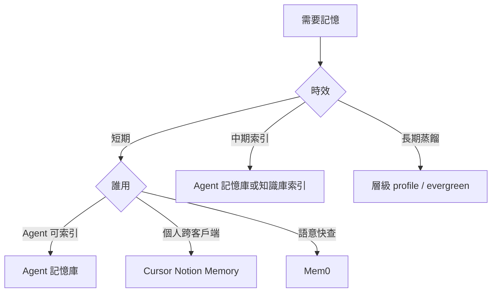

# 外部記憶管理

## 選後端

選**一個主後端**；跨後端須先說明。同一事實勿無計畫寫入多處。記憶是索引與脈絡，不取代 Git `docs/`、`ai/`。

| 後端 | 何時用 | 入口 |
|------|--------|------|
| **Agent 記憶庫** | Agent 偏好／事實／決策原則（可索引、可隔離） | [Agent 記憶庫](https://app.notion.com/p/74fc3fcecfc04102a62b75c314bcd132)；`collection://b32ed069-fadc-4cf3-9c64-4a2e5a8255e7` |
| **Cursor Notion Memory** | 使用者個人、跨客戶端 About／Memories | `notion-memory-search`；先讀 `notion://docs/memory` |
| **Mem0** | 私人／團隊語意快查 | 先 Composio；無則 Mem0 MCP；見下方 |

組織知識庫（SOP、研究全文）仍走 `$my-notion` + 專案 `notion.knowledge_db`，不與 Agent 記憶庫混用。

## 短／中／長期

| 層級 | 判斷 | 內容 | 去處 |
|------|------|------|------|
| **短期** | 數日～數週、綁任務、可改 | 偏好、近期決策、任務脈絡 | Agent 記憶庫 `note`／`log`；Mem0 |
| **中期** | 跨任務、資產索引（非全文）、須去敏 | skills／templates 指向 | 知識庫索引或記憶鍵指向 repo |
| **長期** | 已蒸餾、跨專案、可追溯、須去敏 | 穩定偏好、原則、模式 | Agent 記憶庫 `profile` |

依序：會過期？→ 要全文還是索引？→ 誰用？→ 能去敏？（憑證／客戶識別／未去敏 → 禁寫中長期）

升級：反覆命中的短期 → 更新為 `profile` 或中期索引 → 勿把一次性聊天當長期。

## 原則

- 只在能改善正確性／延續性時讀；勿每則訊息搜尋。
- 寫入須明確授權（「記住」或指定後端）。
- 禁存完整對話、閒聊、推測、密碼、Token、金鑰、付款資料。
- 失敗如實說；勿補造。影響回答時簡述來源。

## Agent 記憶庫（Notion）

- DB：[Agent 記憶庫](https://app.notion.com/p/74fc3fcecfc04102a62b75c314bcd132)
- Data source：`collection://b32ed069-fadc-4cf3-9c64-4a2e5a8255e7`

**查**：`狀態=有效` 且 `AI 可用` → 再依 `scope`／`user_id`／`agent_id`／`類別`／`關鍵字` 過濾；命中後讀 `目前值`；禁整庫拉。

**寫**（同隔離範圍以 `記憶鍵`／`隔離鍵` 去重，更新勿重複新增）：

| 必填／常用 | 說明 |
|------------|------|
| 記憶 | 標題 |
| 記憶鍵 | 穩定語意鍵 |
| 目前值 | 簡短有效事實 |
| 層級 | `profile`／`log`／`note` |
| scope | `global`／`agent`／`conversation` |
| 狀態 | 預設 `有效`；過時→`已過時`／`封存` |
| AI 可用 | 允許 Agent 使用時勾選 |
| 來源 | 優先 `使用者明示`／`使用者確認`；`AI 推定` 須標待確認 |
| 隔離鍵 | `user_id|agent_id|記憶鍵` |

`user_id` 全域慣例固定 `xiaoan`；`agent_id` 空＝全域共享。敏感度高於「一般」時謹慎寫入。工具細節 → [`$my-notion`](../my-notion/SKILL.md)。

## Cursor Notion Memory

1. 本對話首次使用前讀 `notion://docs/memory`。
2. 搜尋：`notion-memory-search`；必要時 fetch About（`id: "memory"`）。
3. 「記住我…」屬個人習慣時寫入 `parent: "memory"`。與 Agent 記憶庫：同一事實擇一，團隊／Agent 可索引優先 Agent 記憶庫。

## Mem0

**讀**：使用者要求回想／指定 Mem0，或他後端不足且任務依賴舊偏好。問題自足或禁止時不搜。

**通路（依序）**：
1. **Composio**：搜尋 `mem0` toolkit；ACTIVE 時用別名 `私人記憶`／`團隊記憶` 選帳，勿硬編碼 ID。
2. **Mem0 MCP**：Composio 不可用時，在 MCP 目錄找 `mem0`／`Mem0` namespace（或含 search／add／update／delete memory 的工具），先讀 schema 再呼叫。
3. 兩者皆無 → 改 Agent 記憶庫／Cursor Notion Memory，或回報無法使用 Mem0。

**空間**：私人＝個人；團隊＝共享（可索引優先 Agent 記憶庫）。跨空間先問。

**身份**：至少要帶 `user_id`、`agent_id` 或 `run_id`。人固定 `user_id=xiaoan`。各客戶端怎麼分開見下方檔案；對不上既有實體就先問，不要新造 agent id。

**流程**：語意搜尋優先 → 只用不猜的正式工具／參數 → 不靜默切 scope。

**寫改刪**：先搜去重 → 單一耐久事實 → 驗證；改刪前顯示並取得同意。推測不得當使用者事實。

## 回應

- 讀到：後端 + 相關摘要  
- 無結果：查詢範圍 + 請補充或指定後端  
- 寫入：內容、後端、新增或更新  
- 未用記憶：一般不必宣告  

## 依客戶端

只讀當前環境那一份。內建記憶跟 Mem0 不是同一套。

| 環境 | 檔 |
|------|-----|
| Grok Bot | [grok-bot.md](references/grok-bot.md) |
| ChatGPT 網頁與 App | [chatgpt.md](references/chatgpt.md) |
| Codex | [codex.md](references/codex.md) |
| Cursor IDE 與 Cloud | [cursor.md](references/cursor.md) |
