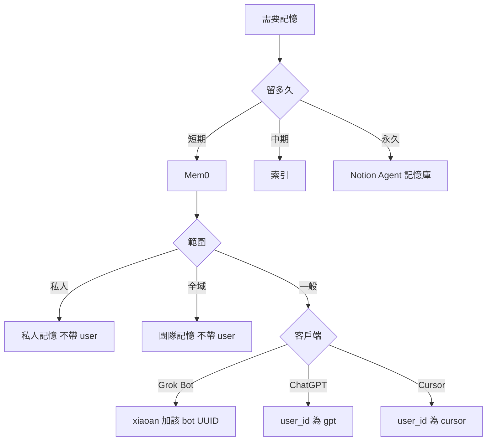

# 外部記憶管理

## 先判斷

讀寫前先做完。時效決定留多久；範圍只用於 Mem0。

1. 這筆是短期、中期，還是永久。
2. 短期才分私人、全域、一般。不要按 session 另開 id。

## 短／中／永久

| 層級 | 判斷 | 內容 | 去處 |
|------|------|------|------|
| **短期** | 數日～數週、綁任務、可改 | 偏好、近期決策、任務脈絡 | Mem0 |
| **中期** | 跨任務、要索引、不存全文、須去敏 | skills／templates 指向 | 知識庫索引或記憶鍵指向 repo |
| **永久** | 已蒸餾、要一直留、須去敏 | 穩定原則與事實 | Notion 的 Agent 記憶庫 |

會過期或還在改 → 短期。只留指向 → 中期。要一直留 → 永久。憑證與未去敏的內容不寫中期、永久。

同一件事只留一處。短期反覆命中、要一直留：寫進 Agent 記憶庫，Mem0 那筆改為 `已過時`。

## 身份

只用於 Mem0。永久記憶不套這張表。

| 範圍 | 庫 | 誰 | 怎麼帶 |
|------|----|----|--------|
| 私人 | `私人記憶` | 全部 | 不帶 user |
| 全域 | `團隊記憶` | 全部 | 不帶 user |
| 一般 | `團隊記憶` | 只有 Grok Bot | `user_id=xiaoan` 與該 bot 的 UUID。UUID 未填留佔位 |
| 一般 | `團隊記憶` | ChatGPT | `user_id=gpt`。所有 session 共用。不設 `agent_id` |
| 一般 | `團隊記憶` | Cursor | `user_id=cursor`。IDE 與 Cloud 所有 session 共用。不設 `agent_id` |

其他客戶端的一般 Mem0 沒有 `user_id` 就先問，不要仿造，也不要按 session 換。私人或全域若工具硬要身份欄，先停下來問，不要猜。

讀寫要分開帶：

- 全域：不帶 user、不帶 agent。搜尋若不能只留「沒有 user、也沒有 agent」的紀錄，先停下來問，不要把整庫當全域。
- 一般：一定帶上表的 user。Grok Bot 再加自己的 agent。不要省略身份去讀一般。

## 後端細節

選後端、Agent 記憶庫（Notion）欄位、Cursor Notion Memory、Mem0 通路與寫改刪流程：見 [backends.md](references/backends.md)。選**一個主後端**；跨後端須先說明；同一事實勿無計畫寫入多處。

## 讀取時機

- 使用者要求回想，或這一步依賴對話外的舊偏好、決策。
- 問題自己答得了，不讀。不要每則訊息搜。
- 新對話要不要先讀，只照當前客戶端那一份。沒寫先讀的，就不要掃。

## 讀取方法

1. 先定種類。
2. 永久：Agent 記憶庫，`狀態=有效` 且 `AI 可用`，再用關鍵字。不整庫拉。
3. 中期：打開索引指到的檔。不要把索引當全文。
4. 短期：Composio 用別名選帳，語意搜尋優先。私人不帶 user。全域不帶 user、不帶 agent；排除不了帶身份的紀錄就停下來問。一般一定帶該客戶端身份。
5. 沒有工具，或 MCP 連不上、要重新登入、呼叫失敗：先說哪個後端、什麼失敗。不要貼 token 或金鑰。不要改讀別種來充數。

## 寫入時機

- 使用者說記住，或指定種類，才寫。先說寫進哪一種。
- 先搜尋去重；有就更新。改或刪之前先顯示並取得同意。
- 短期反覆命中、要一直留：寫進永久，Mem0 那筆改 `已過時`。
- 不要伺機寫。同一件事不要同時留在兩種。
- 禁存完整對話、閒聊、推測、密碼、Token、金鑰、付款資料。失敗如實說，勿補造。

## 回應

- 讀到：後端 + 相關摘要  
- 無結果：查詢範圍 + 請補充或指定後端  
- 寫入：內容、後端、新增或更新  
- 未用記憶：一般不必宣告
- MCP 失敗：哪條連線、原因、這步有沒有做成  

## 依客戶端

只讀當前環境那一份。內建記憶跟 Mem0 不是同一套。

| 環境 | 檔 |
|------|-----|
| Grok Bot | [grok-bot.md](references/grok-bot.md) |
| ChatGPT 網頁與 App | [chatgpt.md](references/chatgpt.md) |
| Codex | [codex.md](references/codex.md) |
| Cursor IDE 與 Cloud | [cursor.md](references/cursor.md) |
