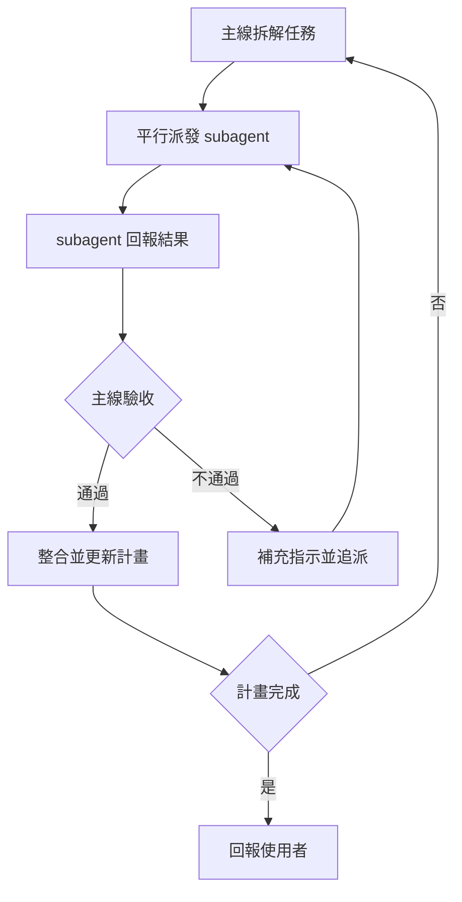

# my-subagent

主線負責拆解、派發、驗收；subagent 只負責執行一個明確的子任務。

## 何時用

- 任務能拆成互不依賴的子任務，平行做比較快。
- 單一小任務、有先後依賴的步驟，直接自己做，不要派。
- 需要多角色討論（如 PM、工程師各說各話）時，必須用獨立 subagent 或獨立 CLI 執行緒，不要由單一模型輪流扮演多個角色。沒有 subagent 也沒有 CLI 時，告知使用者並提供替代方案。

## 主線

1. 先拆任務，每項寫清楚：目標、範圍（可動哪些檔）、完成標準、要回報什麼。
2. 沒有依賴的子任務同時派發；有依賴的等前置完成。
3. 不同 subagent 不要改同一個檔案。
4. 不要把整份對話丟給 subagent，只給它需要的背景。

## 驗收

- 結果交回主線驗證，不能只信 subagent 說「完成」。
- 對照完成標準檢查：改了什麼、是否越界、有沒有實際跑過驗證。
- 不合格就補上具體指示，追派同一個或新的 subagent。

## 收尾

- 完成後整合結果，回報：做了什麼、驗證了什麼、哪些沒做成。
- 盡可能完成整份計畫。遇到無法自行解決的阻礙（缺權限、需要使用者決定）才停，並說明卡在哪。
- 失敗如實說，不要把未驗證的結果說成完成。
