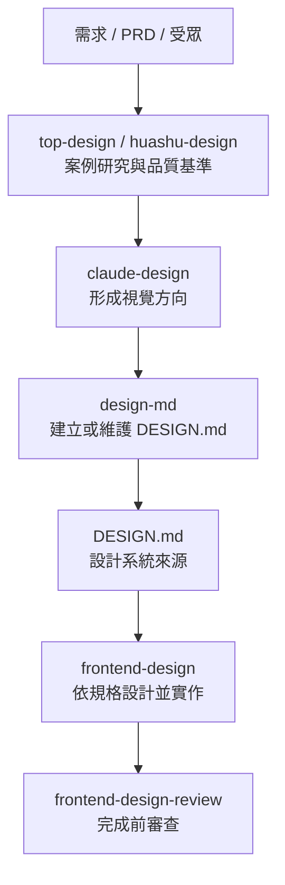

# 介面設計流程

建立新網站或介面時，先研究再寫成規格，最後才寫畫面。不要直接跳到程式碼。只讀對得上的那一階，不要一次全讀。

## 各階段

- `top-design`：高品質網站的設計方法與品質基準。
- `huashu-design`：需要案例時，搜尋真實優質網站並拆解。
- `claude-design`：把研究轉成自己的視覺方向，不照抄案例。
- `design-md`：把設計決定寫成 `DESIGN.md`。定義設計系統，不負責前端實作。
- `frontend-design`：讀既有 `DESIGN.md`，依規格設計並實作。
- `frontend-design-review`：完成前檢查是否符合設計系統、不同螢幕寬度、無障礙與視覺品質。

## 使用原則

1. 已有成熟的 `DESIGN.md`，就以它為準，不必重跑案例研究。
2. 新專案或重新設計，才從案例研究與視覺方向開始。
3. 實作不得另發明顏色、字級、間距、圓角、元件系統。要改底層規則，先更新 `DESIGN.md`。
4. 案例只用來取方向與品質基準，不複製單一網站。
5. 衝突時：專案需求，然後既有 `DESIGN.md`，然後最接近的 skill。
6. Skill 可以建議或審查，不得默默改掉已定的需求或設計決策。
7. React、Vue、WordPress、Tailwind、CSS、Flutter、SwiftUI 只是做法，不要拿來改設計系統。
8. 沒有明確需要時，不要跑 skill 裡的腳本、安裝器、網路或會刪檔的動作。

## 其他已安裝

對上才用，不要因為有裝就讀。

- `shadcn`：用 shadcn/ui 做元件時。
- `web-design-guidelines`：要對網頁介面準則時。
- `ui-ux-pro-max` 略過。核心依賴 Python，本套件腳本只用 Node。
