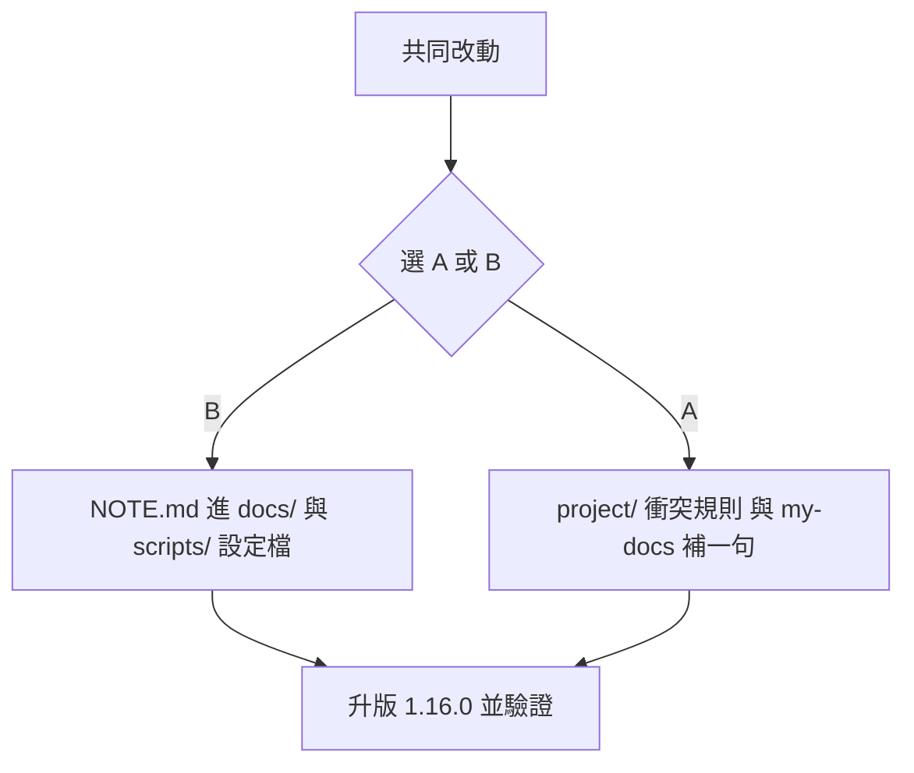

# 計畫：my-codebase-init 的 codebase 結構

日期：`2026-10-31` · 狀態：**建議 B（加生態慣例優先），待使用者確認** · 對象：[`my-plugins/my-workflow/skills/my-codebase-init`](../../my-plugins/my-workflow/skills/my-codebase-init/SKILL.md)

## 背景與問題

`my-codebase-init` 沒有定義「codebase 長什麼樣」：

- 檔案散在各步驟建立，沒有一張總圖。
- `AGENTS.md` 範本的「目錄架構」只是空欄位（`<目錄>/ <用途>`）。
- 真正的骨架靠外部模板目錄，雲端容器拿不到。
- 結果：根目錄很亂，新舊專案也沒有結構可對照。

## 現況

```text
專案根/
├─ AGENTS.md ········ 步驟4   ┐
├─ README.md ········ 步驟4   │ 入口：有
├─ NOTE.md ·········· 步驟4   │
├─ CLAUDE.md ········ 步驟5   ┘
├─ .gitignore ······· 步驟4
├─ .agents/skills/ ·· 步驟4（選用）
├─ .gitattributes ··· 步驟7  ┐
├─ release.config.json       │ 發佈：有，只給打包專案
├─ scripts/pack-release.mjs  │
├─ docs/RELEASE_SPEC.md ·····┘
└─ src/ app/ tests/ ... ← 沒定義（只靠「複製模板骨架」）
```

五層裡只有兩層有定義：

```text
┌ 入口層  誰先讀        AGENTS / README / NOTE / CLAUDE   ✔ 有
├ 知識層  為什麼這樣    docs/（規格、決策、手冊）          ✘ 沒定義
├ 程式層  實際內容      src|app / tests / 設定             ✘ 沒定義
├ 治理層  給 agent 用   .agents/skills、.claude/、scripts/ △ 只有 .agents
└ 發佈層  怎麼交付      .gitattributes / release.* / dist ✔ 有（打包專案）
```

## 已決定

- **AGENTS.md 是通用規則的 SSOT**；**CLAUDE.md 只引用它**（第一行 `@AGENTS.md`），用 Claude 才建。
- **根目錄只留入口**：`AGENTS.md`、`README.md`、`CLAUDE.md`（修正見下方「建議」：語言生態規定的檔照放根目錄）。
- **通用核心、保持簡單**：這次只做通用那層，型態細節（PHP 打包等）走既有的步驟 7。
- **不新增 `STRUCTURE.md`**；結構寫進 `AGENTS.md` 的「目錄架構」節。
- **不寫結構檢查腳本**，只在 init 驗證步驟人工對照 `ls` 與 `AGENTS.md`。
- 已有專案：**只記錄現況，不搬動專案原有目錄**。
- 不為結構建空目錄，有需要才建。

## 選項 A：`project/` 包裝

```text
<專案>/
├─ AGENTS.md  README.md  CLAUDE.md       ← 只有入口
├─ project/                              ← 所有非入口檔
│  ├─ NOTE.md
│  ├─ docs/        (README.md、RELEASE_SPEC.md)
│  └─ release/     (release.config.json、pack-release.mjs)
├─ src|app/  tests/                      ← 專案原有，不搬動
└─ (隱藏) .gitignore .gitattributes .agents/ .claude/
```

- 優點：最整齊；發佈排除只要一行 `/project export-ignore`。
- 缺點：`project/` 是通用詞，容易和專案自己的目錄衝突；不是 `docs/`、`scripts/` 的慣例位置；專案已有根 `docs/` 時會出現兩個文件目錄，需要額外規則；改動約 9 處。

## 選項 B：慣例 `docs/` + `scripts/`（建議）

```text
<專案>/
├─ AGENTS.md  README.md  CLAUDE.md       ← 只有入口
├─ docs/
│  ├─ NOTE.md                            交接紀錄
│  └─ RELEASE_SPEC.md                    發佈規格（僅打包部署）
├─ scripts/
│  ├─ pack-release.mjs                   僅打包部署
│  └─ release.config.json
├─ src|app/  tests/                      ← 專案原有，不搬動
└─ (隱藏) .gitignore .gitattributes .agents/ .claude/
```

- 優點：根目錄同樣只剩三個入口；沒有新概念；舊專案常已有 `docs/`、`scripts/`，不會衝突；改動約 4 處。
- 缺點：沒有「單一目錄裝全部」的整齊感；發佈排除要列 `docs`、`scripts` 兩行（本來就是現在的寫法）。

## 比較

| 項目 | A `project/` | B `docs/` + `scripts/` |
|------|:-----------:|:---------------------:|
| 根目錄只留入口 | ✔ | ✔ |
| 新概念 | 要學 `project/` | 無 |
| 與舊專案目錄衝突 | 可能（`project/`、雙 `docs/`） | 不會 |
| 改動量 | 約 9 處 | 約 4 處 |
| 發佈排除 | 一行 `/project` | `docs`、`scripts` 兩行 |
| 符合一般慣例 | 否 | 是 |

## 建議：B + 生態慣例優先

目標是**通用、最接地氣、每個 agent 和工程師一看就懂**。最可靠的不是自創結構，而是大家早就在用的慣例：`README` 給人看、`docs/` 放文件、`scripts/` 放腳本、`src/`、`tests/` 放程式。

```text
<專案>/
├─ README.md   AGENTS.md   CLAUDE.md     ← 入口（CLAUDE.md 只在用 Claude）
├─ package.json / composer.json …       ← 語言生態規定放根目錄的，照放
├─ LICENSE  CHANGELOG.md  .gitignore     ← 業界慣例的根目錄檔，照放
├─ docs/                                  ← 所有文件
│  ├─ NOTE.md            交接紀錄
│  ├─ adr/               架構決策（有才建）
│  ├─ plans/             計畫（有才建）
│  └─ RELEASE_SPEC.md    發佈規格（僅打包部署）
├─ scripts/                               ← 所有腳本與其設定
│  ├─ pack-release.mjs
│  └─ release.config.json
└─ src/ tests/  或框架自己的結構           ← 跟語言／框架慣例，不改
```

**兩條原則**

1. **生態慣例優先**：「根目錄只留入口」修正為「**根目錄只留入口與生態規定的檔**」。`package.json`、`composer.json`、`LICENSE`、`.gitignore` 等必須在根目錄，工具才找得到，硬搬會壞。程式目錄跟語言與框架慣例（Node 用 `src/`、WordPress 照外掛結構、Laravel 照 `app/`），不重新發明。
2. **我們只加兩個目錄**：`docs/`、`scripts/`。名字人人懂，不需要解釋。

**取捨**：`release.config.json` 放 `scripts/` 旁（腳本與設定在一起，好懂）；比較正統的是設定檔放根目錄，但會讓根目錄變亂，和目標衝突。

**為什麼不選 A**：`project/` 要額外說明，和既有 `docs/` 會出現兩個文件目錄，也不是任何框架的慣例。

## 待決定

- [ ] 確認採用「B + 生態慣例優先」，確認後依下方實作清單執行。

## 實作清單



**共同**
- `my-codebase-init/SKILL.md`：新增「codebase 結構」一節（文字結構圖、五層）；步驟 3 補「讀出實際目錄樹與各頂層目錄用途」；驗證步驟補「`ls` 對照 `AGENTS.md` 目錄架構」。
- `templates/AGENTS.md`：「目錄架構」改成通用核心樹範本，並寫明「根目錄只留入口與生態規定的檔；程式結構跟語言與框架慣例」。
- 「既有檔案：轉換」補：根目錄舊檔搬到新位置、更新所有引用、不搬動專案原有目錄。

**B 專屬**
- `NOTE.md → docs/NOTE.md`；`release.config.json → scripts/`；規格書 `docs/RELEASE_SPEC.md`。
- `pack-release.mjs`：設定檔預設讀「腳本同目錄」，其次 repo 根，`--config` 照舊。
- templates 與 `my-codebase-init-claude` 的路徑同步。

**A 專屬**
- 另需：`project/` 衝突規則、雙 `docs/` 規則、`my-docs` 補一句、內建禁則加 `^project(/|$)`、`.gitattributes` 改 `/project export-ignore`。

**最後**：版本升 `1.16.0`（8 處同號）。

## 驗證計畫

- `node my-plugins/my-workflow/scripts/check-release.mjs` 通過；`pack-release.test.mjs` 全過（含新測試）。
- 實測 1（新專案）：根目錄只有入口 + 隱藏檔，不建空目錄。
- 實測 2（舊格式專案）：舊檔搬到新位置，舊內容無遺失，引用同步更新，`--dry-run` 結果與搬動前一致。
- 實測 3（打包專案）：`--dry-run` 包內不含 `docs/`、`scripts/`（B）或 `project/`（A）。

## 風險

- 腳本設定檔預設位置改變：既有專案設定檔在根目錄仍可用（fallback）。
- 專案已有 `docs/` 或 `project/`：沿用既有、不覆蓋，先問使用者。
- 舊專案的 `AGENTS.md`、README、CI 腳本引用舊路徑：轉換時全專案 `grep` 並更新，否則會斷連結。
- 只有人工對照、沒有自動檢查：結構漂移靠下次轉換或審查發現；之後想自動化再加輕量腳本。
