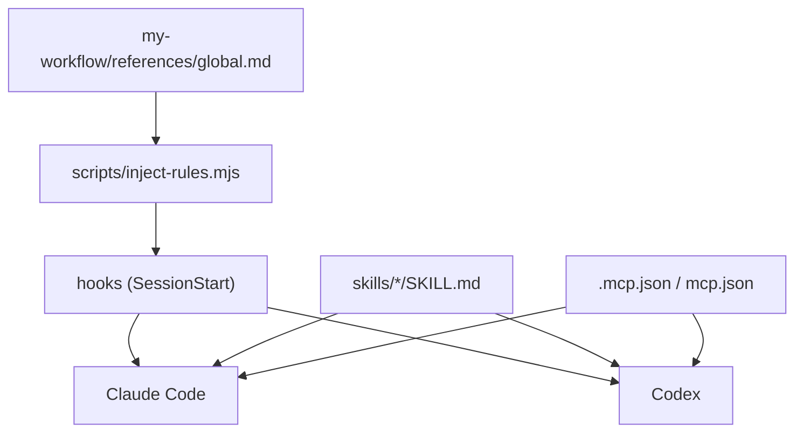

# my-workflow — 開發準則

> **版本**：`1.16.0`（[`pack.yaml`](pack.yaml)）
> 版本標籤 6 處同號（manifest **不寫 version**，market 以 commit 自動更新），清單與流程見 [`docs/RELEASE.md`](docs/RELEASE.md)；用 `scripts/check-release.mjs` 檢查。

給**開發這個 plugin 的人與 Agent**。使用者怎麼安裝、各平台支援程度見 [`README.md`](README.md)。

## 目標

需求：把個人工作流（規則、記憶、審查、PRD、文件、提交、雲端代理等）封裝成可重用 plugin，不必每次重新交代。

1. **單一來源、通用格式**：本目錄是唯一 SSOT，Claude、OpenAI（Codex、ChatGPT）、Gemini 共用。SSOT 一律用開放通用格式：skill 用 Agent Skills（`skills/<name>/SKILL.md`），plugin 用 agent-plugins（根目錄 `plugin.json`）。各供應商專用檔（`.claude-plugin/plugin.json`、`hooks/hooks.json`、`hooks/codex.json`、`gemini-extension.json`、`GEMINI.md`）只引用通用格式，不複製內容。
2. **規則不靠本機腳本**：全域規則在入口 skill 的 [`references/global.md`](skills/my-workflow/references/global.md)。有 hook 的平台（Claude Code、Codex）開對話注入，其他平台載入入口 skill 時自己讀；**任何平台都不能只靠 hook 才拿得到規則**。其餘規則在 `skills/my-workflow/references/index.yaml` 的 `rules` 區登記，伺機載入。
3. **Skills 按需載入**：入口 [`skills/my-workflow`](skills/my-workflow/SKILL.md) 依情境只載對上的一個。
4. **Composio MCP 隨 plugin**：OAuth 登入，repo 不放金鑰。
5. **誠實標示驗證程度**：沒實測的標「未驗證」。

## 結構



| 路徑 | 用途 |
|------|------|
| `.claude-plugin/plugin.json` | Claude Code manifest |
| `plugin.json` | Codex 可攜 manifest（agent-plugins 格式，`extensions.com.openai.hooks` 指向 `hooks/codex.json`）。不放舊式 `.codex-plugin/`（Codex **未驗證**） |
| `.mcp.json` / `mcp.json` | Composio MCP（Claude／Codex 各一份格式） |
| `hooks/hooks.json` / `hooks/codex.json` | SessionStart 注入（Claude `${CLAUDE_PLUGIN_ROOT}`，Codex `${PLUGIN_ROOT}`） |
| `skills/my-workflow/references/global.md` | 全域規則（SSOT） |
| `skills/my-workflow/references/index.yaml` | 入口路由索引（`when`、`keywords`） |
| `rules/<name>.md` | 情境規則，伺機載入 |
| `skills/<name>/SKILL.md`、`skills/<name>/rules/` | 各 skill 與其專屬規則；`name` 與資料夾名一致，平鋪不巢狀 |
| `gemini-extension.json`、`GEMINI.md` | Gemini CLI extension，指到 `skills/`（**未驗證**） |
| `scripts/` | `inject-rules.mjs`（注入 global + 入口 skill + 索引，路徑改絕對）、`check-release.mjs` |
| `docs/RELEASE.md` | 發布流程與無法更新排除 |
| `docs/NOTE.md` | 交接紀錄。接手先讀，做完一段更新 |
| `docs/plans/` | 計畫（`YYYY-MM-DD-<主題>.md`，照 `my-docs`） |

repo 根的 `AGENTS.md`／`CLAUDE.md` 只做導覽；plugin 是自己的專案，準則與交接都在這裡。

Claude Code plugin **無法提供 rules**（plugin 內 `CLAUDE.md` 不載入），所以用 SessionStart hook 注入 `additionalContext`。hook 不能呼叫 Skill 工具，為了「開對話就載入入口」，同一腳本也注入入口 `SKILL.md` 與 `index.yaml`（每次對話固定成本約 8,000 字元）。腳本每次直接讀檔，改內容不必另外同步。

## 規則

- 只改 `my-plugins/my-workflow/`。
- 新增 skill 或 plugin 設定先寫通用格式（Agent Skills、agent-plugins），再視需要加供應商專用檔引用它。`SKILL.md` frontmatter 只用通用欄位，不放單一供應商才認得的欄位；某供應商需要特殊設定時放它自己的檔。
- 新 skill：建 `skills/<name>/SKILL.md`，在 `index.yaml` 補 `when`、`keywords`，更新 README 元件表。新規則：建 `rules/<name>.md`，在 `index.yaml` 的 `rules` 區補。
- 版本標籤以 `pack.yaml` 為準。`.claude-plugin/plugin.json`、`plugin.json` **不寫 `version`**（會凍結自動更新）；各 `SKILL.md` 不手寫 `version`。
- 常駐規則寫成事實陳述（官方建議注入內容不用命令式）；改規則只改對應檔。
- skill 之間用相對連結；`rules/`、`references/` 在 plugin 根，從 `skills/<name>/` 用 `../../`。
- 金鑰、token、`.env` 不進 repo。MCP 優先 OAuth；必須用金鑰時走 `userConfig`（`sensitive: true`）或使用者端設定。
- 腳本用 `.mjs`，要有 `--help`、非零失敗碼，預設不覆寫既有檔。
- 不帶入 WIP、`.playwright-mcp`、意外的 `*.min.js`。路徑大小寫與實際一致。
- 不上架公開市集。

## 安裝與更新

使用者要安裝、更新或檢查時載入 [`my-plugin-install`](skills/my-plugin-install/SKILL.md)，它依平台選方法；平台方法有變只改它的 `references/`。

manifest 不寫 `version`，Claude 以 commit 當版本，`main` 每次更新都偵測得到（需使用者開 **Sync automatically** 或 `autoUpdate`；Codex、Gemini 更新行為**未驗證**）。版本標籤只給人看，發布時才升。「看不到新版、更新反灰、指令不認得」照 [`docs/RELEASE.md`](docs/RELEASE.md)「無法更新怎麼排除」。

## 發布

一律照 [`docs/RELEASE.md`](docs/RELEASE.md)：使用者只拿 `main`，只推 `develop` 等於沒發布；版本 6 處同號、`check-release.mjs` 通過才 commit；合併 `main` 後 `check-release.mjs --remote` 並在乾淨 `CLAUDE_CONFIG_DIR` 實裝確認。被 `.gitignore` 擋住的檔會讓使用者缺檔，檢查腳本會抓。

## 驗證

```text
node my-plugins/my-workflow/scripts/check-release.mjs
node my-plugins/my-workflow/scripts/inject-rules.mjs | python3 -m json.tool
```

另確認：`.json` 合法、`SKILL.md` 的 `name` 與資料夾一致、`index.yaml` 的 skill 都存在、markdown 相對連結都指得到。

## 記憶

走 `skills/my-memory`。客戶端規則在其 `references/`，只讀當前環境那一份（Claude 各環境 `claude.md`、Grok Bot `grok-bot.md`、ChatGPT `chatgpt.md`、Codex `codex.md`）。
