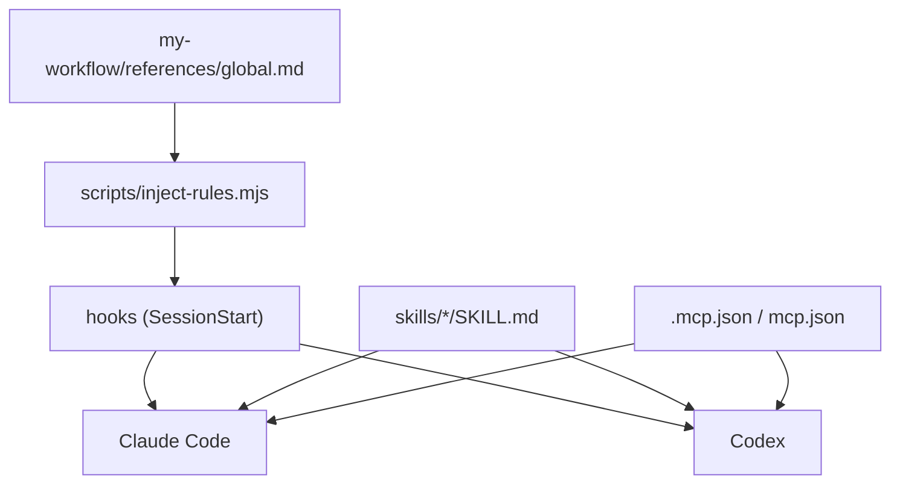

# my-workflow — 開發準則

> **版本**：`1.16.0`（[`pack.yaml`](pack.yaml)）
> 版本標籤 6 處要同一個號（manifest **不寫 version**，market 以 commit 自動更新），清單與發布流程見 [`docs/RELEASE.md`](docs/RELEASE.md)；用 `scripts/check-release.mjs` 檢查。

這份給**開發這個 plugin 的人與 Agent** 看。使用者怎麼安裝見 [`README.md`](README.md)。

## 需求與目標

**需求**：把個人慣用的工作流程（規則、記憶、審查、PRD、文件、提交、雲端代理等）封裝成可重用的 plugin，不必每次重新交代。

**目標**

1. **單一來源**：`my-plugins/my-workflow/` 是唯一 SSOT。內容只維護一份，Claude、OpenAI（Codex、ChatGPT）、Gemini 共用；各平台只多一份薄薄的定義檔指到它。
2. **規則不靠本機腳本**：全域規則放在入口 skill 裡的 [`references/global.md`](skills/my-workflow/references/global.md)。有 hook 的平台（Claude Code、Codex）開對話就注入，其他平台（網頁、Cowork、ChatGPT、Gemini）載入入口 skill 時自己讀；**任何平台都不能只靠 hook 或本機腳本才拿得到規則**。其餘規則（`rules/*.md`、各 skill 的 `rules/`）在 `skills/my-workflow/references/index.yaml` 的 `rules` 區登記 `when`／`keywords`，伺機載入。
3. **Skills 按需載入**：入口 [`skills/my-workflow`](skills/my-workflow/SKILL.md) 讓 agent 依情境載入，其餘子 skill 只載對上的那一個。
4. **Composio MCP 隨 plugin 提供**：用 OAuth 登入，連線設定寫在 plugin 內，repo 不放任何金鑰。
5. **誠實標示驗證程度**：靜態看起來對 ≠ 已在該 app 跑過。沒實測的就標「未驗證」。

## 結構



| 路徑 | 用途 |
|------|------|
| `.claude-plugin/plugin.json` | Claude Code manifest |
| `plugin.json` | Codex 讀的可攜 manifest（agent-plugins 格式，`extensions.com.openai.hooks` 指向 `hooks/codex.json`）。舊式 `.codex-plugin/plugin.json` 只是相容 fallback，不放（Codex 實機**未驗證**） |
| `.mcp.json` / `mcp.json` | Composio MCP（Claude／Codex 各一份格式） |
| `hooks/hooks.json` / `hooks/codex.json` | SessionStart 注入 rules（Claude 用 `${CLAUDE_PLUGIN_ROOT}`，Codex 用 `${PLUGIN_ROOT}`） |
| `skills/my-workflow/references/global.md` | 全域規則（SSOT）。hook 平台注入，其餘平台載入入口 skill 時讀 |
| `rules/<name>.md` | 情境規則（git、code-review 等），伺機載入 |
| `skills/<name>/rules/*.md` | 該 skill 專屬規則，載入 skill 時一併讀 |
| `skills/<name>/SKILL.md` | 各 skill，`name` 與資料夾名一致，平鋪不巢狀 |
| `skills/my-workflow/references/index.yaml` | 入口路由索引（`when`、`keywords`） |
| `gemini-extension.json`、`GEMINI.md` | Gemini CLI extension 定義與入口（指到 `skills/`，不複製內容；**未驗證**） |
| `scripts/` | `inject-rules.mjs`（注入 rules + 入口 skill + 索引，相對路徑改為絕對路徑）、`check-release.mjs`（發布前檢查） |
| `docs/RELEASE.md` | 發布流程與「無法更新」排除 |
| `docs/NOTE.md` | 這個 plugin 的交接紀錄：目前狀態、進行中、待確認。接手先讀，做完一段更新 |
| `docs/plans/` | 計畫（`YYYY-MM-DD-<主題>.md`），照 `my-docs` 的 docs/ 結構 |

repo 根的 `AGENTS.md`／`CLAUDE.md` 只做目錄導覽；每個 plugin 是自己的專案，開發準則與交接紀錄都在這裡。

Claude Code plugin **無法提供 rules**，plugin 內的 `CLAUDE.md` 不會載入，所以改用 SessionStart hook 注入 `additionalContext`。hook 不能呼叫 Skill 工具，為了「開對話就載入入口、不用斜線命令」，同一個腳本也注入入口 `SKILL.md` 與 `index.yaml`（全域規則拆小後約 4,500 字元，每次對話固定成本）。改入口或索引後不用另外同步，腳本每次直接讀檔。

## 規則

- 只改 `my-plugins/my-workflow/`。
- 新 skill：建立 `skills/<name>/SKILL.md`（`name` 與資料夾名一致），在 `skills/my-workflow/references/index.yaml` 補 `when`、`keywords`，並更新 README 的元件表。
- 版本標籤以 `pack.yaml` 為準，其餘見 [`docs/RELEASE.md`](docs/RELEASE.md)。`.claude-plugin/plugin.json`、`plugin.json` **不寫 `version`**（有寫就凍結自動更新）。各 `SKILL.md` 頂層不手寫 `version`。
- 常駐規則寫成事實陳述（hook 注入的內容，官方建議不用命令式）；改規則只改對應的規則檔；新增規則要在 `skills/my-workflow/references/index.yaml` 的 `rules` 區補 `when`、`keywords`。
- skill 之間用相對連結（`../my-memory/SKILL.md`）。`rules/`、`references/` 在 plugin 根目錄，從 `skills/<name>/` 用 `../../` 指到。
- 金鑰、token、`.env` 不進 repo。MCP 優先用 OAuth；必須用金鑰時走 `userConfig`（`sensitive: true`）或使用者端設定。
- 專案腳本用 `.mjs`，要有 `--help`、非零失敗碼，預設不覆寫既有檔。
- 不帶入 WIP、`.playwright-mcp`、意外的 `*.min.js`。路徑大小寫與實際目錄一致。
- 不上架公開市集。

## 各環境

| 環境 | rules | skills | MCP | 驗證狀態 |
|------|-------|--------|-----|----------|
| Claude Code | SessionStart hook | plugin | `.mcp.json` | **已實測**（雲端 Claude Code）：marketplace 加入、安裝、`claude plugin validate`、hook 注入；Desktop 介面操作、Composio OAuth **未驗證** |
| Codex | SessionStart hook（`hooks/codex.json`） | plugin | `mcp.json` | **未驗證**；hook 輸出格式、OAuth（`dcr`）登入需實機確認 |
| claude.ai 網頁／Desktop 聊天／Cowork | 不執行 hook；載入入口 skill 時讀 `references/global.md` | plugin（帳號同步） | plugin 內 `.mcp.json` | 規則走 skill 的路徑**未驗證**；plugin 安裝見 README |
| ChatGPT 網頁 | 不支援 hook；把 `global.md` 貼到自訂指示 | 上傳 skill 資料夾 | — | 未驗證 |
| Gemini CLI | 不靠 hook；`GEMINI.md` 指到 `global.md` | extension（`gemini-extension.json`） | — | **未驗證** |
| Gemini 網頁 | 把 `global.md` 貼到 Gem 指示 | 無匯入機制，只能貼需要的 skill 內容 | — | 未驗證 |

## 安裝與更新

使用者要安裝、更新或檢查 plugin 時，載入 [`my-plugin-install`](skills/my-plugin-install/SKILL.md)：它依目前平台自動選方法（Claude Code、Claude 網頁與 Cowork、雲端 session、Codex、無 plugin 機制的平台）。平台方法有變時改該 skill 的 `references/`，不要把步驟散寫到其他檔。

**自動更新**：`.claude-plugin/plugin.json` 與 `plugin.json` 不寫 `version`，Claude 以 commit 當版本，`main` 每次更新 market 都偵測得到，不必 bump 也不會「看不到新版」（需使用者在 marketplace 開 **Sync automatically** 或 `autoUpdate`；Codex 與 Gemini 的更新行為**未驗證**）。版本標籤（`pack.yaml` 等 6 處）只給人看，發布時才升（見 [`docs/RELEASE.md`](docs/RELEASE.md)）。使用者回報「看不到新版、更新按鈕反灰、指令不認得」時，照該文件的「無法更新怎麼排除」處理。

## 發布

**發布一律照 [`docs/RELEASE.md`](docs/RELEASE.md)**，重點：

- 使用者只會拿到 `main`。只推 `develop` 等於沒發布。
- 發布時版本標籤 6 處同號，`node my-plugins/my-workflow/scripts/check-release.mjs` 通過才 commit。
- 合併到 `main` 後跑 `check-release.mjs --remote`，並在乾淨環境（暫存的 `CLAUDE_CONFIG_DIR`）實裝確認版本。
- 新增的檔案若被 `.gitignore` 擋住，本機正常、使用者卻缺檔；檢查腳本會抓出來。

## 驗證

在 repo 根：

```text
node my-plugins/my-workflow/scripts/check-release.mjs
node my-plugins/my-workflow/scripts/inject-rules.mjs | python3 -m json.tool
```

另需確認：所有 `.json` 合法、每個 `SKILL.md` 的 `name` 與資料夾一致、`index.yaml` 的 skill 名都存在、markdown 相對連結都指得到檔案。

## 記憶

走 `skills/my-memory`。讀要有目的；寫入要確認；禁止憑證、token、金鑰。客戶端規則在 `skills/my-memory/references/`，只讀當前環境那一份：

| 環境 | 檔 |
|------|-----|
| Claude Code／Desktop／claude.ai／雲端 session | `claude.md` |
| Grok Bot（xAI App） | `grok-bot.md` |
| ChatGPT 網頁與 App | `chatgpt.md` |
| Codex | `codex.md` |
