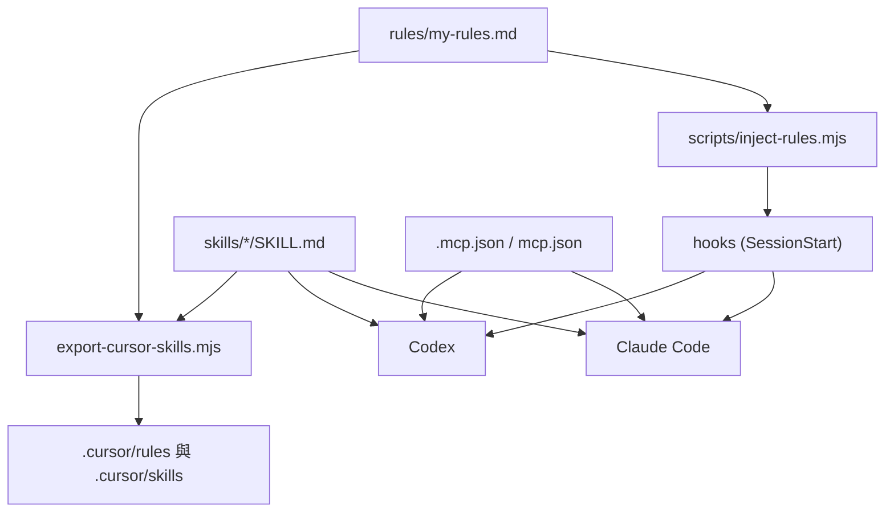

# my-workflow — 開發準則

> **版本**：`1.6.0`（[`pack.yaml`](pack.yaml)）
> 須與 [`.claude-plugin/plugin.json`](.claude-plugin/plugin.json)、[`plugin.json`](plugin.json)、[`references/index.yaml`](references/index.yaml)、toolkit [`project.json`](../../project.json) 同一個號。

這份給**開發這個 plugin 的人與 Agent** 看。使用者怎麼安裝見 [`README.md`](README.md)。

## 需求與目標

**需求**：把個人慣用的工作流程（規則、記憶、審查、PRD、文件、提交、雲端代理等）封裝成可重用的 plugin，不必每次重新交代。

**目標**

1. **單一來源**：`my-plugins/my-workflow/` 是唯一 SSOT。內容只維護一份，Claude Code、Codex、Cursor 共用。
2. **常駐規則是真 rules**：通用規則放 [`rules/my-rules.md`](rules/my-rules.md)，開新對話就生效，不靠 agent 臨時想到才載。
3. **Skills 按需載入**：入口 [`skills/my-workflow`](skills/my-workflow/SKILL.md) 讓 agent 依情境載入，其餘子 skill 只載對上的那一個。
4. **Composio MCP 隨 plugin 提供**：用 OAuth 登入，連線設定寫在 plugin 內，repo 不放任何金鑰。
5. **誠實標示驗證程度**：靜態看起來對 ≠ 已在該 app 跑過。沒實測的就標「未驗證」。

## 結構



| 路徑 | 用途 |
|------|------|
| `.claude-plugin/plugin.json` | Claude Code manifest |
| `plugin.json` | Codex 可攜 manifest；hooks 指向 `hooks/codex.json` |
| `.mcp.json` / `mcp.json` | Composio MCP（Claude／Codex 各一份格式） |
| `hooks/hooks.json` / `hooks/codex.json` | SessionStart 注入 rules（Claude 用 `${CLAUDE_PLUGIN_ROOT}`，Codex 用 `${PLUGIN_ROOT}`） |
| `rules/my-rules.md` | 常駐規則全文（SSOT） |
| `skills/<name>/SKILL.md` | 各 skill，`name` 與資料夾名一致，平鋪不巢狀 |
| `references/index.yaml` | 入口路由索引（`when`、`keywords`） |
| `scripts/` | `inject-rules.mjs`、`export-cursor-skills.mjs` |

Claude Code plugin **無法提供 rules**，plugin 內的 `CLAUDE.md` 不會載入，所以改用 SessionStart hook 注入 `additionalContext`。

## 規則

- 只改 `my-plugins/my-workflow/`。`.cursor/` 由匯出腳本產生，**勿手改**。
- 新 skill：建立 `skills/<name>/SKILL.md`（`name` 與資料夾名一致），在 `references/index.yaml` 補 `when`、`keywords`，並更新 README 的元件表。
- 版本寫 `pack.yaml`，同步上面列的其他四處。各 `SKILL.md` 頂層不手寫 `version`。
- 常駐規則寫成事實陳述（hook 注入的內容，官方建議不用命令式）；改規則只改 `rules/my-rules.md`。
- skill 之間用相對連結（`../my-memory/SKILL.md`）。`rules/`、`references/` 在 plugin 根目錄，從 `skills/<name>/` 用 `../../` 指到。
- 金鑰、token、`.env` 不進 repo。MCP 優先用 OAuth；必須用金鑰時走 `userConfig`（`sensitive: true`）或使用者端設定。
- 專案腳本用 `.mjs`，要有 `--help`、非零失敗碼，預設不覆寫既有檔。
- 不帶入 WIP、`.playwright-mcp`、意外的 `*.min.js`。路徑大小寫與實際目錄一致。
- 不上架公開市集。

## 各環境

| 環境 | rules | skills | MCP | 驗證狀態 |
|------|-------|--------|-----|----------|
| Claude Code | SessionStart hook | plugin | `.mcp.json` | 靜態檢查；實際安裝與 hook 注入**未驗證** |
| Codex | SessionStart hook（`hooks/codex.json`） | plugin | `mcp.json` | **未驗證**；hook 輸出格式、OAuth（`dcr`）登入需實機確認 |
| Cursor（含 Cloud） | `.cursor/rules/my-rules.mdc`（匯出） | `.cursor/skills`（匯出） | 使用者自設 | 匯出腳本已本機跑過 |
| ChatGPT 網頁 | 不支援 hook；手動貼 `rules/my-rules.md` 到自訂指示 | 上傳 skill 資料夾 | — | 未驗證 |

## 驗證

在 repo 根：

```text
node my-plugins/my-workflow/scripts/inject-rules.mjs | python3 -m json.tool
node my-plugins/my-workflow/scripts/export-cursor-skills.mjs <暫存目錄> --dry-run
claude plugin validate ./my-plugins/my-workflow
```

另需確認：所有 `.json` 合法、每個 `SKILL.md` 的 `name` 與資料夾一致、`index.yaml` 的 skill 名都存在、markdown 相對連結都指得到檔案。

匯出到本 repo 給 Cursor Cloud 用：

```text
node my-plugins/my-workflow/scripts/export-cursor-skills.mjs . --force
```

## 記憶

走 `skills/my-memory`。讀要有目的；寫入要確認；禁止憑證、token、金鑰。客戶端規則在 `skills/my-memory/references/`，只讀當前環境那一份：

| 環境 | 檔 |
|------|-----|
| Grok Bot（xAI App） | `grok-bot.md` |
| ChatGPT 網頁與 App | `chatgpt.md` |
| Codex | `codex.md` |
| Cursor IDE 與 Cloud | `cursor.md` |
