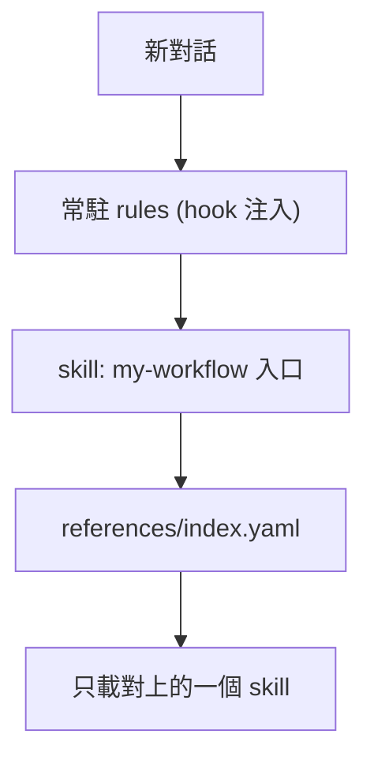

# my-workflow

VECTOR LTD 私人工作流 plugin：常駐規則 + 14 個按需載入的 skills + Composio MCP。版本 `1.11.0`（[`pack.yaml`](pack.yaml)）。不上架公開市集。開發與維護見 [`AGENTS.md`](AGENTS.md)。

**名詞**：`my-plugins/my-workflow/`（本目錄）是 **plugin 本體**；`my-agent-toolkit` 是放它的私有 GitHub repo，也是 marketplace 名稱，**不是 plugin**。安裝指令寫成 `my-workflow@my-agent-toolkit`。

## 支援

| 環境 | 做法 | 程度 |
|------|------|------|
| Claude Code／Desktop Code 分頁（本機） | plugin | rules、skills、Composio MCP 皆有 |
| Desktop 聊天／Cowork | Customize → Plugins → Add marketplace | 僅 skills、MCP；**不執行 hook，rules 不自動注入**（未驗證） |
| Codex | plugin | 結構支援，**未驗證** |
| ChatGPT | 手動貼規則、上傳 skill | 無 plugin 機制，無自動 rules、無 MCP |

## 安裝（手動）

來源：[VECTOR-COOL/my-agent-toolkit](https://github.com/VECTOR-COOL/my-agent-toolkit)（私有，`main` 分支）。本機需能讀取該 repo（`gh auth login` 或 SSH key）。

### Claude Code ／ Desktop Code 分頁

```text
/plugin marketplace add https://github.com/VECTOR-COOL/my-agent-toolkit
/plugin install my-workflow@my-agent-toolkit
```

裝完重開，輸入 `/mcp` 登入 `composio`（OAuth）。Desktop 與終端機共用設定，裝一次即可，到 **+ → Plugins → Manage plugins** 確認。

### Codex

專案 `.codex/config.toml`：

```toml
[plugins."my-workflow@my-agent-toolkit"]
enabled = true
```

marketplace 在 [`.agents/plugins/marketplace.json`](../../.agents/plugins/marketplace.json)，適用於本 repo 內的專案。Codex 會要求信任 hooks。

### ChatGPT

把 [`rules/global.md`](rules/global.md) 貼到自訂指示，再上傳需要的 `skills/` 資料夾（先傳 `my-workflow`）。

## 更新

| 環境 | 做法 |
|------|------|
| Claude Code | `claude plugin marketplace update my-agent-toolkit` → `claude plugin update my-workflow@my-agent-toolkit` → 重開 |
| Codex | 更新 repo 後重新啟用 |
| ChatGPT | 重貼規則、重傳 skill |

## 內容



**規則**：[`rules/global.md`](rules/global.md)（回覆、可信度、安全、品質）由 SessionStart hook 在每次對話開始注入，**連同入口 skill `my-workflow` 與 `references/index.yaml` 一併載入**，不需要斜線命令（hook 無法呼叫 Skill 工具，所以直接注入內容）。其餘規則碰到情境才讀：

| 規則 | 情境 |
|------|------|
| [`git`](rules/git.md) | commit、push、merge、發版 |
| [`code-review`](rules/code-review.md) | 審查程式碼或 PR |
| [`wrap-up`](rules/wrap-up.md) | 任務收尾驗收 |
| [`files-and-scripts`](rules/files-and-scripts.md) | 腳本、臨時檔、設定檔 |
| [`install`](rules/install.md) | 安裝套件或第三方 skill |
| [`tools`](rules/tools.md) | 外部服務、MCP、失敗回報 |
| [`memory`](skills/my-memory/rules/memory.md)、[`consolidate`](skills/my-memory-consolidate/rules/consolidate.md) | 載入記憶 skill 時 |

**Skills**：入口是 `my-workflow`，依 [`references/index.yaml`](references/index.yaml) 的 `when`／`keywords` 載入一個。

| 類別 | Skill |
|------|-------|
| 路由入口 | `my-workflow` |
| 記憶管理／整理 | `my-memory`、`my-memory-consolidate` |
| 知識庫 | `my-notion` |
| 技術文件 | `my-docs` |
| 需求規劃 | `my-create-prd` |
| 介面體驗 | `my-ui-ux` |
| 品質審查 | `my-review` |
| 程式庫維護／初始化 | `my-codebase-clear`、`my-codebase-init`（Claude 環境可搭配 `my-skills/claude/` 的 `my-codebase-init-claude`） |
| 安全提交 | `my-commit-all-and-push` |
| 雲端代理 | `my-cloud-agent` |
| 多線協同 | `my-subagent` |
| 套件更新 | `my-skill-update` |

**Composio MCP**：[`.mcp.json`](.mcp.json)（Claude）與 [`mcp.json`](mcp.json)（Codex），端點 `https://connect.composio.dev/mcp`，OAuth 登入，repo 不含金鑰。改用個人 MCP URL 與 API key 見 [Composio 文件](https://docs.composio.dev/docs/mcp-overview)（`x-api-key`）。

## 驗證狀態

- **已實測**（雲端 Claude Code）：從 GitHub 私有 repo 加入 marketplace、安裝、`claude plugin validate`、SessionStart 規則注入。
- **未驗證**：Desktop 介面操作、Composio OAuth 登入與工具呼叫、Codex（載入、hook 信任、`dcr` 登入、hook 輸出格式）、Desktop 聊天／Cowork。
