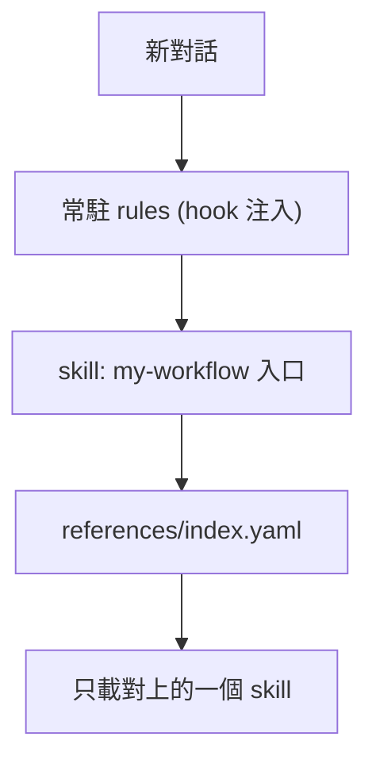

# my-workflow

VECTOR LTD 私人工作流 plugin：常駐規則 + 14 個按需載入的 skills + Composio MCP。版本 `1.6.0`（[`pack.yaml`](pack.yaml)）。不上架公開市集。開發與維護見 [`AGENTS.md`](AGENTS.md)。

**名詞**：`my-plugins/my-workflow/`（本目錄）是 **plugin 本體**；`my-agent-toolkit` 是放它的私有 GitHub repo，也是 marketplace 名稱，**不是 plugin**。安裝指令寫成 `my-workflow@my-agent-toolkit`。

## 支援

| 環境 | 做法 | 程度 |
|------|------|------|
| Claude Code／Desktop Code 分頁（本機） | plugin | rules、skills、Composio MCP 皆有 |
| Desktop 聊天／Cowork | Customize → Plugins → Add marketplace | 僅 skills、MCP；**不執行 hook，rules 不自動注入**（未驗證） |
| Codex | plugin | 結構支援，**未驗證** |
| Cursor／Cursor Cloud | 匯出腳本 | skills + rules |
| ChatGPT | 手動貼規則、上傳 skill | 無 plugin 機制，無自動 rules、無 MCP |

## 安裝

來源：https://github.com/VECTOR-COOL/my-agent-toolkit（私有，`main` 分支）。本機需能讀取該 repo（`gh auth login` 或 SSH key）。

### Claude Code ／ Claude Desktop

```text
/plugin marketplace add https://github.com/VECTOR-COOL/my-agent-toolkit
/plugin install my-workflow@my-agent-toolkit
```

- 終端機版：`claude plugin marketplace add <網址>`、`claude plugin install my-workflow@my-agent-toolkit`。
- Desktop Code 分頁與終端機**共用設定**：終端機裝一次即可，在 **+ → Plugins → Manage plugins** 確認，輸入 `/` 看 skills。雲端工作階段與 WSL 不載入本機 plugin。
- 裝完重開 Claude Code，輸入 `/mcp` 登入 `composio`（OAuth，不需 API key）。
- 聊天／Cowork 的 plugin 由 claude.ai 帳號管理（CLI 裝的不同步），私有 repo 需連結 GitHub 並讓 Claude GitHub App 可讀取。

**請 agent 代裝**（貼給 Claude Code）：

```text
請安裝／更新我的私人 plugin my-workflow，來源 https://github.com/VECTOR-COOL/my-agent-toolkit（私有，main，用我本機 git 憑證）。
1. claude plugin marketplace add <網址>（已加過改 claude plugin marketplace update my-agent-toolkit）
2. claude plugin install my-workflow@my-agent-toolkit（已安裝改 claude plugin update my-workflow@my-agent-toolkit）
3. claude plugin list，回報版本與是否啟用
4. 提醒我輸入 /mcp 登入 composio
不要逐一安裝子 skill，不要複製到家目錄，不要改來源 repo。失敗就如實回報。
```

### Codex

專案 `.codex/config.toml`：

```toml
[plugins."my-workflow@my-agent-toolkit"]
enabled = true
```

marketplace 在 [`.agents/plugins/marketplace.json`](../../.agents/plugins/marketplace.json)，此設定適用於本 repo 內的專案；其他專案需先加入該 marketplace（做法未驗證）。Codex 會要求檢視並信任 hooks；Composio 首次使用會開瀏覽器 OAuth。

### Cursor（含 Cloud）

```text
node my-plugins/my-workflow/scripts/export-cursor-skills.mjs <目標專案> --force
```

寫入 `<目標專案>/.cursor/skills/` 與 `.cursor/rules/my-rules.mdc`，再到目標專案 commit。先加 `--dry-run` 可預覽。

### ChatGPT 與無 hook 的客戶端

把 [`rules/my-rules.md`](rules/my-rules.md) 貼到自訂指示，再上傳需要的 `skills/` 資料夾（先傳 `my-workflow`）。

## 更新

| 環境 | 做法 |
|------|------|
| Claude Code | `claude plugin marketplace update my-agent-toolkit` → `claude plugin update my-workflow@my-agent-toolkit` → 重開 |
| Codex | 更新 repo 後重新啟用；hooks 有變動需重新信任 |
| Cursor | 重跑匯出腳本加 `--force`，再 commit |
| ChatGPT | 重貼規則、重傳 skill |

也可對 agent 說「請更新 my-workflow」，會載入 `my-skill-update`。

## 內容



**常駐規則**：[`rules/my-rules.md`](rules/my-rules.md)（語言、可信度、安全、Git、Code Review、驗收、記憶時機、工具與失敗回報、腳本），由 SessionStart hook 在每次對話開始注入。

**Skills**：入口是 `my-workflow`，依 [`references/index.yaml`](references/index.yaml) 的 `when`／`keywords` 載入一個。

| 類別 | Skill |
|------|-------|
| 路由入口 | `my-workflow` |
| 記憶管理／整理 | `my-memory`、`my-memory-consolidate` |
| 知識庫 | `my-notion` |
| 技術文件 | `my-docs` |
| 需求規劃 | `my-create-prd` |
| 介面體驗 | `my-ui-ux` |
| 品質審查 | `my-review` |
| 程式庫維護／初始化 | `my-codebase-clear`、`my-codebase-init` |
| 安全提交 | `my-commit-all-and-push` |
| 雲端代理 | `my-cursor-cloud-agent` |
| 多線協同 | `my-subagent` |
| 版本升級 | `my-upgrade-plan` |
| 套件更新 | `my-skill-update` |

**Composio MCP**：[`.mcp.json`](.mcp.json)（Claude）與 [`mcp.json`](mcp.json)（Codex），端點 `https://connect.composio.dev/mcp`，OAuth 登入，repo 不含金鑰。改用個人 MCP URL 與 API key 見 [Composio 文件](https://docs.composio.dev/docs/mcp-overview)（`x-api-key`）。

## 驗證狀態

- **已實測**（雲端 Claude Code）：從 GitHub 私有 repo 加入 marketplace、安裝、`claude plugin validate`、SessionStart 規則注入。
- **未驗證**：Desktop 介面操作、Composio OAuth 登入與工具呼叫、Codex（載入、hook 信任、`dcr` 登入、hook 輸出格式）、Desktop 聊天／Cowork。
