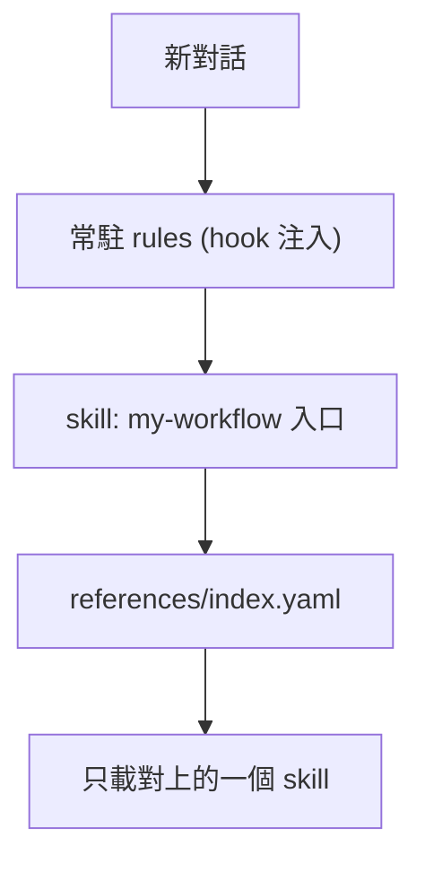

# my-workflow

VECTOR LTD 私人工作流 plugin：常駐規則 + 14 個按需載入的 skills + Composio MCP。目前版本 `1.6.0`（[`pack.yaml`](pack.yaml)）。支援 Claude Code 與 Codex，Cursor 用匯出腳本。不上架公開市集。

開發與維護請看 [`AGENTS.md`](AGENTS.md)。

## 快速開始

| 你用的 | 做法 | 支援程度 |
|--------|------|----------|
| Claude Code | 下面「請 agent 幫我裝」或手動兩行指令 | 完整：rules、skills、Composio MCP |
| Codex | 啟用 plugin（見下） | 完整，但**未實機驗證** |
| Cursor／Cursor Cloud | 匯出腳本 | skills + rules |
| ChatGPT 網頁／App | 手動貼規則、上傳 skill | **沒有 plugin 機制**：無自動注入 rules、無 MCP 打包，只能手動 |

來源：https://github.com/VECTOR-COOL/my-agent-toolkit（私有，預設分支 `main`）。本機需先能讀取這個 repo（`gh auth login` 或 SSH key）。plugin 與兩個 marketplace 檔（`.claude-plugin/marketplace.json`、`.agents/plugins/marketplace.json`）必須在 `main` 上，安裝才會抓到。

### 請 agent 幫我裝（貼給 Claude Code）

```text
請幫我安裝／更新我的私人 plugin my-workflow。
來源 repo：https://github.com/VECTOR-COOL/my-agent-toolkit（私有，main 分支，用我本機的 git 憑證）。

步驟：
1. 執行 claude plugin marketplace add https://github.com/VECTOR-COOL/my-agent-toolkit（已加過就改跑 claude plugin marketplace update my-agent-toolkit）。
2. 執行 claude plugin install my-workflow@my-agent-toolkit（已安裝就改跑 claude plugin update my-workflow@my-agent-toolkit）。
3. 執行 claude plugin list，回報 my-workflow 的版本與是否啟用。
4. 提醒我輸入 /mcp 登入 composio。

注意：不要逐一安裝子 skill，不要複製檔案到家目錄，不要改來源 repo。任何一步失敗就如實回報，不要假裝完成。
```

這幾個 `claude plugin` 子命令（`marketplace add|update`、`install`、`update`、`list`）已確認存在於 CLI。plugin 裝完後需重開 Claude Code 才會載入。

### Claude Code 手動

```text
/plugin marketplace add https://github.com/VECTOR-COOL/my-agent-toolkit
/plugin install my-workflow@my-agent-toolkit
```

Composio MCP 用 OAuth 登入，不需要 API key：安裝後輸入 `/mcp`，選 `composio` 登入授權。

### Codex

在專案的 `.codex/config.toml`：

```toml
[plugins."my-workflow@my-agent-toolkit"]
enabled = true
```

marketplace 定義在 [`.agents/plugins/marketplace.json`](../../.agents/plugins/marketplace.json)，所以**這個設定適用於本 repo 內的專案**；要在其他專案使用，需先把此 marketplace 加進該專案（做法未驗證）。Codex 會要你檢視並信任 hooks 才會執行。Composio MCP 首次使用時會開瀏覽器 OAuth 授權。

### Cursor（含 Cursor Cloud）

```text
node my-plugins/my-workflow/scripts/export-cursor-skills.mjs <目標專案> --dry-run
node my-plugins/my-workflow/scripts/export-cursor-skills.mjs <目標專案> --force
```

寫入 `<目標專案>/.cursor/skills/` 與 `.cursor/rules/my-rules.mdc`，再到目標專案 commit。

### ChatGPT 與其他沒有 hook 的客戶端

把 [`rules/my-rules.md`](rules/my-rules.md) 全文貼到自訂指示，再上傳 `skills/` 內需要的資料夾（先傳 `my-workflow`）。這是手動做法，規則不會自動帶入新對話，也沒有 Composio MCP。

## 更新

| 環境 | 指令 |
|------|------|
| Claude Code | `claude plugin marketplace update my-agent-toolkit`，再 `claude plugin update my-workflow@my-agent-toolkit`，重開 Claude Code |
| Codex | 更新 repo 後重新啟用；hooks 有變動要重新信任 |
| Cursor | 重跑匯出腳本加 `--force`，再 commit |
| ChatGPT | 重新貼規則並重傳 skill |

也可以直接對 agent 說「請更新 my-workflow」，會載入 `my-skill-update` skill。

## 內容



**常駐規則**：[`rules/my-rules.md`](rules/my-rules.md)（語言、可信度、安全、Git、Code Review、驗收、記憶時機、工具與失敗回報、腳本）。由 SessionStart hook 在每次對話開始注入。

**Skills**（入口是 `my-workflow`，由它依索引載入一個）：

| 類別 | 何時使用 | Skill |
|------|----------|-------|
| 路由入口 | 新對話、未知需求分流 | `my-workflow` |
| 記憶管理 | 偏好決策記憶、跨階段狀態存取 | `my-memory` |
| 記憶整理 | 去重、加權、升長期、遺忘 | `my-memory-consolidate` |
| 知識庫管理 | Notion 頁面與資料庫 | `my-notion` |
| 技術文件 | 規格書、操作手冊、ADR | `my-docs` |
| 需求規劃 | 需求訪談、PRD | `my-create-prd` |
| 介面體驗 | 設計系統、UI/UX | `my-ui-ux` |
| 品質審查 | 計畫防飄移、Code Review、驗收 | `my-review` |
| 程式庫維護 | 瘦身、孤立檔案清理 | `my-codebase-clear` |
| 專案初始化 | 模板骨架、新專案與遠端 Repo | `my-codebase-init` |
| 安全提交 | 機敏過濾、繁中 Conventional Commits、推送 | `my-commit-all-and-push` |
| 雲端代理 | Cursor Cloud Agent | `my-cursor-cloud-agent` |
| 多線協同 | 任務拆解、子代理平行派發 | `my-subagent` |
| 版本升級 | 依賴升級計畫與相容性評估 | `my-upgrade-plan` |
| 套件維護 | 檢查與更新本 plugin | `my-skill-update` |

完整關鍵字見 [`references/index.yaml`](references/index.yaml)。

**Composio MCP**：[`.mcp.json`](.mcp.json)（Claude Code）與 [`mcp.json`](mcp.json)（Codex）。端點是 `https://connect.composio.dev/mcp`，兩邊都用 OAuth 登入（Composio 公開 OAuth metadata，含動態註冊端點與 PKCE），repo 內沒有任何金鑰。若改用個人專屬 MCP URL 與 API key，見 [Composio 文件](https://docs.composio.dev/docs/mcp-overview)，API key 放 `x-api-key`。

## 已知限制（未驗證項目）

此 plugin 的結構與 JSON 已在本機靜態檢查，下列**尚未在實際 app 跑過**：

- Claude Code 實際安裝、SessionStart hook 注入
- Codex 載入 plugin、hook 信任流程、OAuth（`dcr`）登入、hook 輸出格式
- 私有 repo 經 marketplace 安裝
- Composio MCP 經 plugin 實際 OAuth 登入並呼叫工具（端點的 OAuth metadata 已用 curl 確認存在）
