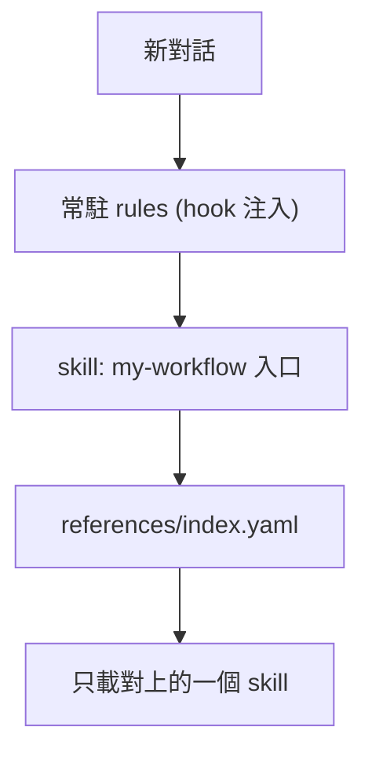

# my-workflow

VECTOR LTD 私人工作流 plugin：常駐規則 + 14 個按需載入的 skills + Composio MCP。目前版本 `1.6.0`（[`pack.yaml`](pack.yaml)）。支援 Claude Code 與 Codex，Cursor 用匯出腳本。不上架公開市集。

開發與維護請看 [`AGENTS.md`](AGENTS.md)。

## 安裝

私有 repo：本機需先能讀取 `VECTOR-COOL/my-agent-toolkit`（`gh auth login` 或 SSH key）。

### Claude Code

```text
/plugin marketplace add VECTOR-COOL/my-agent-toolkit
/plugin install my-workflow@my-agent-toolkit
```

安裝時會問兩個設定：**Composio MCP URL** 與 **Composio API key**（key 存在本機安全儲存，不進 repo）。不用 Composio 可留空或之後停用該 MCP。

更新：`/plugin marketplace update my-agent-toolkit`，再重新安裝或更新 plugin。

### Codex

在專案的 `.codex/config.toml`：

```toml
[plugins."my-workflow@my-agent-toolkit"]
enabled = true
```

repo 內 marketplace 在 [`.agents/plugins/marketplace.json`](../../.agents/plugins/marketplace.json)。Codex 會要你檢視並信任 hooks 才會執行。Composio 的 API key 在連線時依 `x-api-key` 設定提供。

### Cursor（含 Cursor Cloud）

```text
node my-plugins/my-workflow/scripts/export-cursor-skills.mjs <目標專案> --dry-run
node my-plugins/my-workflow/scripts/export-cursor-skills.mjs <目標專案> --force
```

寫入 `<目標專案>/.cursor/skills/` 與 `.cursor/rules/my-rules.mdc`，再到目標專案 commit。

### 沒有 hook 的客戶端（如 ChatGPT 網頁）

把 [`rules/my-rules.md`](rules/my-rules.md) 全文貼到自訂指示，skills 上傳 `skills/` 內需要的資料夾。

## 內容



**常駐規則**：[`rules/my-rules.md`](rules/my-rules.md)（語言、可信度、安全、Git、Code Review、驗收、記憶時機、工具與失敗回報、腳本）。由 SessionStart hook 在每次對話開始注入。

**Skills**（入口是 `my-workflow`，由它依索引載入一個）：

| 類別 | 何時使用 | Skill |
|------|----------|-------|
| 路由入口 | 新對話、未知需求分流 | `my-workflow` |
| 記憶管理 | 偏好決策記憶、跨階段狀態存取 | `my-memory` |
| 記憶整理 | 去重、加權、升長期、遺忘 | `my-memory-consolidate` |
| 知識庫管理 | Notion 頁面與資料庫 | `my-notion` |
| 技術文件 | 規格書、操作手冊、ADR | `my-docs` |
| 需求規劃 | 需求訪談、PRD | `my-create-prd` |
| 介面體驗 | 設計系統、UI/UX | `my-ui-ux` |
| 品質審查 | 計畫防飄移、Code Review、驗收 | `my-review` |
| 程式庫維護 | 瘦身、孤立檔案清理 | `my-codebase-clear` |
| 專案初始化 | 模板骨架、新專案與遠端 Repo | `my-codebase-init` |
| 安全提交 | 機敏過濾、繁中 Conventional Commits、推送 | `my-commit-all-and-push` |
| 雲端代理 | Cursor Cloud Agent | `my-cursor-cloud-agent` |
| 多線協同 | 任務拆解、子代理平行派發 | `my-subagent` |
| 版本升級 | 依賴升級計畫與相容性評估 | `my-upgrade-plan` |
| 套件維護 | 檢查與更新本 plugin | `my-skill-update` |

完整關鍵字見 [`references/index.yaml`](references/index.yaml)。

**Composio MCP**：[`.mcp.json`](.mcp.json)（Claude Code）與 [`mcp.json`](mcp.json)（Codex）。端點與 header 依 [Composio 文件](https://docs.composio.dev/docs/mcp-overview)：URL 由 Composio 產生，API key 放 `x-api-key`。

## 已知限制（未驗證項目）

此 plugin 的結構與 JSON 已在本機靜態檢查，下列**尚未在實際 app 跑過**：

- Claude Code 實際安裝、`userConfig` 提示、SessionStart hook 注入
- Codex 載入 plugin、hook 信任流程、`custom_header` 驗證、hook 輸出格式
- 私有 repo 經 marketplace 安裝
- Composio MCP 實際連線
