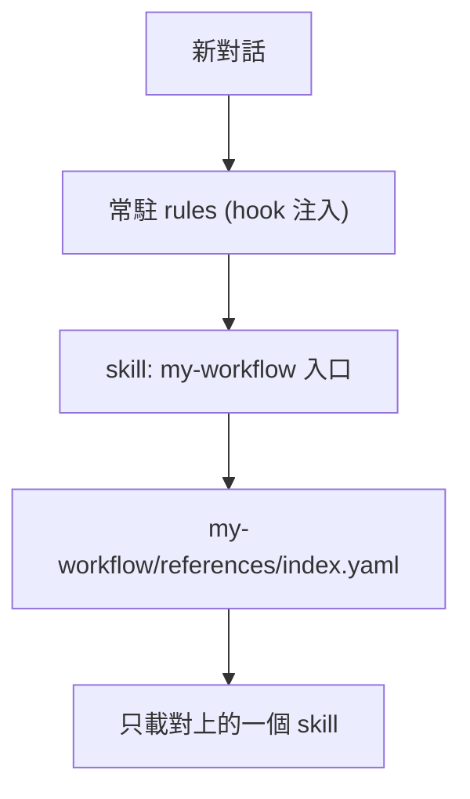

# my-workflow

VECTOR LTD 私人工作流 plugin：常駐規則 + 15 個按需載入的 skills + Composio MCP。版本 `1.16.0`（[`pack.yaml`](pack.yaml)）。不上架公開市集。開發與維護見 [`AGENTS.md`](AGENTS.md)。

**名詞**：`my-plugins/my-workflow/`（本目錄）是 **plugin 本體**；`my-agent-toolkit` 是放它的私有 GitHub repo，也是 marketplace 名稱，**不是 plugin**。安裝指令寫成 `my-workflow@my-agent-toolkit`。

## 支援

一份內容（本目錄），各平台只多一份薄薄的定義檔指到它。**規則不靠本機腳本**：入口 skill `my-workflow` 自帶 [`references/global.md`](skills/my-workflow/references/global.md)，有 hook 的平台開對話就注入，沒有 hook 的平台載入入口 skill 時自己讀。

| 環境 | 做法 | 規則怎麼進來 | 程度 |
|------|------|-------------|------|
| Claude Code／Desktop Code 分頁／IDE | plugin（marketplace） | SessionStart hook 注入 | rules、skills、Composio MCP 皆有；雲端 Claude Code 已實測 |
| 雲端 Claude session | plugin（帳號同步） | hook 注入 | 同上 |
| claude.ai 網頁／Desktop 聊天／Cowork | plugin（Customize → Plugins，帳號同步） | 載入入口 skill 時讀 `global.md`（hook 不執行） | skills、MCP 有；規則走 skill 的路徑**未驗證** |
| Codex | plugin（`.agents/plugins/marketplace.json`） | hook 注入 | 結構支援，**未驗證** |
| ChatGPT 網頁 | 手動：貼 `global.md`、上傳 skill | 貼在自訂指示 | 無 plugin 機制，無 MCP；**未驗證** |
| Gemini CLI | extension（`gemini-extension.json`、`GEMINI.md`） | `GEMINI.md` 指到 `global.md` | **未驗證** |
| Gemini 網頁 | 手動：貼 `global.md` 到 Gem 指示 | 貼在 Gem 指示 | 無匯入機制；**未驗證** |

## 安裝

來源：[VECTOR-COOL/my-agent-toolkit](https://github.com/VECTOR-COOL/my-agent-toolkit)（私有，`main` 分支）。需要能讀取該 repo（本機 `gh auth login` 或 SSH key；網頁版連結 GitHub 並授權 Claude GitHub App）。也可對 agent 說「安裝 my-workflow」，會載入 [`my-plugin-install`](skills/my-plugin-install/SKILL.md) 自動判斷平台。

### Claude Code ／ Desktop Code 分頁

```text
/plugin marketplace add https://github.com/VECTOR-COOL/my-agent-toolkit
/plugin install my-workflow@my-agent-toolkit
```

裝完重開，輸入 `/mcp` 登入 `composio`（OAuth）。到 `/plugin` → Marketplaces → `my-agent-toolkit` 開 **auto-update**，之後 `main` 有新 commit 會自動更新。

### claude.ai 網頁／Desktop 聊天／Cowork

不需要終端機或任何本機腳本：

1. 打開 [Customize > Plugins](https://claude.ai/customize/plugins) → **Add → Add marketplace**，輸入 `VECTOR-COOL/my-agent-toolkit`。
2. 私有 repo：出現 **Connect GitHub** 就連結；出現 **Install the Claude GitHub App** 就授權它讀這個 repo。
3. **Discover** 找 `my-workflow` → **Add**；打開 **Sync automatically**。
4. 開 plugin 的 **Connectors**，`composio` 顯示 Not connected 就登入。

這些平台不執行 hook；開新對話後入口 skill 載入時會自己讀全域規則。沒生效就把 [`global.md`](skills/my-workflow/references/global.md) 貼到個人偏好。

### Codex

專案 `.codex/config.toml`：

```toml
[plugins."my-workflow@my-agent-toolkit"]
enabled = true
```

marketplace 在 [`.agents/plugins/marketplace.json`](../../.agents/plugins/marketplace.json)，適用於本 repo 內的專案。Codex 會要求信任 hooks。**未驗證**。

### Gemini CLI

先 clone 本 repo，再從本目錄安裝（extension 定義在 [`gemini-extension.json`](gemini-extension.json)，入口 [`GEMINI.md`](GEMINI.md)）：

```text
gemini extensions install ./my-plugins/my-workflow
```

GitHub URL 安裝要求 repo 根目錄就是 extension，本 repo 根目錄是多 plugin 的 marketplace，所以不支援 URL 直裝（**未驗證**）。更新：`git pull` 後重新 install。

### ChatGPT／Gemini 網頁

沒有 plugin 機制，手動兩步：

1. 把 [`global.md`](skills/my-workflow/references/global.md) 貼到 Custom GPT／專案指示（ChatGPT）或 Gem 指示（Gemini）。
2. 需要的 skill 內容（先 `my-workflow`）上傳為知識檔或貼進指示。

更新就重貼、重傳。規則不會自動帶入，也沒有 MCP。**未驗證**。

## 更新

`.claude-plugin/plugin.json` 與 `plugin.json` **不寫 `version`**，Claude 以 commit 當版本，`main` 每次更新都偵測得到。

| 環境 | 做法 |
|------|------|
| Claude Code | 開 marketplace 的 **auto-update**；手動：`claude plugin marketplace update my-agent-toolkit` → `claude plugin update my-workflow@my-agent-toolkit` → 重開 |
| claude.ai 網頁／Cowork／雲端 session | [Customize > Plugins](https://claude.ai/customize/plugins) 開 **Sync automatically**；手動按 **Check for updates**，開新對話生效 |
| Codex | 更新 repo 後重新啟用 |
| Gemini CLI | `git pull` 後重新 install |
| ChatGPT／Gemini 網頁 | 重貼規則、重傳 skill |

更新不到新版時，見 [`docs/RELEASE.md`](docs/RELEASE.md) 的「無法更新怎麼排除」。

## 內容



**規則**：[`global.md`](skills/my-workflow/references/global.md)（回覆、可信度、安全、品質）在入口 skill 內。Claude Code、Codex 由 SessionStart hook 在每次對話開始注入，**連同入口 skill `my-workflow` 與 `index.yaml` 一併載入**；其他平台載入入口 skill 時自己讀。其餘規則碰到情境才讀：

| 規則 | 情境 |
|------|------|
| [`git`](rules/git.md) | commit、push、merge、發版 |
| [`code-review`](rules/code-review.md) | 審查程式碼或 PR |
| [`wrap-up`](rules/wrap-up.md) | 任務收尾驗收 |
| [`files-and-scripts`](rules/files-and-scripts.md) | 腳本、臨時檔、設定檔 |
| [`install`](rules/install.md) | 安裝套件或第三方 skill |
| [`tools`](rules/tools.md) | 外部服務、MCP、失敗回報 |
| [`memory`](skills/my-memory/rules/memory.md)、[`consolidate`](skills/my-memory-consolidate/rules/consolidate.md) | 載入記憶 skill 時 |

**Skills**：入口是 `my-workflow`，依 [`index.yaml`](skills/my-workflow/references/index.yaml) 的 `when`／`keywords` 載入一個。

| 類別 | Skill |
|------|-------|
| 路由入口 | `my-workflow` |
| 記憶管理／整理 | `my-memory`、`my-memory-consolidate` |
| 知識庫 | `my-notion` |
| 技術文件 | `my-docs` |
| 需求規劃 | `my-create-prd` |
| 介面體驗 | `my-ui-ux` |
| 品質審查 | `my-review` |
| 程式庫維護／初始化 | `my-codebase-clear`、`my-codebase-init`（Claude 環境可搭配 `my-skills/claude/` 的 `my-codebase-init-claude`） |
| 安全提交 | `my-commit-all-and-push` |
| 發佈打包 | `my-release-packaging` |
| 雲端代理 | `my-cloud-agent` |
| 多線協同 | `my-subagent` |
| 安裝與更新 | `my-plugin-install` |

**Composio MCP**：[`.mcp.json`](.mcp.json)（Claude）與 [`mcp.json`](mcp.json)（Codex），端點 `https://connect.composio.dev/mcp`，OAuth 登入，repo 不含金鑰。改用個人 MCP URL 與 API key 見 [Composio 文件](https://docs.composio.dev/docs/mcp-overview)（`x-api-key`）。

## 驗證狀態

- **已實測**（雲端 Claude Code）：從 GitHub 私有 repo 加入 marketplace、安裝、`claude plugin validate`、SessionStart 規則注入。
- **未驗證**：Desktop 介面操作、Composio OAuth 登入與工具呼叫、Codex（載入、hook 信任、`dcr` 登入、hook 輸出格式）、Desktop 聊天／Cowork。
