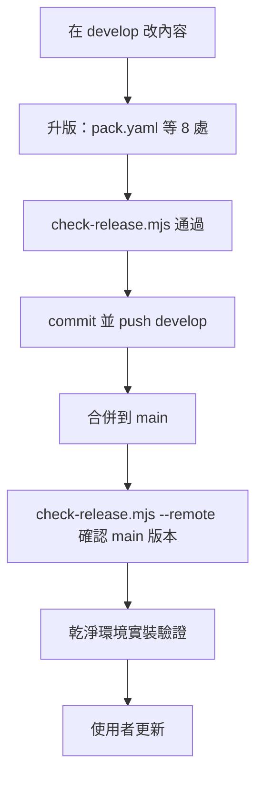

# 發布與更新排除

給**維護 my-workflow 的人與 Agent**。使用者怎麼安裝與更新見 [`README.md`](../README.md)；依平台自動選更新方法的是 skill [`my-plugin-install`](../skills/my-plugin-install/SKILL.md)。



## 發布流程

使用者安裝與更新**一律抓 `main`**。只推到 `develop`，任何人都拿不到新版。

1. **在 `develop` 改內容**。
2. **升版**（SemVer：只改文件或修小錯升 patch，新增 skill 或功能升 minor，破壞相容升 major）。以 `pack.yaml` 為準，以下 8 處要同一個號：

   | 檔案 | 位置 |
   |------|------|
   | `my-plugins/my-workflow/pack.yaml` | `version:`（基準） |
   | `my-plugins/my-workflow/.claude-plugin/plugin.json` | `version`（Claude 判斷新版用這個） |
   | `my-plugins/my-workflow/plugin.json` | `version`（Codex） |
   | `my-plugins/my-workflow/references/index.yaml` | `version:` |
   | `my-plugins/my-workflow/AGENTS.md` | 開頭的「版本」 |
   | `my-plugins/my-workflow/README.md` | 第一段的「版本」 |
   | `project.json` | `version` |
   | `README.md`（repo 根） | 版本徽章 |

3. **跑檢查**，必須通過：

   ```text
   node my-plugins/my-workflow/scripts/check-release.mjs
   ```

   它檢查 8 處版本一致、plugin 內有沒有被 `.gitignore` 擋掉的檔、還沒 `git add` 的檔，並跑 `claude plugin validate`。改到 `my-release-packaging` 時另跑 `node --test my-plugins/my-workflow/skills/my-release-packaging/scripts/pack-release.test.mjs`。
4. **commit 並 push `develop`**。
5. **合併到 `main`**：用 PR 或 `git merge --no-ff develop`，再 push `main`。
6. **確認 `main`**：

   ```text
   node my-plugins/my-workflow/scripts/check-release.mjs --remote
   ```

7. **乾淨環境實裝**（確認 GitHub 上的版本真的裝得起來，不受本機快取影響）：

   ```text
   # macOS／Linux；Windows 用 $env:CLAUDE_CONFIG_DIR 指到一個暫存資料夾
   export CLAUDE_CONFIG_DIR="$(mktemp -d)"
   claude plugin marketplace add https://github.com/VECTOR-COOL/my-agent-toolkit
   claude plugin install my-workflow@my-agent-toolkit
   claude plugin list        # 版本應該是新版
   ```

   用完刪掉那個暫存資料夾，別在真正的設定目錄做。
8. **通知使用者更新**：見下一節。

## 使用者怎麼拿到新版

| 平台 | 做法 |
|------|------|
| Claude 網頁、Desktop、Cowork、雲端 session（帳號同步） | [Customize > Plugins](https://claude.ai/customize/plugins) 的 `my-agent-toolkit` → **Check for updates**；建議開 **Sync automatically**。開新對話才生效 |
| Claude Code 終端機、Desktop Code 分頁（本機安裝） | `claude plugin marketplace update my-agent-toolkit` → `claude plugin update my-workflow@my-agent-toolkit` → 重開 |
| Codex | 更新 repo 後重新啟用，hooks 有變動要重新信任 |

## 無法更新怎麼排除

先分清楚是「**來源沒有新版**」還是「**使用者端沒抓到**」：做上面第 6、7 步。乾淨環境裝得到新版，問題就在使用者端；裝不到，問題在 repo。

### 來源（repo）端

| 症狀 | 原因 | 處理 |
|------|------|------|
| `--remote` 顯示 main 還是舊版 | 只推了 `develop`，沒合併到 `main` | 合併到 `main` 並 push |
| 內容改了，所有平台都說「已是最新」 | 沒升版號，或只改了部分檔案 | 升版，跑 `check-release.mjs` 確認 8 處一致 |
| 本機測試正常，使用者裝了卻缺檔 | 檔案被 `.gitignore` 擋掉沒上傳（例：`AGENTS.md` 規則擋掉了 `templates/AGENTS.md`） | `check-release.mjs` 會列出；在 `.gitignore` 加 `!路徑` 例外並提交 |
| 乾淨環境安裝失敗 | `plugin.json` 或 `marketplace.json` 格式錯 | `claude plugin validate ./my-plugins/my-workflow` 與 `claude plugin validate .` |

### 使用者端

| 症狀 | 原因 | 處理 |
|------|------|------|
| 外掛頁「更新」按鈕反灰、版本停在舊版 | 帳號端的 marketplace 快取沒重新讀 GitHub | 在 marketplace 層按 **Check for updates**；不行就在外掛頁 **⋯ → 移除**，再從 `my-agent-toolkit` 重新加入（不影響 Composio 登入） |
| 一段時間都沒自動更新 | 沒開 **Sync automatically** | 在 marketplace 開啟 |
| 新增 marketplace 時跳 **Connect GitHub** 或 **Install the Claude GitHub App** | 私有 repo 讀取權限沒給或失效 | 到 [Claude GitHub App](https://github.com/apps/claude/installations/select_target) 授權 `VECTOR-COOL/my-agent-toolkit` |
| 終端機 `error: unknown command 'marketplace'` 或 `'update'` | Claude Code 太舊 | `claude update`；不行就重裝：PowerShell `irm https://claude.ai/install.ps1 \| iex`；WinGet 用 `winget upgrade Anthropic.ClaudeCode`；npm 用 `npm install -g @anthropic-ai/claude-code@latest`。之後開新終端機確認 `claude --version` |
| 雲端 session 還是舊版 | session 開始時就固定 plugin，中途不能換 | 帳號端更新後開新 session；session 內讀 `~/.claude/plugins/synced/` 下 my-workflow 的 `.claude-plugin/plugin.json` 看實際版本 |
| 終端機更新了，桌面聊天還是舊版（或反過來） | 本機安裝與帳號同步是兩份 | 只留一份：建議從帳號裝，本機用 `claude plugin uninstall my-workflow@my-agent-toolkit` 移除 |
| 更新了但規則沒生效 | 網頁、Desktop 聊天、Cowork 不執行 hook | 這些平台規則不會自動注入，把 `rules/global.md` 貼到個人偏好或專案指示 |

### 回報時附上

版本號（外掛頁或 `claude plugin list`）、平台、操作步驟、畫面上的錯誤文字。**不要貼 token 或金鑰。**
