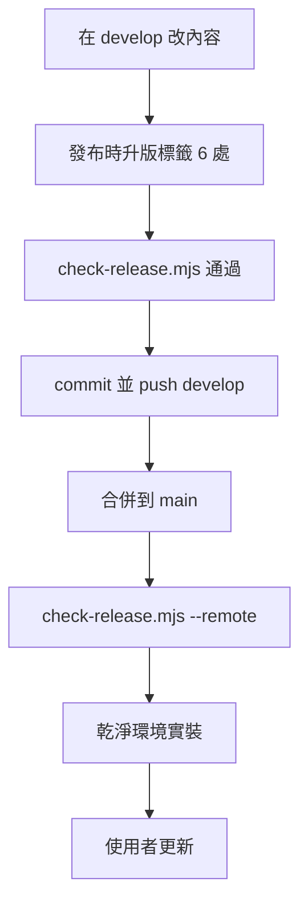

# 發布與更新排除

給**維護 my-workflow 的人與 Agent**。使用者怎麼安裝與更新見 [`README.md`](../README.md)；依平台自動選方法的是 [`my-plugin-install`](../skills/my-plugin-install/SKILL.md)。



## 發布流程

使用者**一律抓 `main`**；只推 `develop` 任何人都拿不到。

1. 在 `develop` 改內容。
2. **升版標籤**（SemVer：文件或小錯 patch，新 skill 或功能 minor，破壞相容 major）。以 `pack.yaml` 為準，6 處同號：

   | 檔案 | 位置 |
   |------|------|
   | `my-plugins/my-workflow/pack.yaml` | `version:`（基準） |
   | `my-plugins/my-workflow/gemini-extension.json` | `version` |
   | `my-plugins/my-workflow/skills/my-workflow/references/index.yaml` | `version:` |
   | `my-plugins/my-workflow/AGENTS.md` | 開頭「版本」 |
   | `my-plugins/my-workflow/README.md` | 第一段「版本」 |
   | `project.json` | `version` |
   | `README.md`（repo 根） | 標題正下方「版本：`v…`」 |

   **`.claude-plugin/plugin.json` 與 `plugin.json` 刻意不寫 `version`**：沒有時 Claude 以 commit 當版本，`main` 每次更新都偵測得到；寫了就要 bump 才會更新，否則凍結（`check-release.mjs` 會擋）。
3. `node my-plugins/my-workflow/scripts/check-release.mjs` 必須通過（版本一致、manifest 無 `version`、沒被 `.gitignore` 擋的檔、沒未 `git add` 的檔、`claude plugin validate`）。改到 `my-release-packaging` 另跑 `node --test my-plugins/my-workflow/skills/my-release-packaging/scripts/pack-release.test.mjs`。
4. commit 並 push `develop`。
5. 合併 `main`：PR 或 `git merge --no-ff develop`，push。
6. `node my-plugins/my-workflow/scripts/check-release.mjs --remote`。
7. **乾淨環境實裝**（不受本機快取影響）：

   ```text
   # macOS／Linux；Windows 用 $env:CLAUDE_CONFIG_DIR 指到暫存資料夾
   export CLAUDE_CONFIG_DIR="$(mktemp -d)"
   claude plugin marketplace add https://github.com/VECTOR-COOL/my-agent-toolkit
   claude plugin install my-workflow@my-agent-toolkit
   claude plugin list
   ```

   用完刪掉暫存資料夾。
8. 通知使用者更新（做法見 README「更新」）。

## 無法更新怎麼排除

先分「**來源沒有新版**」或「**使用者端沒抓到**」：做上面第 6、7 步。乾淨環境裝得到，問題在使用者端；裝不到，在 repo。

### 來源端

| 症狀 | 原因 | 處理 |
|------|------|------|
| `--remote` 顯示 main 舊版 | 只推了 `develop` | 合併到 `main` 並 push |
| 內容改了，所有平台都說「已是最新」 | manifest 被加回 `version` 沒 bump | 刪掉兩個 manifest 的 `version` |
| 本機正常，使用者缺檔 | 被 `.gitignore` 擋掉（例：`templates/AGENTS.md`） | `check-release.mjs` 會列；加 `!路徑` 例外 |
| 乾淨環境安裝失敗 | manifest 格式錯 | `claude plugin validate ./my-plugins/my-workflow` 與 `claude plugin validate .` |

### 使用者端

| 症狀 | 原因 | 處理 |
|------|------|------|
| 更新按鈕反灰、版本停舊版 | 帳號端 marketplace 快取 | marketplace 層 **Check for updates**；不行就外掛頁 **⋯ → 移除** 再重新加入（不影響 Composio 登入） |
| 一直沒自動更新 | 沒開 **Sync automatically** | 開啟 |
| 加 marketplace 跳 **Connect GitHub**／**Install the Claude GitHub App** | 私有 repo 權限沒給或失效 | 到 [Claude GitHub App](https://github.com/apps/claude/installations/select_target) 授權 `VECTOR-COOL/my-agent-toolkit` |
| 終端機 `unknown command 'marketplace'`／`'update'` | Claude Code 太舊 | `claude update`；不行重裝（PowerShell `irm https://claude.ai/install.ps1 \| iex`；`winget upgrade Anthropic.ClaudeCode`；`npm install -g @anthropic-ai/claude-code@latest`），開新終端機 `claude --version` |
| 雲端 session 舊版 | session 開始時固定 plugin | 帳號端更新後開新 session；session 內看 `~/.claude/plugins/synced/` 下的 `.claude-plugin/plugin.json` |
| 終端機更新了，桌面聊天還舊（或反過來） | 本機安裝與帳號同步是兩份 | 只留一份：建議從帳號裝，本機 `claude plugin uninstall my-workflow@my-agent-toolkit` |
| 更新了但規則沒生效 | 網頁、Desktop 聊天、Cowork 不執行 hook | 把 `skills/my-workflow/references/global.md` 貼到個人偏好或專案指示 |

回報附：版本號、平台、操作步驟、錯誤文字。**不貼 token。**
