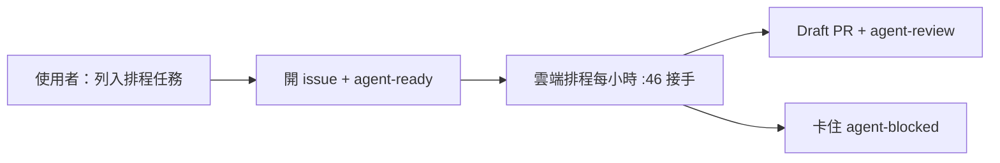

# 排程任務（GitHub Issues 交給雲端排程）

使用者說「列入排程任務」「加入排程任務」「排進排程」「丟給排程做」或同義說法時讀。平台中立：Claude、Codex、ChatGPT、Gemini 都照這份做；差別只在有沒有能開 GitHub issue 的工具。



## 對話中要做的事

只負責**開單**，不在對話裡動手做該事項（除非使用者另外要求）。

1. **整理 issue**，內容用繁體中文：

   ```markdown
   標題：<動詞開頭、一句話說清楚要做什麼>

   ## 背景
   為什麼要做、現況、相關連結（檔案路徑、PR、文件）。

   ## 要做
   - 具體步驟或交付物

   ## 不做
   - 明確排除的範圍（避免排程 agent 越界）

   ## 驗收標準
   - [ ] 可檢查的完成條件（測試、指令輸出、畫面）
   ```

2. **選 repo**：開在 `VECTOR-COOL` 組織下對應的 repo。排程目前只掛這 5 個：

   | repo | 放什麼 |
   |------|--------|
   | `VECTOR-COOL/vcloud-platform` | 治理、規格、L1 文件、開發環境編排 |
   | `VECTOR-COOL/vcloud-backend` | 後端 host 與各服務 |
   | `VECTOR-COOL/vcloud-gateway` | API gateway |
   | `VECTOR-COOL/vCloud-admin` | 管理後台前端 |
   | `VECTOR-COOL/vector-admin-ui-kit` | 後台 UI 元件庫 |

   要開在其他 repo：先提醒使用者「這個 repo 沒掛排程，不會被自動接手」，使用者仍要開才開。

3. **先問再開**：repo、範圍或驗收標準不明時先問，**最多 3 題**，問完再開；能從對話與專案檔推得出的不問。
4. **開 issue 並加 `agent-ready` 標籤**，回報 issue 連結。
5. **帳號**：排程只接手 GitHub 帳號 `VECTOR-54308483` 開的 issue。工具登入的若不是這個帳號，開之前先告知使用者（開了會被標 `agent-skipped`）。

### 沒有 GitHub 工具時

先依 `rules/tools.md` 說明哪個工具沒接上；再給使用者可直接貼上的**issue 草稿**（repo、標題、內文、標籤 `agent-ready`），請使用者用自己的帳號開，不假裝已開。

## 之後全自動（排程做的事）

Claude 雲端排程 routine「GitHub Issues 待辦自動消化」每小時 :46 執行，對話中不用、也不要再手動處理：

| 標籤 | 意思 |
|------|------|
| `agent-ready` | 待接手（開單時加） |
| `agent-working` | 排程已接手，雲端 session 執行中 |
| `agent-review` | 完成，已開 Draft PR（內文 `Closes #N`），等使用者審 |
| `agent-blocked` | 卡住，原因寫在 issue 留言，等使用者補資訊 |
| `agent-skipped` | 非擁有者帳號開的，不處理 |

- 進度與結果以 **issue 標籤與留言**回報；使用者問進度時去讀該 issue。
- 被標 `agent-blocked`：使用者補完資訊後，拿掉 `agent-blocked`、加回 `agent-ready`，下一輪應會重新接手（**未驗證**，依排程只查 `agent-ready` 推定）。
- 不改 routine 本身；要加掛 repo 或調整排程，使用者另外說明再處理。
