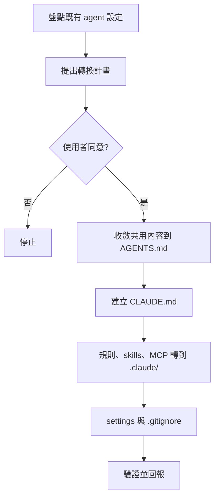

# my-claude-codebase-convert — 既有專案轉成 Claude 最佳化

讓 Claude 在這個 codebase 裡發揮最好，**不破壞其他平台**。新專案用 [`my-codebase-init`](../my-codebase-init/SKILL.md)；這份處理已經存在、原本為其他 agent 設定的專案。

依據：[`best-practices.md`](../../claude/best-practices.md)（官方文件確認過的事實）、[`platform-mapping.md`](../../claude/platform-mapping.md)（各平台對應）、[`templates/`](../../claude/templates/)。



## 原則

- **其他平台的檔案一律保留**，不刪、不改壞。只新增或在原檔加「同步來源」註記。
- `AGENTS.md` 是唯一來源；Claude 專屬的才放 `CLAUDE.md`／`.claude/`。避免同一段內容出現兩份。
- 每個 `CLAUDE.md` 200 行內，寫具體可驗證的指令。
- 先提計畫、經同意才動手；在新分支上改，依 [`rules/git.md`](../../rules/git.md) 提交。

## 1. 盤點

列出專案裡所有 agent 設定，依 [`platform-mapping.md`](../../claude/platform-mapping.md) 的「原檔」欄逐一找。常見位置：

```text
AGENTS.md  CLAUDE.md  CLAUDE.local.md  .claude/  .mcp.json
.cursorrules  .cursor/rules/  .cursor/mcp.json  .cursor/commands/  .cursor/skills/
.github/copilot-instructions.md  GEMINI.md  .windsurfrules  .windsurf/  .codex/  .agents/
```

同時讀 `README.md`、建置與測試設定（如 `package.json`、`Makefile`），找出實際的建置、測試、lint 指令。

## 2. 提出轉換計畫

用表格列出每個原檔：放到 Claude 的哪裡、內容併進 `AGENTS.md` 還是 `.claude/`、原檔怎麼處理（保留／加註記）。標出內容互相矛盾之處，請使用者決定。**同意前不寫任何檔案。**

## 3. 收斂到 AGENTS.md

- 沒有 `AGENTS.md`：從各平台共用的規則建立一份（建置、測試、程式風格、目錄結構、禁止事項）。
- 已有：只補缺的共用內容，不改寫既有段落。
- 各平台原檔裡的共用內容併進來後，原檔保留不動。

## 4. 建立 CLAUDE.md

- 用 [`templates/CLAUDE.md`](../../claude/templates/CLAUDE.md)：第一行 `@AGENTS.md`，下面只放 Claude 專屬內容。
- 已有 `CLAUDE.md`：補上 `@AGENTS.md`，把和 `AGENTS.md` 重複的段落移除，其餘保留。
- 沒有任何指令檔又不好判斷內容時，可先跑 `/init` 產生初稿再精簡。

## 5. 轉換規則、skills、MCP

依 [`platform-mapping.md`](../../claude/platform-mapping.md)：

- **路徑規則**（如 Cursor `.mdc` 的 `globs`）→ `.claude/rules/<topic>.md`，`globs` 改成 `paths`（範本 [`path-rule.md`](../../claude/templates/path-rule.md)）。兩檔開頭互註同步來源。
- **全域規則**（如 `alwaysApply`）→ 優先併進 `AGENTS.md`。
- **skills** → `.claude/skills/<name>/SKILL.md`，格式相同可直接複製；選一處當來源並註明。
- **自訂命令** → `.claude/commands/` 或 skill。
- **MCP**（如 `.cursor/mcp.json`）→ 專案根 `.mcp.json`，金鑰改 `${VAR}`，不寫死。

## 6. 設定與版控

- `.claude/settings.json`：用 [`templates/settings.json`](../../claude/templates/settings.json)，把實際的測試、lint 指令放進 `permissions.allow`，`deny` 擋 `.env`。
- `.gitignore` 加入 `.claude/settings.local.json`、`CLAUDE.local.md`。
- 要讓團隊自動取得 my-workflow plugin：見 [`my-codebase-init-claude`](../my-codebase-init-claude/SKILL.md) 第 3 節。
- 雲端 session 不載入 plugin，要用的規則必須在 repo 內。

## 7. 驗證並回報

- 開新 session：`/status` 看設定來源，`claude doctor` 看設定錯誤，`/doctor prompt-audit` 找過時或矛盾的指令。
- 問 Claude 專案的建置、測試指令與一條路徑規則，確認 `AGENTS.md` 引用與 `.claude/rules/` 有生效。
- 回報表格：新增了哪些檔、併了哪些內容、哪些原檔保留、哪些矛盾待決、哪些沒實測。

## 不要做

- 不要刪除或改寫其他平台的設定檔來「清理」。
- 不要把 `AGENTS.md` 內容複製進 `CLAUDE.md`。
- 不要把金鑰、個人路徑寫進 `.mcp.json` 或 `settings.json`。
- 不要在使用者同意前寫檔。
