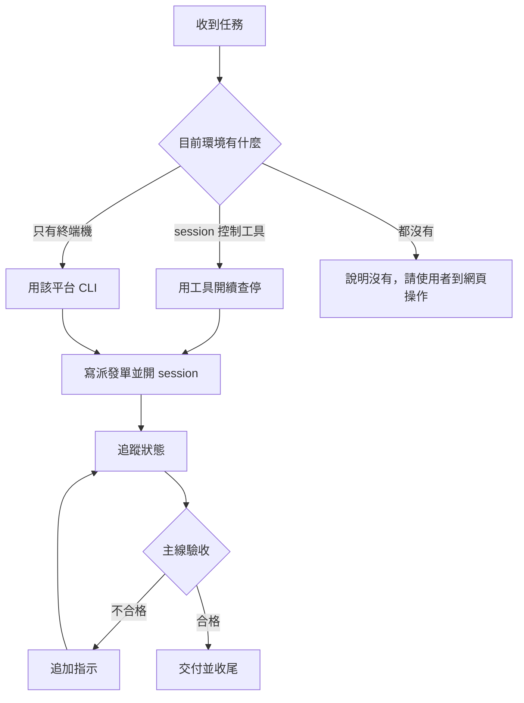

# my-cloud-agent — 雲端 agent 操作

把工作交給另一個在雲端跑的 agent session，並由目前這個對話（**主線**）負責派發、追蹤、驗收。方法通用；各平台的具體工具與指令放在 `references/`，只讀當前平台那一份。



## 選做法

先看自己手上有什麼，不要掃系統猜：

| 環境 | 做法 | 參考 |
|------|------|------|
| Claude，且有 `create_session`、`send_message` 等工具（雲端 session、部分 Desktop） | 用工具 | [claude.md](references/claude.md)「工具」 |
| Claude，只有終端機 | `claude --cloud` 等 CLI | [claude.md](references/claude.md)「CLI」 |
| 其他平台 | 照該平台官方文件 | 沒查證過的指令不要寫、不要猜 |
| 都沒有 | 說明沒有可用的方式，請使用者在網頁操作 | |

## 派發單

雲端 agent 看不到這段對話，派發內容就是它知道的全部。照這個格式寫：

```text
目標：一句話
背景：需要知道的事實、檔案路徑、使用者偏好（只給需要的）
範圍：可以動的與不可以動的
完成標準：怎樣算做完
驗證：它自己要跑的指令或檢查
交付：commit 並 push 到哪個分支；是否開 PR
回報：改了哪些檔、驗證結果、沒做成的事
```

寫不出完成標準，代表任務還沒拆清楚。

## 追蹤與驗收

- 開完把 session 連結或 id 給使用者。
- 完成的 session 不一定會主動回報；用該平台查狀態的方式確認，不要假設已完成。
- 不信「完成」兩個字：看實際提交或變更，對照完成標準，能自己跑的驗證就自己跑。
- 不合格就寫出具體哪裡要改，追加到**同一個** session；方向全錯才開新的。同一項最多追加 2 次，仍不行就主線接手或問使用者。
- 不要用 `sleep` 或緊密迴圈輪詢；查一次狀態，還沒好就告訴使用者。

## 交付

- 分支以**目前 session 或專案規定的分支**為準；沒有規定才用 `develop`。熱修復用使用者指定的分支。
- 不開 PR，除非使用者明確要求。
- 禁止 force push 到 `main`、`develop`、`release/*`。不提交 secrets。
- 不確定是不是雲端就當本地，等使用者要求才 commit。

## 雲端環境與冷啟動

1. 檢查或對齊環境設定（網路、環境變數、setup script），盡量腳本化。
2. 開 session 時要它先啟動專案服務、跑測試；失敗就回到第 1 步。
3. 缺環境變數：說明 key 與要放在哪裡。機密放平台的 secrets 機制，不放一般環境變數。
4. 冷啟動成功後依上面的方式交付。

## 不要做

- 不要編造某平台的指令或 API；沒有就說沒有。
- 不要把 token、金鑰寫進派發單、文件或回報。
- 不要把沒做完說成完成。
- 沒經使用者同意，不要封存、刪除或中斷別人的 session。
