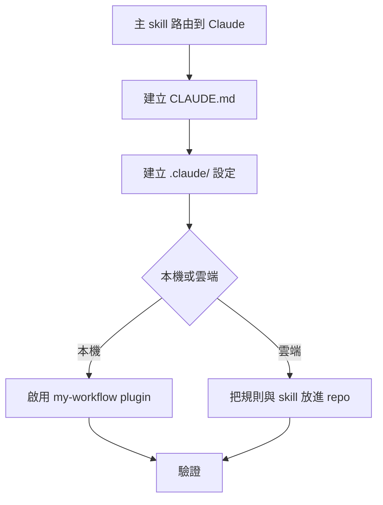

# my-codebase-init-claude — Claude 環境的初始化補充

只在 [`my-codebase-init`](../my-codebase-init/SKILL.md) 判斷目前是 Claude 環境時載入。通用流程（模板、AGENTS.md、README.md、Git、遠端 repo）仍照主 skill，本檔只補 Claude 專屬的部分，不重做主流程。



## 1. CLAUDE.md

Claude Code 讀 `CLAUDE.md`，不直接讀 `AGENTS.md`。`AGENTS.md` 維持唯一來源，`CLAUDE.md` 只引用它：

```markdown
@AGENTS.md
```

- 已有 `CLAUDE.md` 就只補上 `@AGENTS.md`，不覆蓋既有內容。
- Claude 專屬的少量補充（例如指令偏好）才寫在 `CLAUDE.md`，不重複 `AGENTS.md` 的內容。

## 2. .claude/ 設定

- `.claude/settings.json`：可以 commit，放全隊共用的 `permissions`（專案的 lint、測試指令）、`hooks`、`env`。只寫專案需要的，不放個人偏好與機密。
- `.claude/settings.local.json`：個人覆寫，**加進 `.gitignore`**（手動建立的檔案 Claude 不會幫你忽略）。
- 專案專屬 skill 放 `.claude/skills/<name>/SKILL.md`，隨 repo 一起 commit。
- 設定檔是嚴格 JSON，不能有註解或結尾逗號。

## 3. 本機：啟用 my-workflow plugin

要讓團隊成員 clone 後自動得到 plugin，在 `.claude/settings.json` 宣告 marketplace 與啟用的 plugin（鍵名 `extraKnownMarketplaces`、`enabledPlugins`，寫法依官方 settings 參考為準）：

- marketplace 來源是 `VECTOR-COOL/my-agent-toolkit`，plugin 是 `my-workflow@my-agent-toolkit`。
- 這兩個鍵要等每位成員**信任該資料夾**後才生效。
- 私有 repo 需要成員本機已能讀取（`gh auth login` 或 SSH key）。

## 4. 雲端 session 的差異

Claude 雲端 session 在全新 clone 上執行，行為和本機不同：

- **不載入 plugin 與 marketplace**，也不讀 `~/.claude/settings.json` 與 `settings.local.json`。my-workflow 的 hook 注入在雲端不會運作。
- 會帶過去的只有 repo 內容：`CLAUDE.md`、`.claude/settings.json`、`.claude/skills/`。所以雲端要用到的規則與 skill 必須放進 repo，不能只靠 plugin。需要全域規則時，把精簡版寫進 `AGENTS.md`。
- 依賴安裝與冷啟動檢查用 `.claude/settings.json` 的 `SessionStart` hook。環境有 `session-start-hook` skill 就用它。
- 通常沒有 `gh`：建立遠端 repo 改用環境提供的 GitHub MCP 工具（如 `create_repository`）。被 session 的 repo 範圍擋住就如實回報，請使用者建立 repo 或把它加進 session，不要硬做。
- 交付沿用規則：commit 並 push 到 `develop`（或使用者指定的分支），不開 PR。細節見 [`my-claude-cloud-agent`](../my-claude-cloud-agent/SKILL.md)。
- 不確定是不是雲端就當本地。

## 5. 驗證

- 開新 session，輸入 `/status` 確認 `Setting sources` 有載入專案設定；`claude doctor` 檢查設定檔錯誤。
- 問 Claude 專案的 `AGENTS.md` 規則，確認 `CLAUDE.md` 的引用有生效。
- 靜態看起來對不等於已在該環境跑過；沒實測的就標明。

## 不要做

- 不要把 `AGENTS.md` 的內容複製進 `CLAUDE.md`，會漂移。
- 不要 commit `.claude/settings.local.json`、金鑰或個人路徑。
- 不要在雲端 session 假設 plugin 或 hook 存在。
