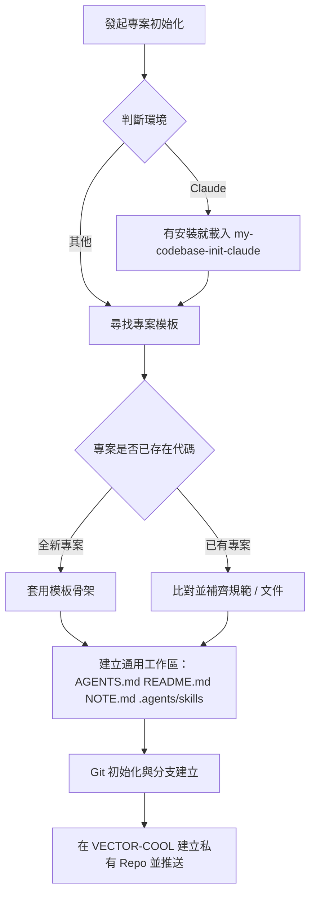

# my-codebase-init — 專案與版控初始化

將新專案依組織標準完成骨架搭建、規範注入與 GitHub 遠端儲存庫初始化。



## 執行流程

### 0. 判斷環境並路由

本 skill 是通用流程，與環境無關。先判斷目前環境：

- **Claude**（Claude Code 本機、Desktop、IDE 外掛、雲端 session）：若已安裝 `my-codebase-init-claude`（在 toolkit 的 `my-skills/claude/`，獨立 skill，不隨本 plugin 安裝）就一併載入，由它補上 `CLAUDE.md`、`.claude/`、plugin 啟用、雲端 session 差異。沒安裝就照本流程，並至少建立第一行為 `@AGENTS.md` 的 `CLAUDE.md`（新版 Claude Code 沒有 `CLAUDE.md` 時也會直接讀 `AGENTS.md`，但保留引用最保險），再提醒使用者可安裝該 skill。
- **Claude 雲端 session 不載入 plugin 與 marketplace**，所以 my-workflow 的規則與 skill 不會自動存在；新專案要用的規則得放進 repo（`CLAUDE.md`、`.claude/`、`AGENTS.md`）。
- **其他環境**：只照本流程。
- 不確定是不是雲端就當本地，不掃系統來猜。

### 1. 定位專案模板目錄

依序尋找專案模板來源，找到即停：
1. 環境變數 `VECTOR_PROJECT_TEMPLATES`。
2. 本機目錄 `D:\PROJECTS\project-templates`（僅本機環境生效）。
3. 若皆不存在，暫停並向使用者回報缺少模板來源，不盲目生成。

### 2. 專案骨架與內容初始化

- **全新專案（尚未初始化）**：
  - 從模板目錄選取最貼近業務型態的模板作為基底，複製基礎檔案結構。
- **已有專案（補齊規範）**：
  - 比對模板中是否有可整合的 `skills/`、`rules/`、`docs/` 或架構範本，僅增量補齊，不破壞既有代碼。

### 3. 建立通用工作區

目標：任何 AI 編輯器（Claude Code、Codex、Cursor、Copilot 等）打開專案，**讀完入口就能立刻接手**。以 `AGENTS.md` 為唯一來源，不為單一平台重複寫一份。範本在 [`templates/`](templates/)，缺什麼補什麼，**已存在的檔案不覆蓋**，只補缺的段落。

| 檔案 | 用途 | 規則 |
|------|------|------|
| `AGENTS.md` | 所有 agent 的專案入口 | 角色指引、指令、目錄架構、規範、禁止事項，開頭寫「接手三步」。200 行內，超過拆到 `docs/` |
| `README.md` | 給人看的專案說明 | **標題正下方一行寫目前版本**（``**版本：`v0.1.0`**``）；再來定位、技術棧、快速啟動 |
| `NOTE.md` | 交接紀錄 | 目前狀態、進行中、下一步、已決定、待確認、怎麼驗證、更新紀錄。做完一段工作或交接時更新；不記機密 |
| `.agents/skills/<name>/SKILL.md` | 專案專屬 skill，跨編輯器共用 | 從模板複製貼近業務的 skill，加上專案自己的；`name` 與資料夾名一致 |

- **版本**：初始 `v0.1.0`（使用者另有指定就照指定）。專案若已有版本來源（`package.json`、`VERSION`、git tag），README 的版本與它保持一致，改版時同步。
- **`.agents/skills/`** 是各編輯器共用的 skill 位置（Codex 會發現它）。其他編輯器若讀自己的路徑（如 Claude 讀 `.claude/skills/`），以 symlink 或複製指到這裡，不要維護兩份；各編輯器的發現路徑以其官方文件為準，沒查證就不要斷言。
- **`CLAUDE.md`**：Claude 環境見下方路由；其他環境不需要。
- 不把任何平台專屬設定寫進 `AGENTS.md` 主體，放在它最後的「各 agent 平台備註」。

### 4. Git 版本控制與遠端設定

若專案尚未設定 Git 版控：
1. 初始化本地 Git 儲存庫：`git init`。
2. 確認 Git 路徑大小寫與檔案系統完全一致。
3. 建立基礎提交，預設主分支為 `main`。
4. 建立並切換至日常開發分支：`git checkout -b develop`。
5. 在 GitHub `VECTOR-COOL` 組織下建立對應的**私有 (Private) 儲存庫**（預設用 `gh`；沒有 `gh` 就改用該環境提供的方式，Claude 雲端見子 skill）：
   ```bash
   gh repo create VECTOR-COOL/<repo-name> --private --source=. --remote=origin
   ```
6. 推送至遠端並設定追蹤：
   ```bash
   git push -u origin main
   git push -u origin develop
   ```
7. 回報遠端儲存庫 URL 與分支狀態。
