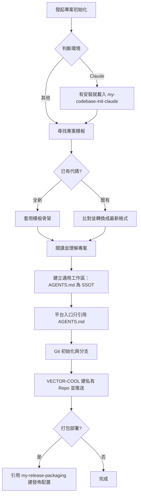

# my-codebase-init — 專案與版控初始化

依組織標準完成骨架、規範注入與 GitHub 遠端初始化。



## codebase 結構

目標：**通用、接地氣**，不自創結構。

```text
<專案>/
├─ README.md   AGENTS.md   CLAUDE.md     ← 入口（CLAUDE.md 只在用 Claude 時建）
├─ package.json / composer.json …       ← 語言生態規定放根目錄的，照放
├─ LICENSE  CHANGELOG.md  .gitignore     ← 業界慣例的根目錄檔，照放
├─ docs/                                  ← 所有文件（內部結構見 my-docs「docs/ 結構」）
│  ├─ NOTE.md            交接紀錄（一定有）
│  └─ specs/ guides/ adr/ plans/ …        有才建
├─ scripts/                               ← 所有腳本與其設定
│  ├─ pack-release.mjs   （僅打包部署）
│  ├─ release.config.json
│  └─ tmp/               開發期臨時產物：測試檔、一次性腳本、agent 跑指令的 error log（<用途>-<日期>.log）；不進版控，任務結束清掉
├─ dist/                                  ← 打包輸出（僅打包部署）；不進版控，my-codebase-clear 預設不清
├─ log/  或框架規定的路徑                  ← 程式執行期日誌（正式機也寫）；內容不進版控、不進包，打包列 placeholders
└─ src/ tests/  或框架自己的結構           ← 跟語言／框架慣例，不改
```

1. **生態慣例優先**：根目錄只留入口與生態規定的檔（`package.json`、`LICENSE`、`.gitignore`、`.gitattributes` 等），硬搬會壞。程式目錄跟語言與框架慣例（Node `src/`、Laravel `app/`、WordPress 外掛結構）。
2. **只加兩個目錄**：`docs/`、`scripts/`。已有就沿用；不建空目錄。`dist/`、`scripts/tmp/` 由腳本或任務產生，不預建；執行期 log 跟框架慣例（Laravel `storage/logs/`、WordPress 自己的），沒慣例才用 `log/`。
3. 隱藏工具目錄（`.agents/`、`.claude/`、`.cursor/`、`.github/`）照各工具規定。
4. 實際結構寫進 `AGENTS.md`「目錄架構」，不另建結構文件。

## 執行流程

### 0. 判斷環境

流程與環境無關，**`AGENTS.md` 為唯一來源**：

- **Claude**（Code、Desktop、IDE、雲端 session）：步驟 5 要建 `CLAUDE.md`。已安裝 `my-codebase-init-claude`（toolkit `my-skills/claude/`，獨立 skill，不隨本 plugin）就一併載入補 `.claude/`、plugin 啟用、雲端差異；沒裝就只建 `CLAUDE.md` 並提醒可安裝。
- **Cursor**：原生讀根目錄 `AGENTS.md`，不另寫規則；使用者要才建 `.cursor/rules/agents.mdc`（步驟 5）。
- **其他**：入口就是 `AGENTS.md`。
- **Claude 雲端 session 不載入 plugin 與 marketplace**，新專案要用的規則得放進 repo（`AGENTS.md`、`CLAUDE.md`、`.claude/`）。
- 不確定是不是雲端就當本地，不掃系統猜。

### 1. 定位模板

依序找，找到即停：環境變數 `VECTOR_PROJECT_TEMPLATES` → 本機 `D:\PROJECTS\project-templates` → 都沒有就暫停回報，不盲目生成。

### 2. 骨架

- **全新專案**：選最貼近業務型態的模板複製基礎結構。
- **已有專案**：只增量補齊模板可整合的 `skills/`、`rules/`、`docs/`，不破壞既有代碼；入口文件與發佈配置**已存在的照 [`references/convert.md`](references/convert.md) 轉換**，不是跳過也不是整份覆蓋。

### 3. 閱讀並理解專案

**寫入口文件前先讀懂專案**，內容來自實際讀到的事實，不猜、不套空範本。

1. 結構：`ls -a`、目錄樹兩層、各頂層目錄用途、`git log --oneline -20`、既有 agent 設定（`AGENTS.md`、`CLAUDE.md`、`.cursor/`、`.github/copilot-instructions.md`、`GEMINI.md`、`.agents/`）。
2. 讀 `README.md`、`package.json`／`composer.json`／`Makefile`／`pyproject.toml`，找**實際存在的**安裝、啟動、測試、lint、build 指令與版本來源。
3. 技術棧、入口檔、主要目錄用途、既有慣例（分支、commit、風格）、不能動的東西。
4. 指令能跑就**實際跑一次**；跑不了標「待確認」。
5. 既有 agent 設定的**通用內容**收斂進 `AGENTS.md`，原檔保留（轉 Claude 最佳實踐用 `my-claude-codebase-convert`）。
6. 用兩三句向使用者說明理解（做什麼、怎麼跑、怎麼測、哪裡不確定），有疑問先問再寫。

### 4. 建立通用工作區

任何 AI 編輯器**讀完入口就能接手**。`AGENTS.md` 為唯一來源，不為單一平台另寫一份。範本在 [`templates/`](templates/)，用步驟 3 的事實填。缺的新建；已存在的照 `references/convert.md`。

| 檔案 | 用途 | 規則 |
|------|------|------|
| `AGENTS.md` | 所有 agent 的入口 | 角色指引、指令、目錄架構、規範、禁止事項，開頭「接手三步」。200 行內，超過拆到 `docs/` |
| `README.md` | 給人看 | **標題正下方一行寫版本**（``**版本：`v0.1.0`**``）；再定位、技術棧、快速啟動 |
| `docs/NOTE.md` | 交接紀錄，專案本地記憶 | 目前狀態、進行中、下一步、已決定、偏好、待確認、怎麼驗證、更新紀錄。做完一段、使用者說「記住」、做出影響後續的決定或交接時更新；只記本專案（跨專案走 `my-memory`），約 100 行內，已決定被推翻要註明取代者；不記機密 |
| `.agents/skills/<name>/SKILL.md` | 專案 skill，跨編輯器共用 | 從模板複製貼近業務的，加專案自己的；`name` 與資料夾名一致 |
| `.gitignore` | 忽略清單 | **一律建立**：`.env`、`.env.*`（保留 `!.env.example`）、`dist/`、`scripts/tmp/`、`log/*`（或框架的 log 路徑）、`node_modules/`、`.claude/settings.local.json`、`CLAUDE.local.md`、`*.log` |
| `.gitattributes` | `export-ignore` | **僅打包部署的專案**在步驟 7 建；函式庫、公開開源不要建 |

- **版本**：初始 `v0.1.0`（使用者另有指定照指定）。已有版本來源（`package.json`、`VERSION`、tag）就與它一致，改版同步。
- `.agents/skills/` 是各編輯器共用位置（Codex 會發現）。其他編輯器讀自己的路徑（如 `.claude/skills/`）時以 symlink 或複製指到這裡，不維護兩份；發現路徑以官方文件為準，沒查證不斷言。
- **結構驗證**：寫完 `ls -a` 根目錄，逐項對照「codebase 結構」與 `AGENTS.md`「目錄架構」；不在清單的就搬或寫進 `AGENTS.md` 說明。
- 平台專屬設定不進 `AGENTS.md` 主體，放最後「各 agent 平台備註」。

### 5. 平台入口（只引用 AGENTS.md）

各平台入口**只放一行引用，不重複內容、不放規則**；只建正在用的平台。

| 平台 | 入口 | 做法 |
|------|------|------|
| 通用（Codex、Copilot coding agent、Zed、Warp、Windsurf 等） | `AGENTS.md` 本身 | 不另建 |
| **Claude Code** | `CLAUDE.md` | 第一行 `@AGENTS.md`，下面只放 Claude 專屬（範本 [`templates/CLAUDE.md`](templates/CLAUDE.md)）。Claude 只在沒有任何 `CLAUDE.md` 時才直接讀 `AGENTS.md`，保留引用最保險 |
| **Cursor** | 原生讀 `AGENTS.md` | 不需要。使用者要才建 `.cursor/rules/agents.mdc`，`alwaysApply: true`，只指向 `AGENTS.md`（範本 [`templates/cursor-agents.mdc`](templates/cursor-agents.mdc)）；必須是 `.mdc`，`.md` 會被忽略；規則裡以路徑引用的檔是 Agent 用工具讀的，不內嵌 |
| Gemini CLI | `.gemini/settings.json` | context 檔名設為 `AGENTS.md` |
| Aider | `.aider.conf.yml` | `read: AGENTS.md` |
| 其他 | 官方文件 | 沒查證不斷言 |

- 入口檔與 `AGENTS.md` 衝突以 `AGENTS.md` 為準。
- 專案 skill 唯一來源 `.agents/skills/`；symlink 在 Windows 可能需額外設定，不確定時用複製並在 `docs/NOTE.md` 記同步方式。

### 6. Git 與遠端

尚未版控時：

1. `git init`；確認路徑大小寫與檔案系統一致。
2. 基礎提交，主分支 `main`；`git checkout -b develop`。
3. 在 `VECTOR-COOL` 建**私有** repo（預設 `gh`；沒有就用該環境提供的方式，Claude 雲端見子 skill）：
   ```bash
   gh repo create VECTOR-COOL/<repo-name> --private --source=. --remote=origin
   ```
4. `git push -u origin main`、`git push -u origin develop`。
5. 回報遠端 URL 與分支狀態。

### 7. 發佈配置（最後一步，僅打包部署）

專案是**解壓到正式機、交給客戶或維運的 ZIP**（PHP、WordPress、靜態網站等）時，引用 [`my-release-packaging`](../my-release-packaging/SKILL.md)。不確定就問；函式庫、公開開源、純內部工具**不要建**：`export-ignore` 也會影響 GitHub 的 Source code ZIP。

0. 已有舊版打包腳本或發佈配置：走 `references/convert.md`「發佈配置轉換」，不重建、不覆蓋客製內容。
1. 依該 skill 建：`.gitattributes`（開發與 AI 治理檔 `export-ignore`）、`scripts/pack-release.mjs`（複製附帶腳本）、`scripts/release.config.json`（用步驟 3 的事實填 `name`、`version`、`lint`、`placeholders`、`forbiddenExtra`、`outDir`，範例 [`release.config.example.json`](../my-release-packaging/references/release.config.example.json)；**不確定的欄位問，不猜**）、`docs/RELEASE_SPEC.md`。
2. `.gitignore` 補 `dist/`。
3. 更新 `AGENTS.md`「發佈（若有）」（唯一產出指令、規格書路徑、`dist/` 不進版控、每次部署後打 tag）與 `docs/NOTE.md`「部署紀錄」；非打包專案刪掉這兩節。
4. **驗證**：`node scripts/pack-release.mjs --dry-run` 結束碼 0、`topLevelIncluded` 只有正式機需要的項目、沒洩漏。失敗就修設定。
5. commit 並 push `develop`：`chore(release): 建立發佈流程配置`。
6. 回報建立的檔、`--dry-run` 結果、沒實測的部分。
