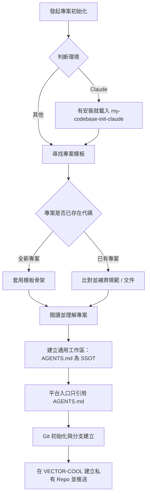

# my-codebase-init — 專案與版控初始化

將新專案依組織標準完成骨架搭建、規範注入與 GitHub 遠端儲存庫初始化。



## 執行流程

### 0. 判斷環境並路由

本 skill 是通用流程，與環境無關，**以 `AGENTS.md` 為唯一來源**。先判斷你是誰、在哪裡跑：

- **你是 Claude**（Claude Code 本機、Desktop、IDE 外掛、雲端 session）：步驟 5 的平台入口要建 `CLAUDE.md`。已安裝 `my-codebase-init-claude`（toolkit 的 `my-skills/claude/`，獨立 skill，不隨本 plugin 安裝）就一併載入，補上 `.claude/` 設定、plugin 啟用、雲端 session 差異；沒安裝就只做 `CLAUDE.md`，再提醒使用者可安裝。
- **你是 Cursor**：Cursor 原生讀根目錄 `AGENTS.md`，不需要為它另寫規則；使用者要 Cursor 自己的入口才建 `.cursor/rules/agents.mdc`（見步驟 5）。
- **其他環境**：只照本流程，入口就是 `AGENTS.md`。
- **Claude 雲端 session 不載入 plugin 與 marketplace**，my-workflow 的規則與 skill 不會自動存在；新專案要用的規則得放進 repo（`AGENTS.md`、`CLAUDE.md`、`.claude/`）。
- 不確定是不是雲端就當本地，不掃系統來猜。

### 1. 定位專案模板目錄

依序尋找專案模板來源，找到即停：
1. 環境變數 `VECTOR_PROJECT_TEMPLATES`。
2. 本機目錄 `D:\PROJECTS\project-templates`（僅本機環境生效）。
3. 若皆不存在，暫停並向使用者回報缺少模板來源，不盲目生成。

### 2. 專案骨架與內容初始化

- **全新專案（尚未初始化）**：
  - 從模板目錄選取最貼近業務型態的模板作為基底，複製基礎檔案結構。
- **已有專案（補齊規範）**：
  - 比對模板中是否有可整合的 `skills/`、`rules/`、`docs/` 或架構範本，僅增量補齊，不破壞既有代碼。

### 3. 閱讀並理解專案

**寫任何入口文件之前先讀懂專案**，內容來自實際讀到的事實，不憑猜測、不套空洞範本（規則：不編造路徑、指令、版本）。

1. 看結構：`ls`、目錄樹、`git log --oneline -20`、有沒有既有的 agent 設定（`AGENTS.md`、`CLAUDE.md`、`.cursor/`、`.github/copilot-instructions.md`、`GEMINI.md`、`.agents/` 等）。
2. 讀 `README.md`、`package.json`／`composer.json`／`Makefile`／`pyproject.toml` 等，找出**實際存在的**安裝、啟動、測試、lint、build 指令與版本來源。
3. 找出技術棧、入口檔、主要目錄的用途、既有慣例（分支、commit、風格）、不能動的東西。
4. 指令能跑就**實際跑一次**驗證；跑不了的標「待確認」，不要寫成已驗證。
5. 已有的 agent 設定，先把其中**通用的內容**收斂進 `AGENTS.md`，原檔保留不刪（要轉成 Claude 最佳實踐用 `my-claude-codebase-convert`）。
6. 讀完用兩三句向使用者說明你的理解（專案做什麼、怎麼跑、怎麼測、哪裡不確定），有疑問先問，再寫檔。

### 4. 建立通用工作區

目標：任何 AI 編輯器（Claude Code、Codex、Cursor、Copilot 等）打開專案，**讀完入口就能立刻接手**。以 `AGENTS.md` 為唯一來源，不為單一平台重複寫一份。範本在 [`templates/`](templates/)，內容用步驟 3 實際讀到的事實填，缺什麼補什麼，**已存在的檔案不覆蓋**，只補缺的段落。

| 檔案 | 用途 | 規則 |
|------|------|------|
| `AGENTS.md` | 所有 agent 的專案入口 | 角色指引、指令、目錄架構、規範、禁止事項，開頭寫「接手三步」。200 行內，超過拆到 `docs/` |
| `README.md` | 給人看的專案說明 | **標題正下方一行寫目前版本**（``**版本：`v0.1.0`**``）；再來定位、技術棧、快速啟動 |
| `NOTE.md` | 交接紀錄 | 目前狀態、進行中、下一步、已決定、待確認、怎麼驗證、更新紀錄。做完一段工作或交接時更新；不記機密 |
| `.agents/skills/<name>/SKILL.md` | 專案專屬 skill，跨編輯器共用 | 從模板複製貼近業務的 skill，加上專案自己的；`name` 與資料夾名一致 |
| `.gitignore` | 忽略清單 | **一律建立**：`.env`、`.env.*`（保留 `!.env.example`）、`dist/`、`node_modules/`、`.claude/settings.local.json`、`CLAUDE.local.md`、`*.log` |
| `.gitattributes` | 發佈排除（`export-ignore`） | **僅「以打包檔部署」的專案**才建（見下）；函式庫、公開開源專案不要建 |

- **版本**：初始 `v0.1.0`（使用者另有指定就照指定）。專案若已有版本來源（`package.json`、`VERSION`、git tag），README 的版本與它保持一致，改版時同步。
- **`.agents/skills/`** 是各編輯器共用的 skill 位置（Codex 會發現它）。其他編輯器若讀自己的路徑（如 Claude 讀 `.claude/skills/`），以 symlink 或複製指到這裡，不要維護兩份；各編輯器的發現路徑以其官方文件為準，沒查證就不要斷言。
- **平台入口**（`CLAUDE.md` 等）：見步驟 5。
- **發佈打包（選用）**：專案是解壓到正式機、交給客戶或維運的 ZIP（PHP、WordPress、靜態網站等）時，載入 `my-release-packaging`：建立 `.gitattributes` 的 `export-ignore`、`scripts/pack-release.mjs`、`release.config.json`、`docs/RELEASE_SPEC.md`。**不是每個專案都需要**：`export-ignore` 也會影響 GitHub 的 Source code ZIP 下載，函式庫與開源專案通常不該排除 `docs/`、`README.md`。不確定就問使用者「這個專案是不是打包部署」。
- 不把任何平台專屬設定寫進 `AGENTS.md` 主體，放在它最後的「各 agent 平台備註」。

### 5. 平台入口（只引用 AGENTS.md）

`AGENTS.md` 是 SSOT，各平台入口**只放一行引用，不重複內容、不放規則**。只建使用者正在用的平台，不一次全建。依官方文件整理：

| 平台 | 入口 | 做法 |
|------|------|------|
| 通用（Codex、Copilot coding agent、Zed、Warp、Windsurf 等） | `AGENTS.md` 本身 | 不需另建（agents.md 列為相容） |
| **Claude Code** | `CLAUDE.md` | 第一行 `@AGENTS.md`，下面只放 Claude 專屬內容（範本 [`templates/CLAUDE.md`](templates/CLAUDE.md)）。Claude 只在沒有任何 `CLAUDE.md` 時才直接讀 `AGENTS.md`，保留引用最保險 |
| **Cursor** | 原生讀根目錄與子目錄的 `AGENTS.md` | 不需要。要 Cursor 自己的入口才建 `.cursor/rules/agents.mdc`，`alwaysApply: true`，內容只指向 `AGENTS.md`（範本 [`templates/cursor-agents.mdc`](templates/cursor-agents.mdc)）；Cursor 規則檔必須是 `.mdc`，`.md` 會被忽略；規則裡以路徑引用的檔案是 Agent 用工具讀的，不會內嵌，所以重要內容仍留在 `AGENTS.md` |
| Gemini CLI | `.gemini/settings.json` | 設定 context 檔名為 `AGENTS.md`（依 agents.md 的說明） |
| Aider | `.aider.conf.yml` | `read: AGENTS.md` |
| 其他 | 該平台官方文件 | 沒查證就不要斷言，也不要憑記憶寫 |

- 入口檔和 `AGENTS.md` 內容衝突時以 `AGENTS.md` 為準。
- 專案專屬 skill 的唯一來源是 `.agents/skills/`；平台若讀自己的路徑（如 `.claude/skills/`），以 symlink 或複製指到這裡，不維護兩份（symlink 在 Windows 可能需要額外設定，不確定時用複製並在 `NOTE.md` 記下同步方式）。

### 6. Git 版本控制與遠端設定

若專案尚未設定 Git 版控：
1. 初始化本地 Git 儲存庫：`git init`。
2. 確認 Git 路徑大小寫與檔案系統完全一致。
3. 建立基礎提交，預設主分支為 `main`。
4. 建立並切換至日常開發分支：`git checkout -b develop`。
5. 在 GitHub `VECTOR-COOL` 組織下建立對應的**私有 (Private) 儲存庫**（預設用 `gh`；沒有 `gh` 就改用該環境提供的方式，Claude 雲端見子 skill）：
   ```bash
   gh repo create VECTOR-COOL/<repo-name> --private --source=. --remote=origin
   ```
6. 推送至遠端並設定追蹤：
   ```bash
   git push -u origin main
   git push -u origin develop
   ```
7. 回報遠端儲存庫 URL 與分支狀態。
