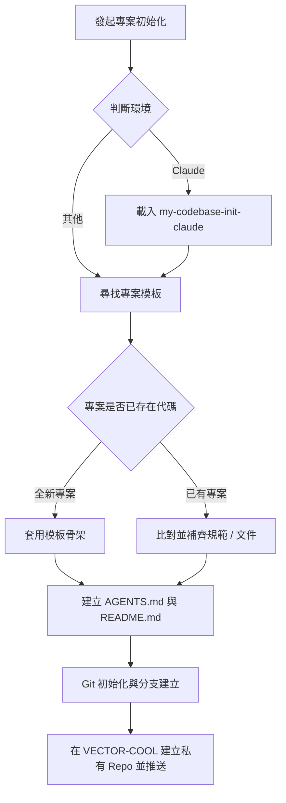

# my-codebase-init — 專案與版控初始化

將新專案依組織標準完成骨架搭建、規範注入與 GitHub 遠端儲存庫初始化。



## 執行流程

### 0. 判斷環境並路由

本 skill 是通用流程，與環境無關。先判斷目前環境：

- **Claude**（Claude Code 本機、Desktop、IDE 外掛、雲端 session）：另載入 [`my-codebase-init-claude`](../my-codebase-init-claude/SKILL.md)。通用流程照下面做，Claude 專屬的步驟（`CLAUDE.md`、`.claude/`、plugin 啟用、雲端 session 差異）由子 skill 補上。
- **Claude 雲端 session 不載入 plugin 與 marketplace**，所以 my-workflow 的規則與 skill 不會自動存在；新專案要用的規則得放進 repo（`CLAUDE.md`、`.claude/`、`AGENTS.md`），細節見子 skill。
- **其他環境**：只照本流程。
- 不確定是不是雲端就當本地，不掃系統來猜。

### 1. 定位專案模板目錄

依序尋找專案模板來源，找到即停：
1. 環境變數 `VECTOR_PROJECT_TEMPLATES`。
2. 本機目錄 `D:\PROJECTS\project-templates`（僅本機環境生效）。
3. 若皆不存在，暫停並向使用者回報缺少模板來源，不盲目生成。

### 2. 專案骨架與內容初始化

- **全新專案（尚未初始化）**：
  - 從模板目錄選取最貼近業務型態的模板作為基底，複製基礎檔案結構。
- **已有專案（補齊規範）**：
  - 比對模板中是否有可整合的 `skills/`、`rules/`、`docs/` 或架構範本，僅增量補齊，不破壞既有代碼。

### 3. 建立核心入口文件

- **`AGENTS.md`**：定義該專案的角色指引、目錄架構、開發環境與禁止事項。
- **`README.md`**：撰寫專案名稱、定位、SemVer 版本號（例如 `v1.0.0` 徽章）、技術棧與快速啟動指令。

### 4. Git 版本控制與遠端設定

若專案尚未設定 Git 版控：
1. 初始化本地 Git 儲存庫：`git init`。
2. 確認 Git 路徑大小寫與檔案系統完全一致。
3. 建立基礎提交，預設主分支為 `main`。
4. 建立並切換至日常開發分支：`git checkout -b develop`。
5. 在 GitHub `VECTOR-COOL` 組織下建立對應的**私有 (Private) 儲存庫**（預設用 `gh`；沒有 `gh` 就改用該環境提供的方式，Claude 雲端見子 skill）：
   ```bash
   gh repo create VECTOR-COOL/<repo-name> --private --source=. --remote=origin
   ```
6. 推送至遠端並設定追蹤：
   ```bash
   git push -u origin main
   git push -u origin develop
   ```
7. 回報遠端儲存庫 URL 與分支狀態。
