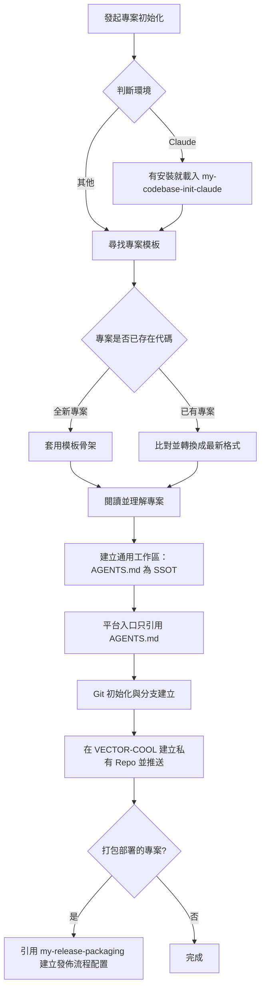

# my-codebase-init — 專案與版控初始化

將新專案依組織標準完成骨架搭建、規範注入與 GitHub 遠端儲存庫初始化。



## codebase 結構

目標：**通用、接地氣**，任何 agent 或工程師一看就懂。不自創結構，用大家早就在用的慣例。

```text
<專案>/
├─ README.md   AGENTS.md   CLAUDE.md     ← 入口（CLAUDE.md 只在用 Claude 時建）
├─ package.json / composer.json …       ← 語言生態規定放根目錄的，照放
├─ LICENSE  CHANGELOG.md  .gitignore     ← 業界慣例的根目錄檔，照放
├─ docs/                                  ← 所有文件（內部結構見 my-docs 的「docs/ 結構」）
│  ├─ NOTE.md            交接紀錄（一定有）
│  └─ specs/ guides/ adr/ plans/ …        有才建
├─ scripts/                               ← 所有腳本與其設定
│  ├─ pack-release.mjs   （僅打包部署）
│  └─ release.config.json
└─ src/ tests/  或框架自己的結構           ← 跟語言／框架慣例，不改
```

1. **生態慣例優先**：根目錄只留**入口與生態規定的檔**。`package.json`、`composer.json`、`LICENSE`、`.gitignore`、`.gitattributes` 等工具要求在根目錄的照放，硬搬會壞。程式目錄跟語言與框架慣例（Node 用 `src/`、Laravel 照 `app/`、WordPress 照外掛結構），不重新發明。
2. **只加兩個目錄**：`docs/`、`scripts/`。專案已有就沿用，不另建第二個；沒有需要不建空目錄。
3. 隱藏的工具目錄（`.agents/`、`.claude/`、`.cursor/`、`.github/`）照各工具規定放。
4. 實際結構寫進 `AGENTS.md` 的「目錄架構」，不另建結構文件。

## 執行流程

### 0. 判斷環境並路由

本 skill 是通用流程，與環境無關，**以 `AGENTS.md` 為唯一來源**。先判斷你是誰、在哪裡跑：

- **你是 Claude**（Claude Code 本機、Desktop、IDE 外掛、雲端 session）：步驟 5 的平台入口要建 `CLAUDE.md`。已安裝 `my-codebase-init-claude`（toolkit 的 `my-skills/claude/`，獨立 skill，不隨本 plugin 安裝）就一併載入，補上 `.claude/` 設定、plugin 啟用、雲端 session 差異；沒安裝就只做 `CLAUDE.md`，再提醒使用者可安裝。
- **你是 Cursor**：Cursor 原生讀根目錄 `AGENTS.md`，不需要為它另寫規則；使用者要 Cursor 自己的入口才建 `.cursor/rules/agents.mdc`（見步驟 5）。
- **其他環境**：只照本流程，入口就是 `AGENTS.md`。
- **Claude 雲端 session 不載入 plugin 與 marketplace**，my-workflow 的規則與 skill 不會自動存在；新專案要用的規則得放進 repo（`AGENTS.md`、`CLAUDE.md`、`.claude/`）。
- 不確定是不是雲端就當本地，不掃系統來猜。

### 1. 定位專案模板目錄

依序尋找專案模板來源，找到即停：
1. 環境變數 `VECTOR_PROJECT_TEMPLATES`。
2. 本機目錄 `D:\PROJECTS\project-templates`（僅本機環境生效）。
3. 若皆不存在，暫停並向使用者回報缺少模板來源，不盲目生成。

### 2. 專案骨架與內容初始化

- **全新專案（尚未初始化）**：
  - 從模板目錄選取最貼近業務型態的模板作為基底，複製基礎檔案結構。
- **已有專案（補齊規範）**：
  - 比對模板中是否有可整合的 `skills/`、`rules/`、`docs/` 或架構範本，僅增量補齊，不破壞既有代碼。
  - 入口文件與發佈配置**已存在的，依下方「既有檔案：轉換成最新格式」處理**，不是跳過，也不是整份覆蓋。

### 3. 閱讀並理解專案

**寫任何入口文件之前先讀懂專案**，內容來自實際讀到的事實，不憑猜測、不套空洞範本（規則：不編造路徑、指令、版本）。

1. 看結構：`ls -a`、目錄樹（兩層即可）、各頂層目錄的用途、`git log --oneline -20`、有沒有既有的 agent 設定（`AGENTS.md`、`CLAUDE.md`、`.cursor/`、`.github/copilot-instructions.md`、`GEMINI.md`、`.agents/` 等）。
2. 讀 `README.md`、`package.json`／`composer.json`／`Makefile`／`pyproject.toml` 等，找出**實際存在的**安裝、啟動、測試、lint、build 指令與版本來源。
3. 找出技術棧、入口檔、主要目錄的用途、既有慣例（分支、commit、風格）、不能動的東西。
4. 指令能跑就**實際跑一次**驗證；跑不了的標「待確認」，不要寫成已驗證。
5. 已有的 agent 設定，先把其中**通用的內容**收斂進 `AGENTS.md`，原檔保留不刪（要轉成 Claude 最佳實踐用 `my-claude-codebase-convert`）。
6. 讀完用兩三句向使用者說明你的理解（專案做什麼、怎麼跑、怎麼測、哪裡不確定），有疑問先問，再寫檔。

### 4. 建立通用工作區

目標：任何 AI 編輯器（Claude Code、Codex、Cursor、Copilot 等）打開專案，**讀完入口就能立刻接手**。以 `AGENTS.md` 為唯一來源，不為單一平台重複寫一份。範本在 [`templates/`](templates/)，內容用步驟 3 實際讀到的事實填。缺的檔案新建；**已存在的檔案依「既有檔案：轉換成最新格式」改成最新格式**（保留所有既有資訊，不是整份覆蓋，也不是跳過）。

| 檔案 | 用途 | 規則 |
|------|------|------|
| `AGENTS.md` | 所有 agent 的專案入口 | 角色指引、指令、目錄架構、規範、禁止事項，開頭寫「接手三步」。200 行內，超過拆到 `docs/` |
| `README.md` | 給人看的專案說明 | **標題正下方一行寫目前版本**（``**版本：`v0.1.0`**``）；再來定位、技術棧、快速啟動 |
| `docs/NOTE.md` | 交接紀錄，也是專案本地記憶 | 目前狀態、進行中、下一步、已決定、偏好、待確認、怎麼驗證、更新紀錄。做完一段工作、使用者說「記住」、做出影響後續的決定或交接時更新；只記本專案（跨專案偏好走 `my-memory`），約 100 行內，已決定被推翻要註明取代者；不記機密 |
| `.agents/skills/<name>/SKILL.md` | 專案專屬 skill，跨編輯器共用 | 從模板複製貼近業務的 skill，加上專案自己的；`name` 與資料夾名一致 |
| `.gitignore` | 忽略清單 | **一律建立**：`.env`、`.env.*`（保留 `!.env.example`）、`dist/`、`node_modules/`、`.claude/settings.local.json`、`CLAUDE.local.md`、`*.log` |
| `.gitattributes` | 發佈排除（`export-ignore`） | **僅「以打包檔部署」的專案**才建（見下）；函式庫、公開開源專案不要建 |

- **版本**：初始 `v0.1.0`（使用者另有指定就照指定）。專案若已有版本來源（`package.json`、`VERSION`、git tag），README 的版本與它保持一致，改版時同步。
- **`.agents/skills/`** 是各編輯器共用的 skill 位置（Codex 會發現它）。其他編輯器若讀自己的路徑（如 Claude 讀 `.claude/skills/`），以 symlink 或複製指到這裡，不要維護兩份；各編輯器的發現路徑以其官方文件為準，沒查證就不要斷言。
- **平台入口**（`CLAUDE.md` 等）：見步驟 5。
- **結構驗證**：寫完 `ls -a` 根目錄，逐項對照上方「codebase 結構」與 `AGENTS.md` 的「目錄架構」：根目錄只有入口、生態規定的檔與目錄；不在清單的就搬或寫進 `AGENTS.md` 說明。
- **發佈打包（選用）**：打包部署的專案在**最後一步**（步驟 7）引用 `my-release-packaging` 建立發佈流程配置，這裡先不建 `.gitattributes`。
- 不把任何平台專屬設定寫進 `AGENTS.md` 主體，放在它最後的「各 agent 平台備註」。

### 既有檔案：轉換成最新格式

專案已經有這些檔案時（舊專案、別的 skill 或別的工具建的），**修改或轉換成最新格式**。原則：**不遺失資訊**——舊內容的每一條都要在新檔找得到，只是重組成最新結構；不確定歸類的放「待確認」，不丟棄。

**流程**

1. **盤點與判斷**：逐檔對照下表「舊格式特徵」，判斷哪些已是最新、哪些要轉換、哪些缺。已是最新格式的不動。
2. **提出轉換計畫**：用表格列出每個檔的現況、要改什麼、舊內容會放到新檔哪裡、無法歸類的項目、會刪除的重複內容。**使用者同意前不寫檔。**
3. **在新分支上轉換**（例如 `chore/init-format`），一個 commit：`chore(docs): 入口文件轉換成最新格式`。專案沒有 Git 就先 `git init` 並提交現況當還原點。
4. **驗證**：逐條核對舊內容都在新檔；`git diff` 只應有結構調整與新增；指令實際跑過；發佈配置跑 `--dry-run`。有遺失就補回來。
5. 回報：轉換了哪些檔、每個檔的主要變更、待確認項目。

**各檔轉換規則**

| 檔案 | 舊格式特徵 | 轉換成最新格式 |
|------|-----------|----------------|
| `AGENTS.md` | 沒有「接手三步」；指令、目錄、規範、禁止事項散在各處；內容超過 200 行；含平台專屬內容 | 重組成範本結構（接手三步、專案、指令、目錄架構、規範、禁止事項、發佈、各 agent 平台備註）。舊條目逐條歸位；平台專屬內容移到最後一節或對應入口；過長就拆到 `docs/` 並在這裡留連結 |
| `README.md` | 版本只在徽章或內文、不在標題正下方；沒有版本 | **標題正下方一行** ``**版本：`vX.Y.Z`**``，版本取自專案版本來源（徽章若是靜態文字就以版本來源為準）；其餘內容保留；缺的「技術棧」「快速啟動」「文件」依實際補上 |
| `docs/NOTE.md` | 沒有；在根目錄的 `NOTE.md`；或叫 `TODO.md`、`HANDOFF.md`、`MEMORY.md`、`STATUS.md` 的交接／進度檔 | 用 `git mv` 搬到 `docs/NOTE.md`，轉成 `NOTE.md` 結構（目前狀態、進行中、下一步、已決定、偏好、待確認、怎麼驗證、更新紀錄；舊檔裡的偏好歸「偏好」，決策歸「已決定」）。舊檔內容併入後，舊檔若只剩重複內容就刪除（git 歷史留底），並更新所有引用 |
| `CLAUDE.md` | 內容和 `AGENTS.md` 重複；或沒有 `@AGENTS.md` | 第一行 `@AGENTS.md`；和 `AGENTS.md` 重複的段落移除（先確認 `AGENTS.md` 已有）；只留 Claude 專屬內容 |
| `.cursorrules`、`.cursor/rules/*.mdc`、`.github/copilot-instructions.md`、`GEMINI.md`、`.windsurfrules` | 各平台各寫一份規則 | **不刪、不改壞**。把其中**通用內容**收斂進 `AGENTS.md`；原檔保留，需要時在開頭註明「以 AGENTS.md 為準」。要轉成 Claude 最佳實踐（`.claude/rules/` 等）用 `my-claude-codebase-convert` |
| `.agents/skills/`、`.claude/skills/`、`.cursor/skills/` | 專案 skill 在多處各有一份 | 以 `.agents/skills/` 為唯一來源，其他指向它（symlink 或複製並在 `docs/NOTE.md` 記下同步方式） |
| 根目錄其他檔 | 根目錄散著規格、計畫、設計文件、腳本、打包設定（如 `SPEC.md`、`RELEASE_SPEC.md`、`build.mjs`、`release.config.json`） | 文件 `git mv` 進 `docs/`、腳本與其設定進 `scripts/`，再全專案 `grep` 舊路徑並更新引用（含 CI、`package.json` scripts）。**生態規定的檔與專案原有的程式目錄不搬**；搬了會壞或不確定的，列給使用者決定 |
| `.gitignore` | 缺 `.env*`、`dist/`、`.claude/settings.local.json`、`CLAUDE.local.md`、`*.log` | 只**補缺的條目**，不改動既有行 |
| `.gitattributes` | 打包專案缺 `/docs`、`/scripts` 或 AI 治理檔的 `export-ignore` | 只補缺的 `export-ignore` 行；不確定是不是打包部署就問 |
| `scripts/pack-release.mjs`、`scripts/release.config.json`、`docs/RELEASE_SPEC.md` | 設定檔在根目錄；或**舊版打包腳本**：沒有 `release.config.json` 支援、專案名稱／版本檔／禁則／lint 路徑寫死在腳本裡、用 `tar -tf` 讀 zip、沒有 `--since`、沒有內容掃描 | 見下「發佈配置轉換」 |

**發佈配置轉換**（步驟 7 發現舊版打包腳本時）

1. 讀舊腳本，把寫死的專案內容**搬到 `scripts/release.config.json`**（根目錄已有 `release.config.json` 就 `git mv` 過去）：專案名稱（`name`）、版本來源檔與 regex（`version`）、lint 指令（`lint`）、專案特有的禁則（`forbiddenExtra`，如帳密檔、上傳與日誌目錄的 pattern）、輸出目錄（`outDir`）。上傳、日誌目錄的 base path 同時列入 `placeholders`。
2. 用 `my-release-packaging` 附帶的最新腳本**取代** `scripts/pack-release.mjs`（舊版保留在 git 歷史，不另存備份檔）。舊腳本裡**不屬於上述設定、無法歸類的客製邏輯**，逐項列給使用者決定，不要默默丟掉。
3. `.gitattributes` 確認有 `/scripts export-ignore`（設定檔已在 `scripts/` 內，不必再單獨列）；`docs/RELEASE_SPEC.md` 依最新範本補上「占位目錄」「增量更新檔」「部署 SOP（解壓覆蓋）」，保留專案自己的白名單與排除清單。
4. **驗證新舊結果一致**：用舊腳本與新腳本各打一次（或各 `--dry-run`），比對包內檔案清單，差異必須能解釋（例如新腳本多了內容掃描、占位目錄）；不能解釋的差異就是轉換漏了東西。

### 5. 平台入口（只引用 AGENTS.md）

`AGENTS.md` 是 SSOT，各平台入口**只放一行引用，不重複內容、不放規則**。只建使用者正在用的平台，不一次全建。依官方文件整理：

| 平台 | 入口 | 做法 |
|------|------|------|
| 通用（Codex、Copilot coding agent、Zed、Warp、Windsurf 等） | `AGENTS.md` 本身 | 不需另建（agents.md 列為相容） |
| **Claude Code** | `CLAUDE.md` | 第一行 `@AGENTS.md`，下面只放 Claude 專屬內容（範本 [`templates/CLAUDE.md`](templates/CLAUDE.md)）。Claude 只在沒有任何 `CLAUDE.md` 時才直接讀 `AGENTS.md`，保留引用最保險 |
| **Cursor** | 原生讀根目錄與子目錄的 `AGENTS.md` | 不需要。要 Cursor 自己的入口才建 `.cursor/rules/agents.mdc`，`alwaysApply: true`，內容只指向 `AGENTS.md`（範本 [`templates/cursor-agents.mdc`](templates/cursor-agents.mdc)）；Cursor 規則檔必須是 `.mdc`，`.md` 會被忽略；規則裡以路徑引用的檔案是 Agent 用工具讀的，不會內嵌，所以重要內容仍留在 `AGENTS.md` |
| Gemini CLI | `.gemini/settings.json` | 設定 context 檔名為 `AGENTS.md`（依 agents.md 的說明） |
| Aider | `.aider.conf.yml` | `read: AGENTS.md` |
| 其他 | 該平台官方文件 | 沒查證就不要斷言，也不要憑記憶寫 |

- 入口檔和 `AGENTS.md` 內容衝突時以 `AGENTS.md` 為準。
- 專案專屬 skill 的唯一來源是 `.agents/skills/`；平台若讀自己的路徑（如 `.claude/skills/`），以 symlink 或複製指到這裡，不維護兩份（symlink 在 Windows 可能需要額外設定，不確定時用複製並在 `docs/NOTE.md` 記下同步方式）。

### 6. Git 版本控制與遠端設定

若專案尚未設定 Git 版控：
1. 初始化本地 Git 儲存庫：`git init`。
2. 確認 Git 路徑大小寫與檔案系統完全一致。
3. 建立基礎提交，預設主分支為 `main`。
4. 建立並切換至日常開發分支：`git checkout -b develop`。
5. 在 GitHub `VECTOR-COOL` 組織下建立對應的**私有 (Private) 儲存庫**（預設用 `gh`；沒有 `gh` 就改用該環境提供的方式，Claude 雲端見子 skill）：
   ```bash
   gh repo create VECTOR-COOL/<repo-name> --private --source=. --remote=origin
   ```
6. 推送至遠端並設定追蹤：
   ```bash
   git push -u origin main
   git push -u origin develop
   ```
7. 回報遠端儲存庫 URL 與分支狀態。

### 7. 發佈流程配置（最後一步，僅打包部署的專案）

專案是**解壓到正式機、交給客戶或維運的 ZIP**（PHP、WordPress、靜態網站等）時，Git 與遠端都建好後，**引用 [`my-release-packaging`](../my-release-packaging/SKILL.md)** 建立發佈流程配置。不確定就問使用者「這個專案是不是打包部署」；函式庫、公開開源專案、純內部工具**不要建**：`export-ignore` 也會影響 GitHub 的 Source code ZIP，會把 `docs/`、`README.md` 排除。

0. **已有舊版打包腳本或發佈配置**：改走上面「發佈配置轉換」，不要重建、不要覆蓋掉專案的客製內容。
1. 載入 `my-release-packaging`，依它的流程建立：
   - `.gitattributes`：把開發與 AI 治理檔（`.agents/`、`.claude/`、`.cursor/`、`AGENTS.md`、`CLAUDE.md`、`docs/`、`scripts/`、`tests/` 等）標成 `export-ignore`。
   - `scripts/pack-release.mjs`：複製該 skill 附帶的腳本。
   - `scripts/release.config.json`（和腳本放一起，腳本預設先讀同目錄）：用步驟 3 讀到的事實填（範例見 [`release.config.example.json`](../my-release-packaging/references/release.config.example.json)）：`name`、`version`（版本來源檔與 regex）、`lint`（實際存在的檢查指令）、`placeholders`（上傳、圖檔、日誌目錄的 base path）、`forbiddenExtra`（專案特有的帳密或設定檔）、`outDir`。**不確定的欄位問使用者，不猜。**
   - `docs/RELEASE_SPEC.md`：依該 skill 的規格書範本。
2. 把 `.gitignore` 補上 `dist/`（若步驟 4 還沒有）。
3. 回頭更新 `AGENTS.md` 的「發佈（若有）」一節（唯一產出指令、規格書路徑、`dist/` 不進版控、每次部署後打 tag），以及 `docs/NOTE.md` 的「部署紀錄」。沒有打包部署的專案就把這兩節刪掉。
4. **驗證**：實際跑 `node scripts/pack-release.mjs --dry-run`，確認結束碼 0、`topLevelIncluded` 只有正式機需要的項目、沒有洩漏。失敗就修設定，不要略過審核。
5. commit 並 push `develop`：`chore(release): 建立發佈流程配置`。
6. 回報建立了哪些檔、`--dry-run` 的結果，以及沒實測的部分（例如沒有在正式機實際部署過）。
