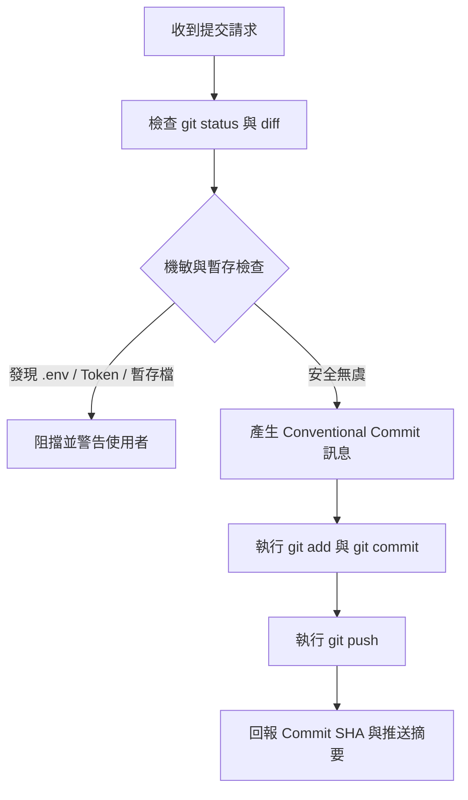

# my-commit-all-and-push — 安全提交與推送

將工作區的現有變更進行安全審查後，產生符合規範的語意化 Commit 訊息並推送至遠端儲存庫。



## 執行流程

### 1. 變更狀態與安全預檢

執行 `git status` 與 `git diff --cached` / `git diff`：
- **只帶自己的變更**：專案常有多個 session 同時在改。逐一確認每個變動檔是不是這次任務改的；不是的（別的 session、未追蹤的檔）不加入，並在回報時列出。
- **機敏資訊檢查**：嚴禁提交 `.env`、API Key、Token、私鑰或密碼。若有發現，立即中止並通知使用者。
- **暫存產物檢查**：確認無遺留的測試暫存檔（如 `scripts/tmp/`、`.log`、無用 dump 檔）。
- **分支檢查**：確認當前分支。嚴禁在 `main`／`master`、`develop`、`release/*` 執行任何 force push。

### 2. 產生 Conventional Commits 訊息

根據本次實際變更內容，組合標準 Conventional Commits 格式：

```text
<type>(<scope>): <繁體中文簡短主旨>

[選填：詳細條列變更要點 what & why]
```

- type 清單、主旨格式（祈使句、50 字元內、不加句號）與破壞性變更標記，以 [`rules/git.md`](../../rules/git.md) 為準，不在這裡另列。
- 主旨使用繁體中文。

### 3. 執行提交與推送

1. 只把自己改的檔加入暫存：`git add <files>`。不用 `git add .`／`git add -A`，避免帶進別人的變更。
2. 建立提交：`git commit -m "<訊息>"`。
3. 推送至遠端追蹤分支：`git push origin <當前分支>`。
4. 回報結果：輸出 Commit SHA、分支名稱、推送狀態與變更檔案數量。
