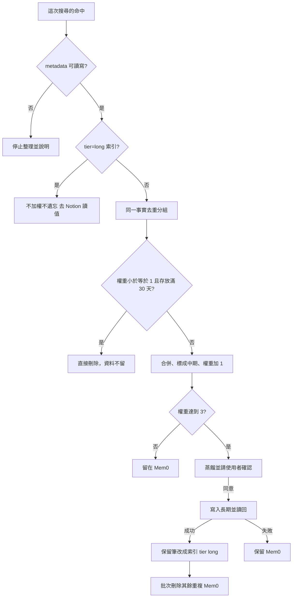

# 記憶整理

規則與閥值見 [rules/consolidate.md](rules/consolidate.md)，使用本 skill 時先讀。

寫入交給 Mem0 擋完全相同的句子。滾動加權只處理**這次查詢已經命中的那幾筆**。不整庫掃描，不為整理再搜一次，不逐筆補讀。身份、確認與後端讀寫以 [`my-memory`](../my-memory/SKILL.md) 與 [backends.md](../my-memory/references/backends.md) 為準。欄位以 [schemas.md](../my-memory/references/schemas.md) 為準。

## 時機

| 時機 | 誰做 | 做什麼 |
|------|------|--------|
| 寫入 | Mem0 新增，`infer=true` | 抽出事實，並擋完全相同的句子。這裡不加權、不升中期、不遺忘 |
| 查詢 | 本 skill | 用這一次命中去重、升中期、權重加 1 |
| 升長期 | 本 skill，同意後 | 寫入 Notion，讀回成功後把保留筆改成索引（`tier=long`），再刪其餘重複 |
| 直達長期 | 本 skill，同意後 | 使用者說永久記住或明示穩定身分事實：寫入 Notion，讀回成功後新增一筆索引，不走權重 |
| 遺忘 | 本 skill，條件成立就做 | 刪除該筆 Mem0。隱藏不算，資料必須清掉 |

搜尋分數、Memory Decay 的縮放、`categories` 都不是 `weight`。不要在寫入或查詢當下開關專案的 decay。

## 閥值

| 名稱 | 值 |
|------|----|
| 起始權重 | `1`。沒有 `weight`，或舊值 `normal`，都當 `1` |
| 舊值 `high` | 當 `3` |
| 每次查詢加權 | 同一則對話、同一組只加 `1` |
| 升長期 | 加權後 `weight` **大於等於 3** |
| 低權重 | `weight` **小於等於 1** |
| 遺忘 | 低權重，且最舊的 `created_at` **滿 30 天**；`tier=long` 索引**不適用** |

`tier=long` 的索引筆不加權、不遺忘、不與短期合併；它只是指向 Notion。沒有 `created_at` 就不遺忘，也不要猜日期。不能寫 metadata 時，這次不加權、不升層；遺忘條件仍成立就刪除。刪除失敗要明講，不要改成隱藏。

憑證、token、金鑰、付款資料不加權，也不寫進長期。

## 寫入

使用者說記住，且這筆是短期時：

1. `infer=true`。只有使用者要留下原句時才 `infer=false`。原句可能產生重複，留到下次查到再合併，不要為了它再搜一輪。
2. 這一則對話裡已經有同一事實的記憶 id，就更新那筆。沒有 id 就直接新增。不要先搜尋去重。
3. 新增工具沒有 `metadata` 時，寫入成功後用該筆 id 設 `weight=1`、`tier=short`。不要另開一筆。
4. 不要設 `expiration_date`。隱藏後資料還在，也會讓這筆不再被查到，因而刪不掉。

## 查詢當下

沿用回答問題的那一次搜尋結果。還沒有結果、必須查 Mem0 時，只打一次：

- `filters` 帶這次身份。至少要有工具要求的 `user_id`、`agent_id`、`app_id`、`run_id` 其中之一。
- `fields` 只留 `id`、`memory`、`user_id`、`agent_id`、`created_at`、`metadata`。
- `top_k` 用這次問題需要的筆數。`threshold` 用工具預設。
- 不要開 `rerank`。不要再取單筆，不要列整庫，不要為了找過期記憶再查一次。

只處理這次命中的筆。

0. 先把 `tier=long` 的索引筆挑出來：不加權、不遺忘、不進分組，照 [`my-memory`](../my-memory/SKILL.md) 讀取方法去 Notion 讀完整值。同一事實若同時有索引筆與短期筆，短期筆併進索引（保留索引、刪短期），不要再升一次長期；Notion 的 `目前值` 與短期內容衝突時列出差異問使用者。
1. 其餘按「同一 `scope`、同一 `user_id`、同一 `agent_id`、同一事實」分組。同一事實看語意。不同身份不要併在一起。
2. 一組先看遺忘。低權重且存放滿 30 天：這一組全部 id 立刻批次刪除，不加權、不升中期。回覆列出已刪 id、摘要與存放天數。
3. 其餘組：合併成一句，寫回保留的那筆，`tier` 設成 `mid`，`weight` 加 1。保留筆用這組最舊的 `created_at` 計算日後遺忘，不要用合併時間把年紀清零。
4. 每一組的保留筆只更新一次。批次更新若只能改文字，就不要拿它改 `weight` 或 `tier`，改用單筆更新 metadata。
5. 保留筆更新成功後，同組其餘 id 用批次刪除一次。更新沒成功就不要刪。回覆列出保留 id、新權重，以及刪掉的重複 id。
6. 加權後 `weight` 大於等於 3：進入升長期。還沒同意前，這筆留在 Mem0。

還在改的任務狀態可以升成中期，但不升長期。

## 升長期

沿用同一組的合併結果。

1. 蒸餾成一句去敏的穩定事實。還在改、或只是任務狀態，就拒絕升長期。
2. 抄來源的 `scope`、`user_id`、`agent_id`。隔離鍵是 `scope|user_id|agent_id|記憶鍵`。先查這把，沒有再查舊鍵 `user_id|agent_id|記憶鍵`。查到就更新那一頁。
3. 內容互補就合成一句。內容衝突就列出差異，等使用者選。永久庫已有多筆重複時，併進隔離鍵相符的那筆，其餘標 `已過時`，不要刪頁。
4. 顯示合併後的長期內容、隔離鍵、將改成索引的保留筆 id、將刪除的其餘 Mem0 id。等使用者同意。
5. 同意後寫入 Notion（`關鍵字` 欄一併填好），讀回確認。成功後把保留筆正文改成索引格式（見 [schemas.md](../my-memory/references/schemas.md)：`[長期] <一句摘要> #<關鍵字> → notion:<隔離鍵> <頁面連結>`，關鍵字抄 Notion 那頁的），`tier=long`，`weight` 沿用；再用批次刪除刪掉其餘列出的 id。長期沒寫成，不改保留筆、不刪 Mem0。

只刪列出的 id。不要依 user、agent 或 metadata 一次刪掉整群。

## 直達長期

使用者說「永久記住」，或內容是使用者明示的穩定身分事實（公司地址、統編、聯絡方式、固定偏好與原則）時，不走權重：

1. 任務狀態、還在改的、推測的，拒絕直達，改走短期。
2. 蒸餾成一句去敏事實，定隔離鍵，先查 Notion 有沒有同鍵（新鍵再舊鍵）；有就是更新那頁。
3. 顯示內容與隔離鍵，等使用者同意。
4. 同意後寫 Notion（`關鍵字` 欄填使用者會問的詞）、讀回；成功才在 Mem0 新增索引筆（格式見 schemas.md，關鍵字抄 Notion；`infer=false`、`tier=long`、`weight=3`，身份照這筆的範圍）。Notion 沒寫成就不寫索引。
5. Notion 那頁日後改成 `已過時`／`封存`，一併刪索引筆。

## 遺忘

遺忘就是刪除，用來減少 Mem0 的儲存。低權重且存放滿 30 天，兩項都要成立，成立就必須刪。

1. 用批次刪除刪掉這一組的全部 id。不要先問，也不要留到下次。
2. 刪完在回覆列出 id、摘要、權重、存放天數。
3. 刪除失敗要明講，並保留 id，下次查到再刪。不要改成設定到期日或只從結果裡拿掉。

隱藏、`expiration_date`、把權重改低，都不算遺忘，因為資料還在。遺忘只處理本次命中、或使用者點名的筆。不要為了找過期記憶去掃整庫。
