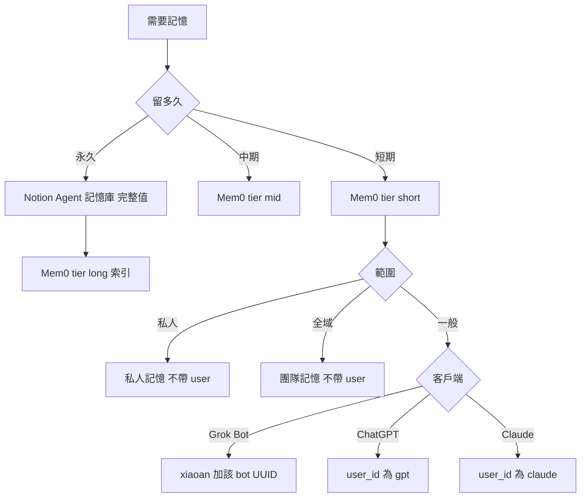

# 外部記憶管理

規則見 [rules/memory.md](rules/memory.md)，使用本 skill 時先讀。

## 先判斷

讀寫前先做完。時效決定留多久；範圍只用於 Mem0。

1. 這筆是短期、中期，還是永久。**直達永久**的條件：使用者說「永久記住」，或內容是使用者明示的穩定身分事實（公司地址、統編、聯絡方式、固定偏好與原則）。任務狀態、還在改的、推測的，一律短期。
2. 分私人、全域、一般（短期、中期與長期索引都要）。不要按 session 另開 id。

## 短／中／永久

| 層級 | 判斷 | 內容 | 去處 |
|------|------|------|------|
| **短期** | 剛寫入，`tier` 不是 `mid` | 偏好、近期決策、任務脈絡 | Mem0 |
| **中期** | 查詢時已去重，`tier=mid`，權重未滿 3 | 合併後的一句 | 仍在 Mem0 |
| **永久** | 權重大於等於 3 升上來，或直達條件成立 | 穩定原則與事實 | 完整值在 Notion 的 Agent 記憶庫；Mem0 留一筆索引（`tier=long`，一句摘要＋Notion 指向） |

會過期或還在改 → 先留短期。查到短期就依 [`my-memory-consolidate`](../my-memory-consolidate/SKILL.md) 去重、升中期並加權。權重大於等於 3 才升永久；直達條件成立就不走權重，但仍先顯示確認。權重小於等於 1 且存放滿 30 天必須刪除該筆 Mem0；索引筆不加權、不遺忘。憑證與未去敏的內容不寫永久。技能與文件的指向放知識庫或 repo，不放進這條滾動。

完整值只留一處：長期在 Notion，Mem0 的索引只是指向，不另寫一份內容。分工是 **Mem0 管短期與語意入口（又小又快，在免費額度內）、Notion 管完整值**；配額與命中率的做法見 [backends.md](references/backends.md)「配額與速度」。

## 身份

短期 Mem0 用這張表。整理進永久時，把同一組 `scope`、`user_id`、`agent_id` 抄進 Agent 記憶庫。私人與全域這兩欄留空。

| 範圍 | 庫 | 誰 | 怎麼帶 |
|------|----|----|--------|
| 私人 | `私人記憶` | 全部 | 不帶 user |
| 全域 | `團隊記憶` | 全部 | 不帶 user |
| 一般 | `團隊記憶` | 只有 Grok Bot | `user_id=xiaoan` 與該 bot 的 UUID。UUID 未填留佔位 |
| 一般 | `團隊記憶` | ChatGPT | `user_id=gpt`。所有 session 共用。不設 `agent_id` |
| 一般 | `團隊記憶` | Claude | `user_id=claude`。Claude Code、Desktop、雲端 session 所有環境共用。不設 `agent_id` |

其他客戶端的一般 Mem0 沒有 `user_id` 就先問，不要仿造，也不要按 session 換。私人或全域若工具硬要身份欄，先停下來問，不要猜。

讀寫要分開帶：

- 全域：不帶 user、不帶 agent。搜尋若不能只留「沒有 user、也沒有 agent」的紀錄，先停下來問，不要把整庫當全域。
- 一般：一定帶上表的 user。Grok Bot 再加自己的 agent。不要省略身份去讀一般。

## 後端細節

選後端、讀寫流程見 [backends.md](references/backends.md)。欄位名、型別、選項與隔離鍵格式見 [schemas.md](references/schemas.md)。寫入前先讀格式，不要自創欄位或選項。選**一個主後端**；跨後端須先說明；同一事實勿無計畫寫入多處。

## 讀取時機

- 使用者要求回想，或這一步依賴對話外的舊偏好、決策。
- 問題自己答得了，不讀。不要每則訊息搜。
- 新對話要不要先讀，只照當前客戶端那一份。沒寫先讀的，就不要掃。

## 讀取方法

一次語意搜尋同時拿到短期、中期與長期索引，再視命中決定要不要去 Notion。

1. Mem0 語意搜一次：查詢詞用使用者原話加 1～2 個同義詞合成一句，`top_k` 用這題需要的筆數。Composio 用別名選帳。私人不帶 user。全域不帶 user、不帶 agent；排除不了帶身份的紀錄就停下來問。一般一定帶該客戶端身份。只查一次，不為整理再搜或逐筆補讀。
2. 命中 `tier=long` 索引：用索引裡的隔離鍵到 Agent 記憶庫讀那一頁的 `目前值`，以 Notion 為答案；索引筆本身不加權、不遺忘。找不到那頁或 `狀態` 不是 `有效`，回報索引與 Notion 不一致，問使用者要刪索引還是恢復頁面。
3. 命中短期或中期：立刻依 [`my-memory-consolidate`](../my-memory-consolidate/SKILL.md) 去重、加權、升中期。權重夠了再問要不要升長期。該遺忘的立刻刪除。
4. 沒命中或不夠：Agent 記憶庫結構化過濾，`狀態=有效` 且 `AI 可用`，再依目前客戶端的 `scope`／`user_id`／`agent_id` 過濾，並可一併讀 `scope=global` 且 `user_id` 為空的列。不整庫拉。欄位名見 [schemas.md](references/schemas.md)。查到而 Mem0 沒有對應索引的頁面，補一筆索引。
5. 沒有工具，或 MCP 連不上、要重新登入、呼叫失敗：先說哪個後端、什麼失敗。不要貼 token 或金鑰。不要改讀別種來充數。

## 寫入時機

- 使用者說記住，或指定種類，才寫。先說寫進哪一種。
- 直達永久（使用者說「永久記住」，或明示的穩定身分事實）：顯示將寫入的內容與隔離鍵，同意後寫 Notion、讀回，再在 Mem0 新增索引筆（格式見 [schemas.md](references/schemas.md)，`infer=false`、`tier=long`）。Notion 沒寫成就不寫索引。
- 寫入短期用 `infer=true`。這一則對話已有同一事實的 id 就更新，否則直接新增，不要先搜一輪去重。使用者指定的改或刪，先顯示並取得同意。
- 查到 Mem0、或權重已滿、或要遺忘：走 `my-memory-consolidate`。升長期先顯示，同意且寫入成功後才刪除對應 Mem0。遺忘條件成立就刪除該筆，刪完列出 id。
- 不要伺機寫。同一件事不要同時留在兩種。
- 禁存完整對話、閒聊、推測、密碼、Token、金鑰、付款資料。失敗如實說，勿補造。

## 回應

- 讀到：後端 + 相關摘要  
- 無結果：查詢範圍 + 請補充或指定後端  
- 寫入：內容、後端、新增或更新  
- 未用記憶：一般不必宣告
- MCP 失敗：哪條連線、原因、這步有沒有做成  

## 依客戶端

只讀當前環境那一份。內建記憶跟 Mem0 不是同一套。

| 環境 | 檔 |
|------|-----|
| Claude Code／Desktop／claude.ai／雲端 session | [claude.md](references/claude.md) |
| Claude Code 專案裡綁定 ai-team 角色的 thread | [claude-code.md](references/claude-code.md) |
| Grok Bot | [grok-bot.md](references/grok-bot.md) |
| ChatGPT 網頁與 App | [chatgpt.md](references/chatgpt.md) |
| Codex | [codex.md](references/codex.md) |
