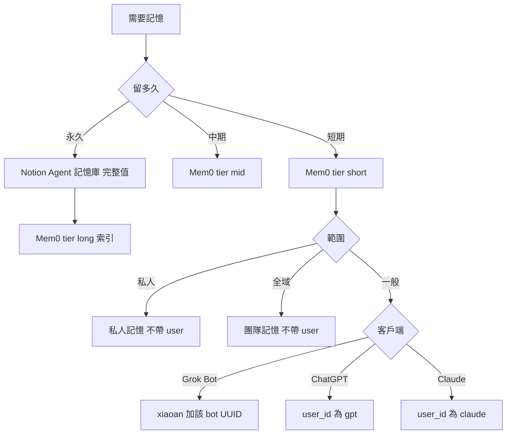

# 外部記憶管理

規則見 [rules/memory.md](rules/memory.md)，使用本 skill 先讀。後端與流程見 [backends.md](references/backends.md)；欄位格式見 [schemas.md](references/schemas.md)，寫入前先讀，不自創欄位或選項。

## 先判斷

1. **留多久**：短期、中期或永久。**直達永久**：使用者說「永久記住」，或明示的穩定身分事實（公司地址、統編、聯絡方式、固定偏好與原則）。任務狀態、還在改的、推測的一律短期。
2. **範圍**（只用於 Mem0）：私人、全域、一般。不按 session 另開 id。

| 層級 | 判斷 | 去處 |
|------|------|------|
| **短期** | 剛寫入，`tier` 不是 `mid` | Mem0 |
| **中期** | 已去重，`tier=mid`，權重未滿 3 | Mem0 |
| **永久** | 權重 ≥ 3 升上來，或直達條件成立 | 完整值在 Notion Agent 記憶庫；Mem0 留索引（`tier=long`，一句摘要＋Notion 指向） |

完整值只留一處；Mem0 管短期與語意入口（又小又快，免費額度內），Notion 管完整值。去重、升中期、遺忘由排程 agent 跑 `my-memory-consolidate`（沒裝就不整理）；索引筆不加權、不遺忘。直達永久不走權重，但仍先顯示確認。技能與文件的指向放知識庫或 repo，不進記憶。

## 身份

| 範圍 | 庫 | 誰 | 怎麼帶 |
|------|----|----|--------|
| 私人 | `私人記憶` | 全部 | 不帶 user、不帶 agent |
| 全域 | `團隊記憶` | 全部 | 不帶 user、不帶 agent |
| 一般 | `團隊記憶` | Grok Bot | `user_id=xiaoan` 與該 bot 的 UUID（未填留佔位） |
| 一般 | `團隊記憶` | ChatGPT | `user_id=gpt`，所有 session 共用，不設 `agent_id` |
| 一般 | `團隊記憶` | Claude | `user_id=claude`，所有環境共用，不設 `agent_id` |

其他客戶端沒有 `user_id` 就先問，不仿造、不按 session 換。整理進永久時把同一組 `scope`、`user_id`、`agent_id` 抄進 Agent 記憶庫。讀全域若無法只留「沒有 user 也沒有 agent」的紀錄，停下來問，不把整庫當全域；讀一般一定帶身份。工具硬要身份欄時停下來問。

## 讀取

**時機**：使用者要求回想，或這一步依賴對話外的舊偏好、決策；自己答得了不讀，不每則訊息搜。新對話要不要先讀，照當前客戶端那一份。

**方法**：

1. Mem0 語意搜一次：查詢詞用使用者原話加 1～2 個同義詞合成一句，`top_k` 用這題需要的筆數；帶上表身份；Composio 用別名選帳。只查一次，不為整理再搜或逐筆補讀。
2. 命中 `tier=long`：用索引的隔離鍵到 Agent 記憶庫讀那頁 `目前值`。找不到或 `狀態` 不是 `有效`，回報不一致，問使用者刪索引還是恢復頁面。
3. 命中短期或中期：照常回答，不整理。
4. 沒命中或不夠：Agent 記憶庫結構化過濾（`狀態=有效` 且 `AI 可用`，再依 `scope`／`user_id`／`agent_id`，可一併讀 `scope=global` 且 `user_id` 空的列），不整庫拉。查到而 Mem0 沒索引的頁面補一筆。
5. 沒有工具或 MCP 失敗：說哪個後端、什麼失敗；不貼 token；不改讀別種充數。

## 寫入

- 使用者說記住或指定種類才寫，先說寫進哪一種。不伺機寫；同一件事不同時留兩種。
- 直達永久：顯示內容與隔離鍵，同意後寫 Notion、讀回，再在 Mem0 新增索引（`infer=false`、`tier=long`，格式見 schemas.md）。Notion 沒寫成就不寫索引。
- 短期用 `infer=true`。這一則對話已有同一事實的 id 就更新，否則直接新增，不先搜去重。
- 使用者拿到排程整理的升長期建議並同意：先顯示，寫長期並讀回成功才刪對應 Mem0。使用者明確要求手動整理時才載入 `my-memory-consolidate`。
- 使用者指定的改或刪，先顯示並取得同意。禁存完整對話、閒聊、推測、密碼、Token、金鑰、付款資料。失敗如實說。

## 回應

讀到：後端 + 摘要。無結果：查詢範圍 + 請補充或指定後端。寫入：內容、後端、新增或更新。MCP 失敗：哪條、原因、這步有沒有做成。未用記憶一般不宣告。

## 依客戶端

只讀當前環境那一份；內建記憶跟 Mem0 不是同一套。

| 環境 | 檔 |
|------|-----|
| Claude Code／Desktop／claude.ai／雲端 session | [claude.md](references/claude.md) |
| Claude Code 專案裡綁定 ai-team 角色的 thread | [claude-code.md](references/claude-code.md) |
| Grok Bot | [grok-bot.md](references/grok-bot.md) |
| ChatGPT 網頁與 App | [chatgpt.md](references/chatgpt.md) |
| Codex | [codex.md](references/codex.md) |
