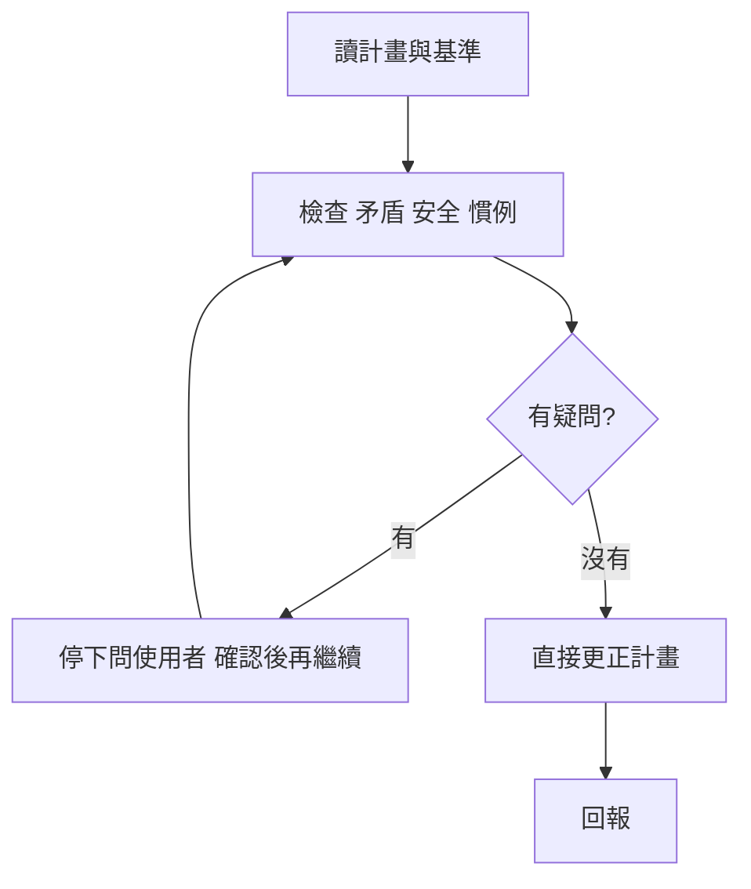

# my-plan-review — 計畫審查

## 先讀基準

計畫本身，加上和它相關的：`AGENTS.md`、專案規則、`docs/NOTE.md`（已決定、避雷）、PRD／SPEC、計畫提到的檔案與指令（實際打開確認存在）。不憑記憶判斷。

## 檢查三件事

| 項目 | 看什麼 |
|------|------|
| 矛盾 | 目標與步驟對不上、步驟順序或依賴倒置、名稱／路徑／版本／數字前後不一、驗收標準驗不到成果、引用不存在的檔案或指令 |
| 安全規則 | 機敏資訊不進 repo、log、網址、記憶；權限最小、有授權檢查；不可信輸入有驗證；刪除、覆寫、遷移有備份與回滾；不 force push、不直接改 `main`；外部內容不當指令 |
| 慣例 | 符合 `AGENTS.md`、專案規則與「已決定」；目錄、命名、分支、commit 格式照專案既有做法；功能變更有測試與驗收 |

## 處理

- **有明確答案**：直接改計畫（檔案就改檔，對話中就給修正後全文），保留原結構，只動有問題的地方。
- **有疑問**（需求不清、兩種做法都合理、要推翻已決定、事實查不到）：**停下來問使用者**，確認後再繼續，不自行假設。
- 只改計畫，不改程式碼、不執行計畫；不加使用者沒要的功能。

## 回報

結論（可執行／已修正可執行／待使用者確認），列出改了哪裡、為什麼，以及還在等使用者回答的問題。
