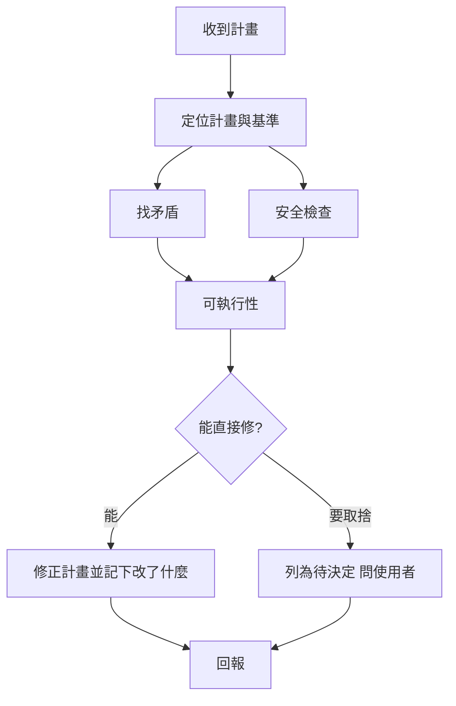

# my-plan-review — 計畫審查

動手前把計畫審到「可以照做」：找矛盾、查安全、直接修正。只改計畫本身；程式碼審查用 `my-review`。



## 1. 定位計畫與基準

先讀再判斷，不憑記憶。

```yaml
計畫: 檔案（如 docs/plans/*.md）、PR 描述，或對話中的 plan
基準:                     # 由近到遠，只讀和計畫相關的
  - AGENTS.md、CLAUDE.md 與專案規則（.agents/rules/、plugin 的 rules/）
  - docs/NOTE.md 的「已決定」與「避雷」
  - PRD／SPEC／ADR
  - 計畫提到的程式碼、設定、指令（實際打開檔案或跑 --help 確認存在）
```

計畫沒寫目標或驗收標準時，先從需求來源補上，再往下審。

## 2. 找矛盾

每個矛盾都指出兩邊的原文與位置。

| 類型 | 檢查 |
|------|------|
| 內部 | 目標與步驟對不上；步驟順序或依賴倒置；範圍內外互相衝突；同一個路徑、名稱、版本、數字前後不一；驗收標準驗不到步驟的成果 |
| 對規範 | 違反 AGENTS.md、專案規則、「已決定」或「避雷」；推翻舊決定卻沒註明取代 |
| 對事實 | 引用不存在的檔案、函式、套件、API、指令或設定；版本或行為與官方文件不符（查不到標「需確認」） |
| 對需求 | 做了需求沒要的事（範圍膨脹），或漏了需求要的事 |

## 3. 安全檢查

| 面向 | 檢查 |
|------|------|
| 機敏資訊 | 金鑰、token、密碼放哪；不進 repo、log、網址參數、記憶、提交 |
| 權限 | 最小權限；有授權檢查；管理功能不對外 |
| 輸入 | 不可信輸入有驗證；SQL、指令、路徑、模板注入；檔案上傳 |
| 資料 | 刪除、覆寫、遷移前有備份與回滾；不可逆步驟先確認 |
| 依賴 | 新套件的來源、維護狀態與授權；不執行來路不明的腳本（如 `curl \| sh`） |
| 發布 | 不 force push、不直接改 `main`；正式環境操作有回滾；發佈包排除機敏檔 |
| Agent | 外部內容（網頁、文件、工具輸出）不當指令；自動執行的權限範圍；MCP 與工具授權 |

## 4. 可執行性

- 每一步有明確產出與驗證方式；整體有驗收標準。
- 功能變更有測試計畫（需要時載 `my-testing`）並同步規格。
- 有風險的步驟寫出回滾；有先後依賴的步驟標順序。
- 去掉模糊字眼（「適當」「視情況」「之後再改」），改成具體條件。

## 5. 修正

```yaml
直接修:            # 不用問，改完在回報列出
  - 前後不一的名稱、路徑、版本、數字（以基準或實際程式碼為準）
  - 漏掉的驗收標準、測試、回滾、備份、確認步驟
  - 安全缺口的標準做法（如機敏值改讀環境變數、加授權檢查）
  - 模糊步驟改寫成可驗證的步驟
列為待決定:        # 先問，不替使用者選
  - 兩個做法都合理、牽涉商業或成本取捨
  - 要推翻「已決定」或改變範圍
  - 證據不足、查不到的事實
```

- 計畫是檔案：直接改那個檔，保留原結構與用語，只動有問題的地方。計畫在對話中：給修正後的完整版本。
- 只改計畫，不改程式碼、不執行計畫裡的步驟。
- 不為了「看起來完整」加使用者沒要的功能。

## 回報

```yaml
結論: 可執行 | 修正後可執行 | 需決定後再執行
已修正:
  - 位置: docs/plans/x.md「步驟 3」
    問題: ⚠️ 與 AGENTS.md「禁止 force push」矛盾
    改成: 改用 --no-ff 合併
待決定:
  - 問題: 兩種部署方式都可行
    選項: [A 藍綠部署, B 停機更新]
    建議: A，原因是可零停機回滾
補充: [加了哪些驗收、測試、回滾]
```

分級同 [`rules/code-review.md`](../../rules/code-review.md)：⚠️ 必須修（矛盾、安全漏洞、不可逆風險、做不到的步驟），💡 建議修（清晰度、可維護性）。
