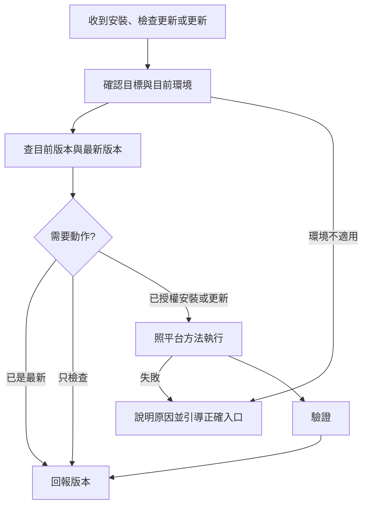

# my-plugin-install — 安裝與更新 plugin

依「目前所在平台」自動選方法，不要問使用者用哪個平台再開始，先自己判斷；判斷不了才問。預設對象是 my-workflow：

- 來源 repo（marketplace）：`https://github.com/VECTOR-COOL/my-agent-toolkit`，私有，`main` 分支
- marketplace 名稱 `my-agent-toolkit`，plugin `my-workflow`，安裝 id `my-workflow@my-agent-toolkit`

以上是 Git marketplace 的識別；帳號端私人／工作區 plugin 使用平台回傳的 ID。使用者指定「對話內安裝與更新、Web 也能用」時，優先走 [OpenAI 帳號端流程](references/openai.md)，即使目前是 Codex 也不改成本機目標。

## 1. 判斷平台

看自己是誰、手上有什麼工具，不要掃系統猜：

| 判斷依據 | 平台 | 方法 |
|------|------|------|
| 你是 Claude，能執行 shell 且有 `claude` 指令 | Claude Code（終端機、Desktop Code 分頁、IDE） | [claude.md](references/claude.md)「Claude Code」 |
| 你是 Claude，在雲端 session（全新 clone 的雲端容器） | Claude 雲端 session | [claude.md](references/claude.md)「雲端 session」 |
| 你是 Claude，沒有 shell（claude.ai 網頁、Desktop 聊天、Cowork） | Claude 網頁／Cowork | [claude.md](references/claude.md)「網頁與 Cowork」 |
| 你是 Codex，或要求對話內安裝且 Web 可用 | OpenAI | [openai.md](references/openai.md)「先選安裝目標」 |
| 你是 ChatGPT | ChatGPT | [openai.md](references/openai.md)「帳號端安裝與更新」 |
| 你是 Gemini（CLI 或網頁） | Gemini | [gemini.md](references/gemini.md) |
| 其他沒有 plugin 機制的平台 | 需確認 | 查該平台官方支援；貼規則或上傳檔案不算 marketplace 安裝 |

每家廠商一檔：Claude 讀 `claude.md`、OpenAI 讀 `openai.md`、Gemini 讀 `gemini.md`。只讀對應平台的那一節。

## 2. 檢查更新

安裝或更新前先檢查；使用者只說「檢查更新」時，只讀查詢，不安裝、升版、上傳或刷新可能改動安裝內容的 marketplace。

1. 確認目標平台、帳號／工作區與實際 plugin；不能用另一個同名項目或本機快取代替。
2. 取得已安裝／帳號端版本、release 與可用的來源 commit，再讀來源 `main` 的目前 commit 與 plugin 內容。讀不到哪一側就明說，不能判成最新。
3. 比對 plugin 本身的內容差異；repo 其他 plugin 有 commit 不代表本 plugin 有更新。版本相同也要查內容；帳號端版本可能獨立升版，不直接和 repo 標籤比較大小。
4. 回報「已是最新／有更新／尚未安裝／無法確認」，附檢查時間、目標、兩側版本或 release／commit、差異摘要與下一步。OpenAI 的詳細比對見 [openai.md](references/openai.md)「檢查更新」。

- **最新版本**：來源 repo `main` 上 `my-plugins/my-workflow/pack.yaml` 的 `version`（給人看的標籤）。`.claude-plugin/plugin.json` 刻意不寫 `version`，Claude 以 commit 當版本，所以 `main` 有新 commit 就算有新版。
- **目前版本**：依平台方法查（如 `claude plugin list`）。
- 版本標籤相同但內容不同是正常的（標籤只在發布時升）。Claude Git marketplace 的更新排除見 plugin 的 `docs/RELEASE.md`；OpenAI 帳號上傳的版本與 release 依 [openai.md](references/openai.md) 處理，不套用 Claude 的無 version 規則。
- 建議使用者開 marketplace 的自動更新（Claude Code 的 auto-update、claude.ai 的 **Sync automatically**）。

## 3. 執行與驗證

- 照平台方法安裝或更新。安裝與更新都會改使用者環境，**先說要執行什麼，取得同意再做**。
- 私有 repo：本機要能讀取（`gh auth login` 或 SSH key）；Claude 網頁走 Claude GitHub App 授權，OpenAI 工作區同步走其管理員 GitHub 授權流程。
- 完成後驗證：版本／release 正確、plugin 已安裝啟用；在指定平台開新對話，實際執行 skill 任務。Web 目標另驗 Web，不以本機成功代替。
- 回報：平台、做了什麼、前後版本、驗證結果、哪一步沒做成。

## 失敗或環境不適用時的引導

- 先回報失敗階段與實際錯誤（移除憑證），分清楚未執行、執行失敗、結果不明、已儲存但未驗證。不只說「不支援」或丟一個連結。
- 指出應使用的產品與介面、帳號／工作區、可確認的入口和具體下一步，以及完成後如何接續驗證。介面或命令不確定就查當前官方文件／工具 help，不猜按鈕。
- 缺工具時先探索可用能力；有適用 plugin 就提供安裝入口，需要新對話載入時說明。只有 shell 不代表能操作帳號端，只有本機成功也不代表 Web 成功。
- 私有來源讀取或更新權限不足時，引導登入正確帳號、授權來源 repo 或請擁有者／管理員操作；不要求貼出 token。
- 能在原授權範圍內修正的問題就修正後重試；結果不明先讀回狀態，不盲目重複建立、更新、移除重裝。保留已完成的工作與原安裝。
- 不自動改換目標平台、marketplace、帳號或 scope。轉換環境時提供可直接貼到新對話的交接提示，包含目標、來源、已查證 ID／release、錯誤、已完成與待完成步驟，不含秘密。
- Claude 的版本沒變、更新反灰或雲端停在舊版，見 [`docs/RELEASE.md`](../../docs/RELEASE.md)「無法更新怎麼排除」；OpenAI 見 [openai.md](references/openai.md) 的情境表，其他平台依各自 reference。

## 不要做

- 不要改 Git 設定、不要強制推送、不要改來源 repo。
- 不要逐一安裝 plugin 裡的子 skill；裝的是整個 plugin。
- 不要把沒成功說成成功；畫面上的訊息照實回報，不貼 token。
