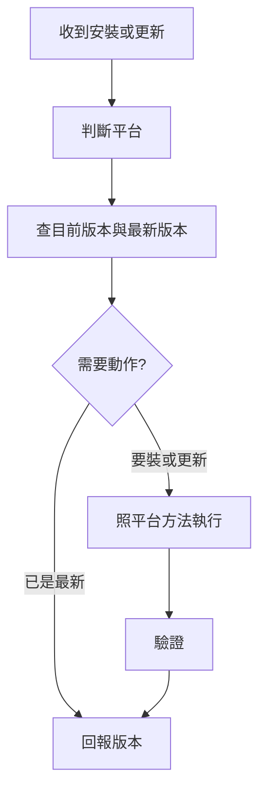

# my-plugin-install — 安裝與更新 plugin

依「目前所在平台」自動選方法，不要問使用者用哪個平台再開始，先自己判斷；判斷不了才問。預設對象是 my-workflow：

- 來源 repo（marketplace）：`https://github.com/VECTOR-COOL/my-agent-toolkit`，私有，`main` 分支
- marketplace 名稱 `my-agent-toolkit`，plugin `my-workflow`，安裝 id `my-workflow@my-agent-toolkit`

## 1. 判斷平台

看自己是誰、手上有什麼工具，不要掃系統猜：

| 判斷依據 | 平台 | 方法 |
|------|------|------|
| 你是 Claude，能執行 shell 且有 `claude` 指令 | Claude Code（終端機、Desktop Code 分頁、IDE） | [claude.md](references/claude.md)「Claude Code」 |
| 你是 Claude，在雲端 session（全新 clone 的雲端容器） | Claude 雲端 session | [claude.md](references/claude.md)「雲端 session」 |
| 你是 Claude，沒有 shell（claude.ai 網頁、Desktop 聊天、Cowork） | Claude 網頁／Cowork | [claude.md](references/claude.md)「網頁與 Cowork」 |
| 你是 Codex | Codex | [codex.md](references/codex.md) |
| 平台沒有 plugin 機制（如 ChatGPT） | 手動 | 下方「沒有 plugin 機制」 |

只讀對應平台的那一節。

## 2. 查版本

- **最新版本**：來源 repo `main` 上 `my-plugins/my-workflow/.claude-plugin/plugin.json` 的 `version`。
- **目前版本**：依平台方法查（如 `claude plugin list`）。
- 版本相同但內容不同，代表 plugin 改了卻沒升版；平台不會提供更新，要先請維護者升版（見 plugin 的 `AGENTS.md`）。

## 3. 執行與驗證

- 照平台方法安裝或更新。安裝與更新都會改使用者環境，**先說要執行什麼，取得同意再做**。
- 私有 repo：本機要能讀取（`gh auth login` 或 SSH key）；網頁版要先連結 GitHub 並讓 Claude GitHub App 能讀這個 repo。
- 完成後驗證：版本號正確、plugin 已啟用；開新對話，問它有沒有收到 my-workflow 的全域規則。
- 回報：平台、做了什麼、前後版本、驗證結果、哪一步沒做成。

## 更新失敗

版本沒變、更新按鈕反灰、`unknown command`、雲端 session 停在舊版等，照 plugin 的 [`docs/RELEASE.md`](../../docs/RELEASE.md)「無法更新怎麼排除」：先確認來源 `main` 有新版，再查使用者端。

## 沒有 plugin 機制

例如 ChatGPT 網頁：

- 把 `rules/global.md` 貼到自訂指示。
- 需要的 skill 資料夾單獨上傳（先傳 `my-workflow`）。
- 更新就重貼、重傳。規則不會自動帶入新對話，也沒有 hook 與 MCP。

## 不要做

- 不要改 Git 設定、不要強制推送、不要改來源 repo。
- 不要逐一安裝 plugin 裡的子 skill；裝的是整個 plugin。
- 不要把沒成功說成成功；畫面上的訊息照實回報，不貼 token。
