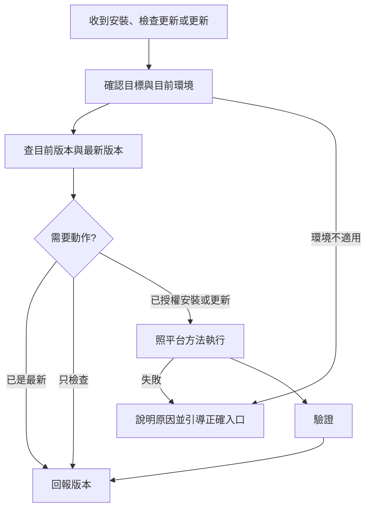

# my-plugin-install — 安裝與更新 plugin

先依使用者指定的目標平台、帳號／工作區與 marketplace 選流程，再確認目前環境的實際工具與權限能否執行；不能只靠模型身分推定能力。未指定目標時，先用對話脈絡與已知環境判斷，仍有歧義才問。預設對象是 my-workflow：

- 來源 repo（marketplace）：`https://github.com/VECTOR-COOL/my-agent-toolkit`，私有，`main` 分支
- marketplace 名稱 `my-agent-toolkit`，plugin `my-workflow`，安裝 id `my-workflow@my-agent-toolkit`

以上是 Git marketplace 的識別；帳號端私人／工作區 plugin 使用平台回傳的 ID，Antigravity 本機／工作區 plugin 以安裝目錄名 `<dir>`（`my-workflow`）識別並以 `customization://<dir>` 連結。在 Claude 要求「對話內安裝、Web 也能用」時，裝到 claude.ai 帳號 marketplace（[claude.md](references/claude.md)「對話內：安裝到帳號 marketplace」），不改成本機 `/plugin` 安裝：本機安裝不會同步回帳號。使用者指定「對話內安裝與更新、ChatGPT Web 也能用」時，優先走 [OpenAI 帳號端流程](references/openai.md)，即使目前是 Codex 也不改成本機目標。只說「Web」時先從脈絡確認是哪個產品，不把 Claude／Gemini 網頁需求轉成 ChatGPT；Gemini 網頁目前無私人 plugin marketplace（Antigravity 與 Gemini CLI 安裝不會同步到 Gemini 網頁），依 [gemini.md](references/gemini.md) 說明限制並引導，不拿本機安裝或 Gem 貼文冒充 Web marketplace 完成。

## 1. 判斷平台

依目標選下表的 reference，再探索當前可用工具；不能用「有 shell」「模型叫 Codex／Gemini」推定具備帳號端 Web marketplace 工具，也不掃整台系統猜平台。缺少必要能力或目標平台本身不支援時依後文引導，不更換使用者的目標。

| 判斷依據 | 平台 | 方法 |
|------|------|------|
| 目標是 Claude，對話內安裝且 Web 可用；或目標是 claude.ai 網頁、Desktop 聊天、Cowork | Claude 帳號 marketplace | [claude.md](references/claude.md)「對話內：安裝到帳號 marketplace」 |
| 目標明確只要本機 Claude Code | Claude Code（終端機、Desktop Code 分頁、IDE） | [claude.md](references/claude.md)「Claude Code 本機 marketplace」 |
| 目標是 Claude 雲端 session | Claude 雲端 session | [claude.md](references/claude.md)「雲端 session」 |
| 目標是 Codex | OpenAI | [openai.md](references/openai.md)「先選安裝目標」 |
| 目標是 ChatGPT，包含對話內操作且 ChatGPT Web 可用 | ChatGPT | [openai.md](references/openai.md)「帳號端安裝與更新」 |
| 目標是 Google Antigravity（AGY：Antigravity 2.0、IDE、`agy` CLI） | Antigravity（AGY） | [gemini.md](references/gemini.md)「先選安裝目標」「Antigravity（AGY）：對話內安裝與更新」 |
| 目標是 Gemini CLI | Gemini CLI | [gemini.md](references/gemini.md)「Gemini CLI：本機 extension 與 skills」 |
| 目標是 Gemini 網頁，或在 Gemini／Antigravity 要求安裝到支援 Web 的 market | Gemini／跨平台 Web | [gemini.md](references/gemini.md)「先選安裝目標」「失敗或環境不適用：引導下一步」 |
| 其他沒有 plugin 機制的平台 | 需確認 | 查該平台官方支援；貼規則或上傳檔案不算 marketplace 安裝 |

每個目標生態一檔：Claude 讀 `claude.md`、OpenAI 讀 `openai.md`、Gemini／Google（含 Antigravity）讀 `gemini.md`。執行任務的模型與目標可以不同；只讀目標對應的章節。

## 2. 檢查更新

安裝或更新前先檢查；使用者只說「檢查更新」時，只讀查詢，不安裝、升版、上傳或刷新可能改動安裝內容的 marketplace。

1. 確認目標平台、帳號／工作區與實際 plugin；不能用另一個同名項目或本機快取代替。
2. 取得已安裝／帳號端版本、release 與可用的來源 commit，再讀來源 `main` 的目前 commit 與 plugin 內容。讀不到哪一側就明說，不能判成最新。
3. 比對 plugin 本身的內容差異；repo 其他 plugin 有 commit 不代表本 plugin 有更新。版本相同也要查內容；帳號端版本可能獨立升版，不直接和 repo 標籤比較大小。
4. 回報「已是最新／有更新／尚未安裝／無法確認」，附檢查時間、目標、兩側版本或 release／commit、差異摘要與下一步。「尚未安裝」須有目標環境的明確安裝狀態證據；搜尋不到或權限不足一律不能據此判定。詳細比對見 [claude.md](references/claude.md)「檢查更新（只讀）」、[openai.md](references/openai.md)「檢查更新」與 [gemini.md](references/gemini.md)「檢查更新（只讀）」。

- **來源版本標籤**：來源 repo `main` 上 `my-plugins/my-workflow/pack.yaml` 的 `version`，只作人類可讀標籤。marketplace 來源 commit 改變時，仍須確認本 plugin 的內容差異，不能把 repo 任意新 commit 都當成本 plugin 有更新。
- **目前版本**：依平台方法查（Claude Code 先確認 CLI 版本再 `claude plugin list`，分清本機 `@my-agent-toolkit` 與帳號同步 `@synced`；claude.ai 帳號端看 Customize > Plugins；Antigravity 查 `plugins.json`、`~/.gemini/config/plugins/` 或 `GetAllPlugins` 過濾 `jq` 並讀實際路徑的 `pack.yaml`／commit；Gemini CLI 用 `gemini extensions list`）。
- **各平台版本欄位差異**：版本標籤只在發布時升，標籤相同但內容不同是正常的。`.claude-plugin/plugin.json` 與 `plugin.json`（Codex／Antigravity 共用）刻意不寫 `version`（見 `docs/RELEASE.md`）；OpenAI 帳號上傳產物的版本與 release 依 [openai.md](references/openai.md) 處理；`gemini-extension.json` 則與 `pack.yaml` 同步寫入版本號，檢查更新時仍須比對來源 `main` commit 與檔案差異（見 [gemini.md](references/gemini.md)）。
- **自動／連結更新建議**：Claude Code 第三方 marketplace 預設不自動更新，要到 `/plugin` → Marketplaces 開 **Enable auto-update**；claude.ai 開 **Sync automatically**；Antigravity 建議用 `plugins.json` 指到本地 repo、Gemini CLI 建議用 `gemini extensions link`，讓本地 `git pull origin main` 直接反映更新。

## 3. 執行與驗證

- 照平台方法安裝或更新，先說明將執行的動作。使用者已明確要求安裝或更新，即可在該授權範圍內執行，不重複詢問；只要求檢查時不寫入，新增或擴大範圍才另行確認。平台要求的安裝按鈕或 OAuth 授權仍須完成。
- 私有 repo：本機要能讀取（`gh auth login` 或 SSH key）；Claude 網頁走 Claude GitHub App 授權，OpenAI 工作區同步走其管理員 GitHub 授權流程。
- 完成後驗證：版本／release 正確、plugin 已安裝啟用（Antigravity 新增目錄或 `plugins.json` 須重啟才發現，管理連結用 `[my-workflow](customization://my-workflow)`）；在指定平台開新對話，實際執行 skill 任務。Web 目標另驗 Web，不以本機成功代替。
- 回報：平台、做了什麼、前後版本、驗證結果、哪一步沒做成。

## 失敗或環境不適用時的引導

- 先回報失敗階段與實際錯誤（移除憑證），分清楚未執行、執行失敗、結果不明、已儲存但未驗證。不只說「不支援」或丟一個連結。
- 指出應使用的產品與介面、帳號／工作區、可確認的入口和具體下一步，以及完成後如何接續驗證。介面或命令不確定就查當前官方文件／工具 help，不猜按鈕。
- 缺工具時先探索可用能力；有適用 plugin 就提供安裝入口，需要新對話載入時說明。只有 shell 不代表能操作帳號端，只有本機成功也不代表 Web 成功。
- 私有來源讀取或更新權限不足時，引導登入正確帳號、授權來源 repo 或請擁有者／管理員操作；不要求貼出 token。
- 能在原授權範圍內修正的問題就修正後重試；結果不明先讀回狀態，不盲目重複建立、更新、移除重裝。保留已完成的工作與原安裝。
- 不自動改換目標平台、marketplace、帳號或 scope。轉換環境時提供可直接貼到新對話的交接提示，包含目標、來源、已查證 ID／release、錯誤、已完成與待完成步驟，不含秘密。
- Claude 見 [claude.md](references/claude.md) 的情境表與 [`docs/RELEASE.md`](../../docs/RELEASE.md)「無法更新怎麼排除」；OpenAI 見 [openai.md](references/openai.md) 的情境表；Antigravity／Gemini 見 [gemini.md](references/gemini.md) 的情境表。

## 不要做

- 不要改 Git 設定、不要強制推送、不要改來源 repo。
- 不要逐一安裝 plugin 裡的子 skill；裝的是整個 plugin。
- 不要把沒成功說成成功；畫面上的訊息照實回報，不貼 token。
