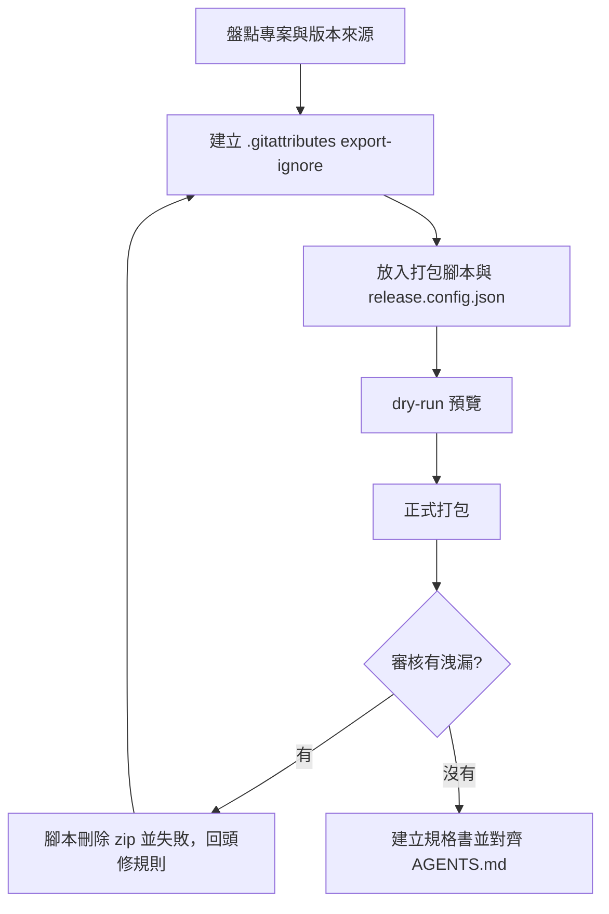

# my-release-packaging — 正式發佈打包

把專案打成交給正式機、客戶或維運解壓部署的乾淨 `.zip`，**不洩漏機敏檔、不夾帶開發與 AI 治理檔**，並把規則寫進專案的 SSOT 文件。



## 適用與邊界

- **適用**：要產出交給正式機解壓部署的 `.zip`；要建立 `.gitattributes` 與一鍵打包腳本；要寫或對齊發佈打包規格書。
- **不適用**：Docker 映像（用 `.dockerignore` 與 `Dockerfile`）；遠端 CI/CD 自動部署（若專案規則禁止遠端環境，就只在本機產出）。
- **安全邊界**：**禁止**對工作目錄做全目錄壓縮（`zip -r .`、`Compress-Archive *` 等），會把沒進版控的帳密與上傳檔一起打包。一律走 `git archive`。

## 檔案三層分類

所有檔案先歸類，各層用對應機制控制：

| 分層 | 內容範例 | 進 Git | 進發佈包 | 控制機制 |
| --- | --- | :---: | :---: | --- |
| ① 本機私密／執行期暫存 | `.env*`、帳密檔、`log/*.log`、使用者上傳檔、快取、`dist/` | 否 | 否 | `.gitignore` + 腳本禁則審核 |
| ② 開發／測試／AI 治理檔 | `.agents/`、`.claude/`、`.cursor/`、`AGENTS.md`、`CLAUDE.md`、`NOTE.md`、`README.md`、`docs/`、`scripts/`、`tests/` | 是 | 否 | `.gitattributes`（`export-ignore`） |
| ③ 正式執行程式碼 | 應用程式入口、核心、前端靜態資源、必要 `vendor/`、`*.example` 設定範本、空目錄錨點 `.gitkeep` | 是 | **是** | `git archive` 自動保留 |

## 流程

### 1. 盤點

1. `git ls-tree --name-only HEAD`、`git status -s` 看追蹤檔案與頂層結構。
2. 讀 `.gitignore`，確認第 ① 層已完整忽略，且輸出目錄（預設 `dist/`）已列入。
3. 找出**版本來源**（`package.json`、`composer.json`、`VERSION`、或程式內的版本常數）與**檢查指令**（lint、語法檢查）。

### 2. `.gitattributes`（export-ignore）

把第 ② 層路徑標成 `export-ignore`，依專案增減：

```gitattributes
/.agents        export-ignore
/.claude        export-ignore
/.cursor        export-ignore
/dist           export-ignore
/docs           export-ignore
/scripts        export-ignore
/tests          export-ignore
/AGENTS.md      export-ignore
/CLAUDE.md      export-ignore
/NOTE.md        export-ignore
/README.md      export-ignore
/.gitignore     export-ignore
/.gitattributes export-ignore
```

### 3. 打包腳本與設定檔

- 把 [`scripts/pack-release.mjs`](scripts/pack-release.mjs) 複製到專案 `scripts/pack-release.mjs`（只用 Node 內建模組、`git`、`tar`）。
- 專案差異全放 repo 根目錄的 `release.config.json`，範例見 [`references/release.config.example.json`](references/release.config.example.json)；沒有設定檔也能跑（版本取自 `package.json` 或 `VERSION`）。

| 設定 | 用途 |
| --- | --- |
| `name` | 檔名前綴 |
| `version.file` + `version.regex` | 從任意檔案取版本；regex 要有一個擷取群組 |
| `lint` | 前置檢查指令陣列，如 `["node","scripts/lint.mjs"]`，失敗即中止 |
| `forbiddenExtra` | 專案特有的禁則（正規表示式字串），疊加在內建禁則上 |
| `outDir` | 輸出目錄，預設 `dist` |

腳本四個階段：**前置檢查** → `git stash create` 取工作區快照（含已追蹤檔的未提交修改，不含未追蹤檔）→ `git archive --worktree-attributes` 產 ZIP（未 commit 的 `.gitattributes` 也立即生效）→ **審核**條目，有洩漏就刪除 zip、結束碼 1。內建禁則涵蓋 `.env*`、私鑰、`.git/`、AI 治理目錄與檔案、`dist/`。

```bash
node scripts/pack-release.mjs --dry-run      # 預覽，不留下 zip
node scripts/pack-release.mjs                # 打包到 dist/<name>-v<版本>-<日期>.zip
node scripts/pack-release.mjs --out dist/custom.zip --force
```

輸出檔已存在會拒絕，要覆寫才加 `--force`。審核用 `git archive` 的 tar 輸出列條目，所以 Windows、macOS、Linux 都能跑（不依賴 `tar` 讀 zip）。

### 4. 規格書與文件對齊

1. 依 [`references/release-spec-template.md`](references/release-spec-template.md) 建立 `docs/RELEASE_SPEC.md`：包含白名單、排除黑名單、命名、指令、部署與覆蓋更新 SOP。
2. `AGENTS.md` 加「發佈打包規範」：唯一產出指令 `node scripts/pack-release.mjs`、規格書路徑；硬約束寫明禁止把 `dist/` 提交版控、禁止手動全目錄壓縮。
3. 同步更新 `README.md`（文件清單）與 `NOTE.md`（交接：目前版本、怎麼打包）。

### 5. 驗證

交付前實際執行，不推測：

1. `node scripts/pack-release.mjs` 結束碼為 0。
2. JSON 摘要 `leakedSensitiveOrDevFiles: 0`，`topLevelIncluded` 只有正式環境需要的項目。
3. `git status -s` 確認 `dist/*.zip` 被忽略、沒污染版控。
4. 想確認審核真的有效，可暫時加一個機敏檔試跑，應看到失敗並刪除 zip。

## 常見錯誤

| 錯誤 | 原因 | 做法 |
| --- | --- | --- |
| 改了 `.gitattributes` 還沒 commit，打包卻仍含舊檔 | `git archive` 預設讀 commit 內的屬性 | 腳本已加 `--worktree-attributes`；手動執行時別漏 |
| 用 `zip -r` 壓整個專案 | 把未進版控的帳密與上傳檔打進去 | 一律 `git archive` |
| 正式機需要空目錄但包裡沒有 | Git 不追蹤空目錄 | 目錄內放 `.gitkeep` 並提交，`.gitignore` 寫 `/log/*` 加 `!/log/.gitkeep` |
| 新增的檔案沒進包 | `git stash create` 不含未追蹤檔 | 先 `git add` 新檔 |

## 完成回報

1. 壓縮包路徑、大小、條目數。
2. `topLevelIncluded` 與審核結果。
3. 新增或更新的檔案：`.gitattributes`、腳本、`release.config.json`、`docs/RELEASE_SPEC.md`、`AGENTS.md`。
4. 沒實測的部分明說。
