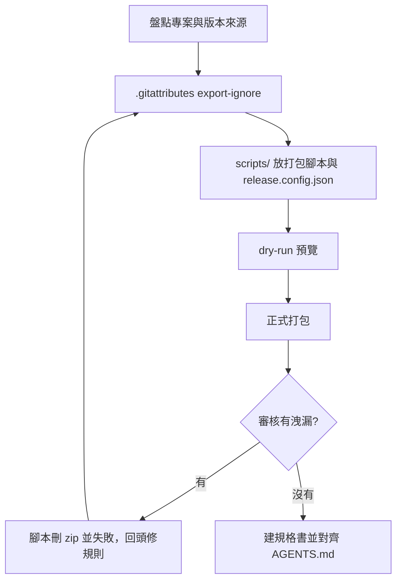

# my-release-packaging — 正式發佈打包

把專案打成交給正式機、客戶或維運解壓部署的乾淨 `.zip`，**不洩漏機敏檔、不夾帶開發與 AI 治理檔**，規則寫進專案 SSOT。



## 適用與邊界

- **適用**：交給正式機解壓部署的 `.zip`；建 `.gitattributes` 與一鍵打包腳本；寫或對齊發佈規格書。
- **不適用**：Docker 映像（`.dockerignore`）；遠端 CI/CD 自動部署。
- **禁止**全目錄壓縮（`zip -r .`、`Compress-Archive *`），會把未版控的帳密與上傳檔打進去。一律 `git archive`。

## 檔案分層

| 分層 | 範例 | 進 Git | 進包 | 機制 |
|------|------|:---:|:---:|------|
| ① 本機私密／執行期暫存 | `.env*`、帳密檔、`log/*.log`、上傳檔、快取、`dist/`、`scripts/tmp/`（開發期 log 與臨時檔） | 否 | 否 | `.gitignore` + 腳本禁則；`scripts/tmp/` 另被 `/scripts export-ignore` 擋 |
| ② 開發／測試／AI 治理 | `.agents/`、`.claude/`、`.cursor/`、`AGENTS.md`、`CLAUDE.md`、`README.md`、`docs/`、`scripts/`、`tests/` | 是 | 否 | `.gitattributes` `export-ignore` |
| ③ 正式程式碼 | 入口、核心、前端靜態資源、必要 `vendor/`、`*.example` 範本 | 是 | **是** | `git archive` 保留 |
| ④ 上傳／日誌目錄 | `img/`、執行期 `log/`（或框架路徑）、暫存目錄：**目錄要存在**（開發期 log 不在此，在 `scripts/tmp/`） | 上傳檔否 | 有內容照常；沒有就補空目錄 | `placeholders` 只寫 base path |

## 流程

### 1. 盤點

`git ls-tree --name-only HEAD`、`git status -s` 看結構；讀 `.gitignore` 確認第 ① 層完整且含輸出目錄（預設 `dist/`）；找**版本來源**（`package.json`、`composer.json`、`VERSION`、程式常數）與**檢查指令**（lint、語法檢查）。

### 2. `.gitattributes`

第 ② 層標 `export-ignore`，依專案增減：

```gitattributes
/.agents        export-ignore
/.claude        export-ignore
/.cursor        export-ignore
/dist           export-ignore
/docs           export-ignore
/scripts        export-ignore
/tests          export-ignore
/AGENTS.md      export-ignore
/CLAUDE.md      export-ignore
/README.md      export-ignore
/.gitignore     export-ignore
/.gitattributes export-ignore
```

設定檔在 `scripts/` 內已被涵蓋。舊專案根目錄還有 `NOTE.md`、`release.config.json` 時另補兩行（腳本內建禁則也擋根目錄 `NOTE.md`）。

### 3. 打包腳本與設定

- 複製 [`scripts/pack-release.mjs`](scripts/pack-release.mjs) 到專案 `scripts/`（只用 Node 內建、`git`、`tar`）。
- 專案差異全放 `scripts/release.config.json`（範例 [`references/release.config.example.json`](references/release.config.example.json)）；沒有也能跑（版本取自 `package.json` 或 `VERSION`）。腳本先找同目錄，其次 repo 根（舊專案相容），`--config` 可指定。

| 設定 | 用途 |
|------|------|
| `name` | 檔名前綴 |
| `version.file` + `version.regex` | 從任意檔取版本；regex 要有一個擷取群組 |
| `lint` | 前置檢查指令陣列，失敗即中止 |
| `forbiddenExtra` | 專案特有禁則（regex 字串），疊加內建 |
| `forbiddenRemove` | 放行的內建禁則（子字串比對），如 `["AGENTS"]` |
| `contentScan` | `{ "enabled": false, "allow": ["regex"] }` |
| `requireClean`、`strict` | `true` 等同每次加對應旗標 |
| `placeholders` | 內容不發佈、目錄要存在的 base path，見「占位目錄」 |
| `outDir` | 輸出目錄，預設 `dist` |

**腳本流程**：前置檢查 → 工作區檢查（未追蹤檔警告；`--strict` 失敗；`--require-clean` 要求全乾淨；未提交修改會進包並標 `includesUncommittedChanges`）→ `git stash create` 快照 → `git archive --worktree-attributes`（未 commit 的 `.gitattributes` 也生效）→ **審核** → `.sha256`。審核有洩漏就刪 zip、結束碼 1。

**審核兩層**：**檔名禁則**內建涵蓋 `.env*`、私鑰與憑證、`.git/`、AI 治理目錄與檔案、`dist/`；**內容掃描**掃包內文字檔，命中私鑰區塊或 AWS／GitHub／Anthropic／OpenAI／Slack 金鑰就失敗，疑似 `password = '…'` 只警告；`*.example`、`*.sample` 不掃。

```bash
node scripts/pack-release.mjs --dry-run                  # 預覽，不留檔
node scripts/pack-release.mjs                            # dist/<name>-v<版本>-<日期>.zip + .sha256
node scripts/pack-release.mjs --since v1.2.0             # 增量更新檔
node scripts/pack-release.mjs --require-clean --strict   # 正式發佈建議
node scripts/pack-release.mjs --out dist/custom.zip --force
```

輸出已存在會拒絕，`--force` 才覆寫。不用 `tar` 讀 zip，三平台都能跑；只有內容掃描需要 `tar`。測試：`node --test scripts/pack-release.test.mjs`。

#### 占位目錄（`placeholders`）

`img/`、`log/`、`content/temp/` 這類目錄正式機需要**存在**（程式會寫入），但 Git 不追蹤空目錄，內容排除後目錄就不見，部署後寫檔失敗。

- 只寫 base path：`"placeholders": ["img", "log", "content/user_files"]`。子目錄由程式自建，不必列；列了會合併到上層。
- 包裡該目錄已有檔案或子目錄 → 原樣保留；完全沒內容 → 補 `<目錄>/.gitkeep`（`git archive --add-virtual-file`），repo 不必提交。
- 要不要發佈目錄內容是 `.gitignore` 與 `.gitattributes` 的事，`placeholders` 不改變它。禁則擋整個目錄時，`.gitkeep` 仍放行，真實檔案照擋。
- 更新檔：上一版已有該目錄，或本次自帶該目錄檔案，都不放；只有刪除、沒檔可附帶時，列在 `CHANGES.txt`「需建立的空目錄」。
- 需支援 `--add-virtual-file` 的 Git（2.43 實測可用）；太舊會報錯提示升級，或改在 repo 提交 `.gitkeep`。

#### 增量更新檔（`--since <tag 或 commit>`）

只打包該 ref 以來**新增與修改**的發佈檔（同樣套 export-ignore 與審核），並產生 `<zip 名>.CHANGES.txt`：

- 新增／修改在 zip 內；**刪除不在 zip 內**——部署是解壓覆蓋不會刪舊檔，`CHANGES.txt` 列出要在正式機**手動移除**的檔（含「原本在包、現在被 export-ignore 排除」的）。
- 發佈範圍沒變更會失敗並說明；只有刪除時不產 zip，仍產 `CHANGES.txt`。
- 基準 ref 用上次實際部署的版本（每次部署後打 tag），基準錯了就漏檔。

### 4. 規格書與文件

1. 依 [`references/release-spec-template.md`](references/release-spec-template.md) 建 `docs/RELEASE_SPEC.md`（白名單、排除黑名單、命名、指令、部署與覆蓋更新 SOP）。
2. `AGENTS.md` 加「發佈打包規範」：唯一產出指令 `node scripts/pack-release.mjs`、規格書路徑；禁止提交 `dist/`、禁止全目錄壓縮。
3. 同步 `README.md`（文件清單）與 `docs/NOTE.md`（目前版本、怎麼打包、上次部署基準 tag）。

### 5. 驗證

實際執行，不推測：結束碼 0；JSON 摘要 `leakedSensitiveOrDevFiles: 0`，`topLevelIncluded` 只有正式環境需要的；`git status -s` 確認 `dist/*.zip`、`*.sha256`、`*.CHANGES.txt` 被忽略；想確認審核有效，可暫時加一個機敏檔試跑，應失敗並刪 zip。

## 常見錯誤

| 錯誤 | 原因 | 做法 |
|------|------|------|
| 改了 `.gitattributes` 沒 commit，包仍含舊檔 | `git archive` 預設讀 commit 內屬性 | 腳本已加 `--worktree-attributes`；手動執行別漏 |
| 用 `zip -r` | 帳密與上傳檔進包 | 一律 `git archive` |
| 正式機需要空目錄但包裡沒有 | Git 不追蹤空目錄 | 列進 `placeholders`；或提交 `.gitkeep` 並在 `.gitignore` 寫 `/log/*` 加 `!/log/.gitkeep` |
| 新檔沒進包 | `git stash create` 不含未追蹤檔 | 先 `git add`；正式發佈用 `--strict` |
| 更新檔部署後舊檔還在 | 解壓覆蓋不刪檔 | 照 `CHANGES.txt`「刪除」清單手動移除 |
| 更新檔缺檔 | `--since` 基準不是上次部署版本 | 每次部署後打 tag |

## 完成回報

壓縮包路徑、大小、條目數與 `.sha256`（更新檔另附新增／修改／刪除數量與 `CHANGES.txt`）；`topLevelIncluded` 與審核結果；新增或更新的檔；沒實測的部分明說。
