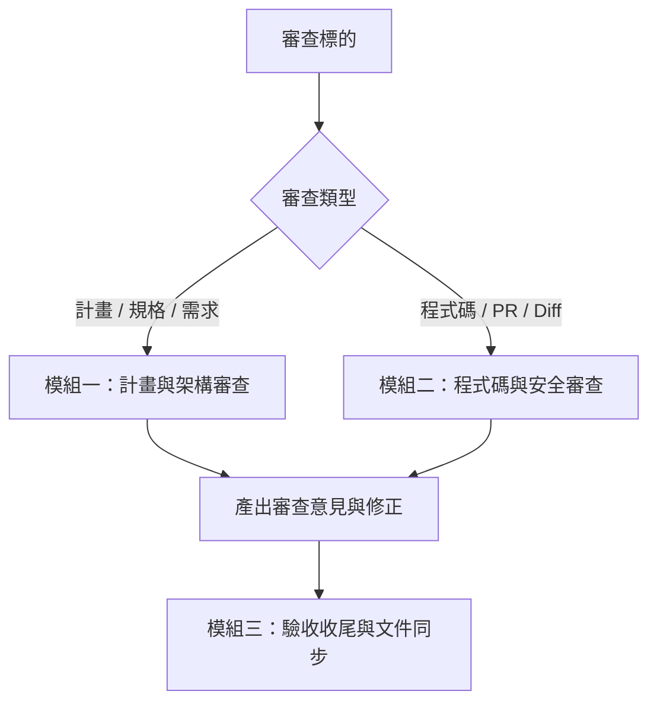

# my-review — 專案與程式碼綜合審查

以商業專案的高標準，嚴格審查計畫目標、系統架構與程式碼實作，防止專案飄移、產生幻覺或引入品質與安全缺陷。

---

## 模組一：計畫與架構審查

照 [`my-plan-review`](../my-plan-review/SKILL.md)：對照規範與實際程式碼找矛盾、查安全、直接修正計畫。這裡只在執行途中做快速對齊：列出任務目標與參考文件，方向飄移就指出並拉回，通知使用者。

---

## 模組二：程式碼與安全審查（Code Review）

當審查對象為**原始碼、變更檔案或 Git Diff / PR** 時，照 [`rules/code-review.md`](../../rules/code-review.md)：範圍、檢查清單（正確性、安全性、可維護性、效能）、⚠️／💡 分級與結尾結論都以該檔為準，這裡不另抄一份。

---

## 模組三：驗收收尾與文件同步

任務執行或審查通過後，照 [`rules/wrap-up.md`](../../rules/wrap-up.md) 收尾：文件對齊、測試（含 E2E）、清理暫存與殘留項。
