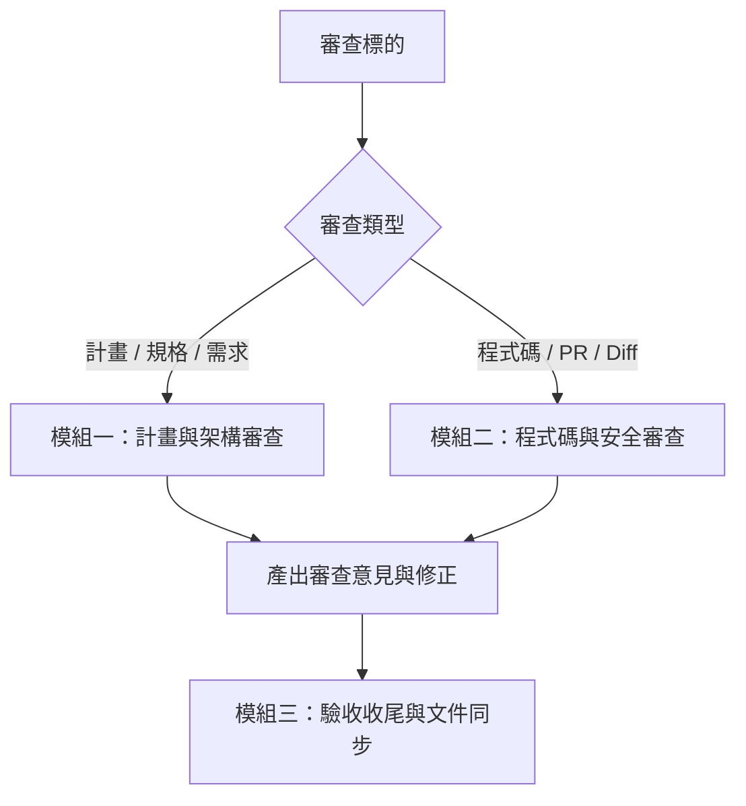

# my-review — 專案與程式碼綜合審查

以商業專案的高標準，嚴格審查計畫目標、系統架構與程式碼實作，防止專案飄移、產生幻覺或引入品質與安全缺陷。

---

## 模組一：計畫與架構審查

當審查對象為**計畫、需求、SPEC 或任務執行方向**時：

1. **對齊目標與防飄移**：
   - 開頭明確列出：任務簡介、核心目標、參考文件與網址。
   - 檢查目前進行的方向是否符合原始目標；若正在飄移，立即指出並拉回計畫目標，主動通知使用者。
2. **防範幻覺與過度假設**：
   - 嚴格遵守專案既有規範與真實環境；不編造不存在的架構或依賴。
   - 遇到不確定的技術或專案情境，先查閱專案既有文件或上網查證可信文章／Skill，不憑空臆測。
3. **可實作性與精確度**：
   - 計畫必須具備明確步驟、可驗證的交付標準（Acceptance Criteria）。
   - 語言精簡白話，確保 AI Agent（如 Claude）能準確理解與執行，不含模糊指示。
   - 發現計畫缺漏處，直接具體補充，並提示使用者。

---

## 模組二：程式碼與安全審查（Code Review）

當審查對象為**原始碼、變更檔案或 Git Diff / PR** 時：

1. **審查流程**：
   - 取得審查範圍（指定檔案或 `git diff`），並參考 PR 描述／commit 訊息以理解變更目的。
   - 遵循專案既有 coding standards 與風格，不強加個人無關偏好。
   - 只聚焦本次變更與直接關聯範圍，不無端大規模重寫無關代碼。
   - 專案若有測試或 lint 指令，實際執行驗證，不推測「應該會過」。
   - **預設只提供報告與具體建議**，不直接擅自修改代碼；使用者同意或要求時才動手修改。

2. **核心檢查清單**：
   - **正確性**：邏輯邊界、極值條件、空值（null/undefined）、非預期輸入、錯誤處理（是否吞掉異常、資源未釋放）。
   - **安全性**：注入防範（SQL / 命令 / XSS 參數化）、硬編碼機敏資訊（API keys, tokens, .env）、權限與越權（IDOR）、外部不可信輸入直接執行防護。
   - **可維護性**：函式職責單一、無冗餘重複代碼（DRY）、命名語意清晰、公開介面向下相容。
   - **效能**：迴圈內 N+1 查詢、未關閉的連線與監聽器、明顯不合理的演算法複雜度。

3. **分級報告格式**：
   - **⚠️ 必須修改（Must Fix）**：Bug、安全漏洞、破壞向下相容、建置或測試失敗。
   - **💡 建議修改（Should Fix）**：代碼異味、可維護性改善、小幅效能提升。
   - 每項清楚標註：檔案與行號、問題說明、為什麼是問題、具體修改範例。
   - 結尾給出一句話結論（可合併 / 修正後合併 / 需重新討論）。

---

## 模組三：驗收收尾與文件同步

任務執行或審查通過後，必須完成收尾：

1. **對齊規格、Schema 與文件**：
   - 將變更與新定架構同步更新至專案 SPEC、`docs/`、資料庫／API Schema（如 Prisma、OpenAPI、GraphQL、JSON Schema）、`AGENTS.md`、`rules` 或相關 `skill`，確保文件與程式碼一致不飄移。
2. **測試覆蓋與自動化驗證**：
   - 補齊對應測試，維持或提高測試覆蓋率。
   - 實際執行自動化測試（單元測試、整合測試）。
   - 涉及使用者流程、API 端到端或重要業務場景時，必須執行並通過端到端測試（E2E，如 Playwright、Cypress 或 API E2E），確保真實運行路徑正常，不推測「測試應該會過」。
3. **清理臨時檔案**：
   - 安全清除任務產生的暫存測試檔、日誌與臨時驗證腳本。
4. **確認未留殘留項**：
   - 檢查無遺留的 TODO、FIXME、除錯用 console/print 或未提交的半成品。
