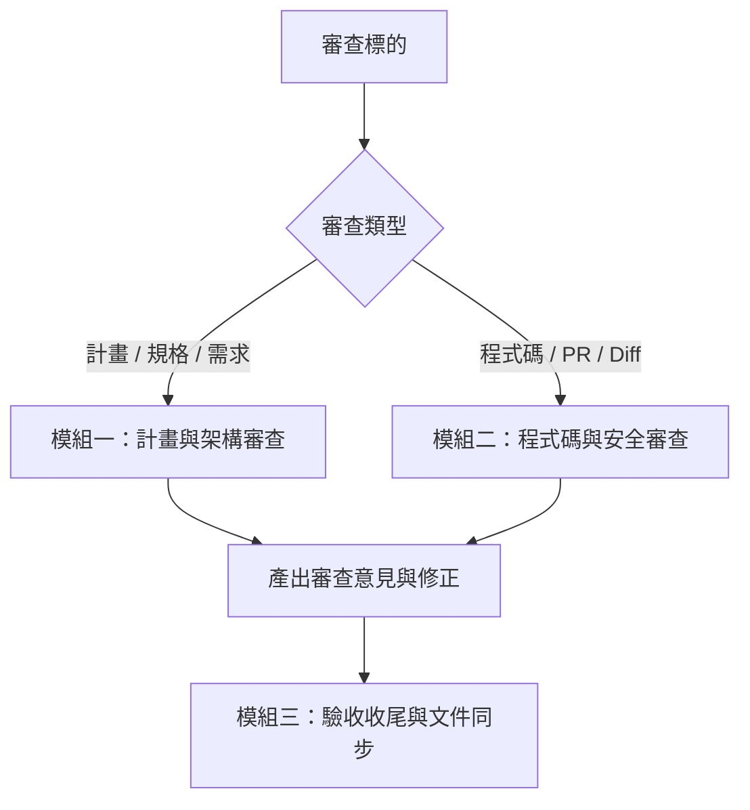

# my-review — 專案與程式碼綜合審查

以商業專案的高標準，嚴格審查計畫目標、系統架構與程式碼實作，防止專案飄移、產生幻覺或引入品質與安全缺陷。

---

## 模組一：計畫與架構審查

當審查對象為**計畫、需求、SPEC 或任務執行方向**時：

1. **對齊目標與防飄移**：
   - 開頭明確列出：任務簡介、核心目標、參考文件與網址。
   - 檢查目前進行的方向是否符合原始目標；若正在飄移，立即指出並拉回計畫目標，主動通知使用者。
2. **防範幻覺與過度假設**：
   - 嚴格遵守專案既有規範與真實環境；不編造不存在的架構或依賴。
   - 遇到不確定的技術或專案情境，先查閱專案既有文件或上網查證可信文章／Skill，不憑空臆測。
3. **可實作性與精確度**：
   - 計畫必須具備明確步驟、可驗證的交付標準（Acceptance Criteria）。
   - 語言精簡白話，確保 AI Agent（如 Claude）能準確理解與執行，不含模糊指示。
   - 發現計畫缺漏處，直接具體補充，並提示使用者。

---

## 模組二：程式碼與安全審查（Code Review）

當審查對象為**原始碼、變更檔案或 Git Diff / PR** 時，照 [`rules/code-review.md`](../../rules/code-review.md)：範圍、檢查清單（正確性、安全性、可維護性、效能）、⚠️／💡 分級與結尾結論都以該檔為準，這裡不另抄一份。

---

## 模組三：驗收收尾與文件同步

任務執行或審查通過後，照 [`rules/wrap-up.md`](../../rules/wrap-up.md) 收尾：文件對齊、測試（含 E2E）、清理暫存與殘留項。
