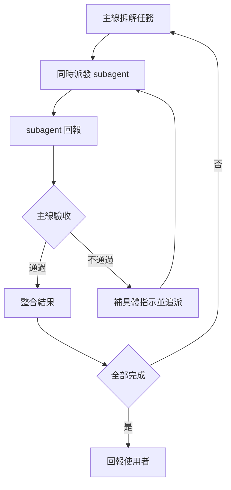

# my-subagent

分工：**主線**（目前這個對話）負責拆解、派發、驗收；**subagent** 只做一個明確的子任務，做完回報。



## 何時用

- 任務能拆成互不依賴的子任務（例：三個模組各自修改、多個檔案各自調查），平行比較快。
- 不用：單一小任務、後一步要用前一步結果、要改同一個檔案。這些主線自己做。
- 多角色討論（如 PM 與工程師各說各話）：每個角色用獨立 subagent，不要單一模型輪流扮演。客戶端沒有 subagent 機制時，告知使用者並提供替代方案（例如分次對話）。

## 怎麼派

- 用當前客戶端的 subagent 機制。Claude Code 用 `Agent` 工具；其他客戶端用對應功能，不確定就先問使用者。
- 沒有依賴的子任務，在**同一則訊息**一次發出所有呼叫，才會平行；有依賴的等前置完成再派。
- 需要追派時，優先用 `SendMessage` 續同一個 subagent（保留它的上下文）；方向整個錯了才開新的。
- 會改檔的子任務彼此不可動同一個檔。無法避開時，改成循序，或用 `isolation: "worktree"` 各給一份獨立工作目錄。
- 只讀調查（找檔案、讀程式碼回答問題）可多派；會寫檔的子任務控制在能驗收得完的數量。

## 派發單（每個 subagent 一份）

subagent 看不到這段對話，派發單就是它知道的全部。照這個格式寫：

```text
目標：一句話說清楚要達成什麼
背景：它需要知道的事實、相關檔案路徑、使用者的偏好（只給需要的，不貼整段對話）
範圍：可以動的檔案／目錄；不可以動的
完成標準：怎樣算做完（例：測試通過、檔案存在且內容含 X）
驗證：它自己要跑的指令或檢查
回報：用條列回報 ① 改了哪些檔 ② 驗證結果（貼實際輸出重點）③ 沒做成或不確定的事
```

寫不出「完成標準」代表任務還沒拆清楚，先回頭拆。

## 驗收

不信 subagent 說「完成」，主線自己確認：

1. 看實際變更（例如 `git diff`、讀檔），不只看回報文字。
2. 對照「完成標準」逐項檢查，並確認沒有改到範圍外的檔案。
3. 能自己跑驗證（測試、build、lint）就自己跑一次。
4. 不合格：寫出具體哪裡不合格與要怎麼改，追派。同一項最多追派 2 次，仍不行就主線接手，或停下來問使用者。

## 收尾

- 整合所有結果後回報：做了什麼、驗證了什麼、哪些沒做成。
- 盡量一次完成整份工作。只有遇到自己無法解決的阻礙（缺權限、需要使用者決定）才停，並說明卡在哪。
- 失敗如實說，沒驗證過的不要說成完成。
