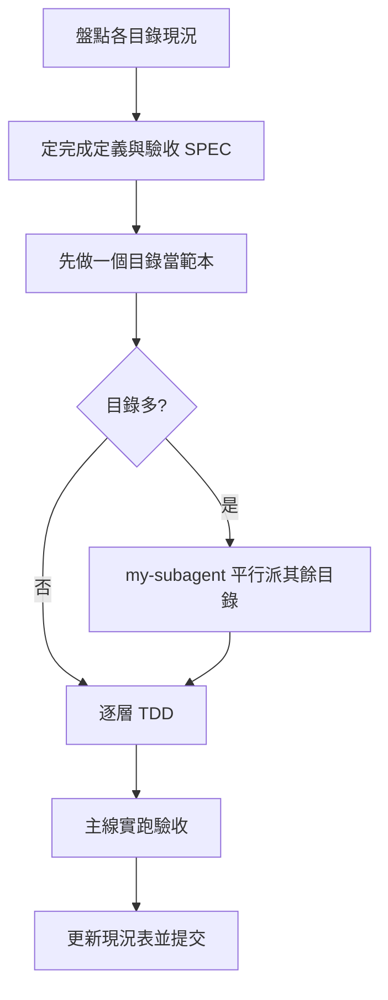

# my-testing — 測試計畫

目標：**每個目錄**都有可實跑的四層測試、一份測試 SPEC、一份 Agent 測試規則；**所有目錄都完成才算通過**。流程採 TDD。

## 1. 四層，各有位置

| 層 | 回答 | 規則 |
|----|------|------|
| Unit 單元 | 這段邏輯對嗎？ | 純函式與靜態檢查，不連 DB／HTTP，全層秒級 |
| Smoke 煙測 | 系統活著嗎？ | 唯讀；環境、DB、匿名 HTTP、敏感檔不外洩；看內容不只看狀態碼；伺服器沒起來是**失敗**不是略過 |
| 整合（Scenario） | 模組、DB、HTTP 合起來對嗎？ | 資料流程與 CRUD；測試資料用固定前綴並於 tearDown 清理 |
| E2E | 真實使用者流程走得通嗎？ | 真瀏覽器（Playwright）；至少：登入頁、未登入被擋、錯密碼不放行、登入後進後台、前台首頁 |

能在下層驗的不要拉到上層。「整合測試」是四層合起來的總稱，其中 Scenario 專指資料流程那層。

## 2. 每個目錄的完成定義

缺一項該目錄就不算通過：

1. 單元、煙測、整合、E2E 四層**實跑過**。
2. 測試 SPEC：`docs/specs/testing-plan-spec.md`。
3. Agent 測試規則：**`.agents/rules/testing.md`**（規則本文只放這裡）。
4. **`CLAUDE.md` 用 `@.agents/rules/testing.md` 引用**，不重複內容；`AGENTS.md` 登記。
5. 一行指令跑一層（例 `scripts/test.sh <unit|smoke|scenario|e2e|all>`）。
6. 已知缺陷檔 `tests/known-debt.md`，失敗中的真缺陷放「阻斷項」。
7. 發佈包不帶測試：`tests/`、測試設定、`.agents/` 設 `export-ignore`。
8. 版本、環境類必查項（框架版本、DB 版本、語言執行版本）有對應斷言。

模板：[`references/spec-template.md`](references/spec-template.md)（SPEC）、[`references/rule-template.md`](references/rule-template.md)（Agent 規則）。專案已有規格就沿用，只補缺的。

## 3. TDD

1. **先紅**：先寫測試描述應有行為，跑出紅燈，且紅的原因要對（不是路徑寫錯）。
2. **再綠**：只做最小修補讓它過；不順手重構。
3. **特性測試**（鎖住既有行為）本來就綠：故意弄壞一次確認它會紅，再還原。
4. **回歸缺陷**：先寫能重現的失敗測試，再修。
5. 修補超出最小範圍或會動核心、第三方 → 不修，登記阻斷項並回報。

## 4. 通過判定

| 狀態 | 條件 |
|------|------|
| ✅ 通過 | 完成定義齊備；四層實跑 exit 0；skip 只有「缺憑證」且已記載 |
| 🟡 通過（含阻斷債） | 齊備且實跑；仍有登記的阻斷項，數量與內容列出，由使用者決定是否接受 |
| 🔴 未通過 | 缺任何一項，或有未登記的失敗，或某層沒實跑 |

**整體通過** = 所有目錄都不是 🔴。多目錄時維護一張現況表（目錄 × 四層 × 阻斷項 × 驗證日期），尚未實跑填 `—`，不推測。

## 5. 紅線

- **不作弊**：不降斷言、不刪測試、不把失敗改 skip、不把疑似 bug 寫成預期。
- **資料**：只連本機 DB；只寫固定前綴的測試資料並清理；schema 鎖定的專案禁止任何 DDL。
- **憑證**：不猜帳密；測試帳號走專案既有腳本，密碼只放 gitignore 檔，不進輸出、報告、提交。沒憑證時登入類測試 skip 並明說。
- **不動第三方與核心**：`vendor/` 等不改；補測試的提交不夾帶核心變更。
- **語言版本**：用專案實際鎖定的執行版本跑（例：鎖 PHP 7.4 的專案別只用本機預設 8.x 跑），測試碼同樣不用新版語法。
- **分開提交**：各目錄提交各自 repo，只加明確路徑；不 push，除非使用者要求。

## 6. 做法

- 先盤點：測試目錄、runner、DB、伺服器、執行版本、是否已有 SPEC。
- 目錄多時，**先做一個當範本**，再依 [`my-subagent`](../my-subagent/SKILL.md) 同時派其餘目錄；派發單要寫明合約（完成定義）、參考實作、PHP／埠號等環境、紅線、回報格式。子代理的回報不當成完成，主線實跑驗收。
- 子代理可能被中斷（工作階段結束）：續派前先看該目錄 `git status` 與已寫的檔，別重做。
- 收尾照 [`rules/wrap-up.md`](../../rules/wrap-up.md)；提交照 [`rules/git.md`](../../rules/git.md)。

## 7. 回報

寫實跑結果，不要只說「測過了」：跑了哪些指令、各層通過／失敗／略過數、失敗原因、哪些沒跑與原因、阻斷項、提交 hash。

## 8. 常見坑

- Windows：POST body 別用 `escapeshellarg` 帶 `%`、`"`；改暫存檔加 `--data-binary @檔`。丟棄輸出用平台變數，不寫死 `/dev/null`。
- 假檔案當上傳測資（例：PNG 檔頭加零）會讓新版 PHP 的第三方元件 Fatal；測資要用**有效**檔案。
- PHP Fatal 常以 HTTP 200 回應；頁面斷言一律含「無 `Fatal error`／`Parse error`／`Uncaught`」。
- 內建伺服器要用 router 模擬 `.htaccess`，否則靜態資源與後台路徑 404。
- 本機 PHPUnit 輸出被第三方 Deprecated 洗版時用 `-d display_errors=0`，別開 `error_reporting=E_ALL`。
